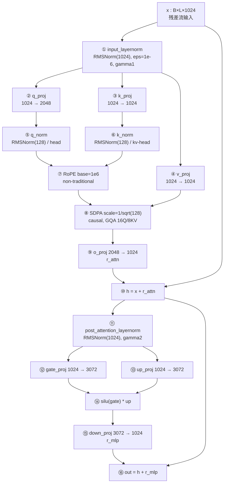
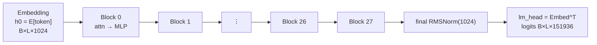
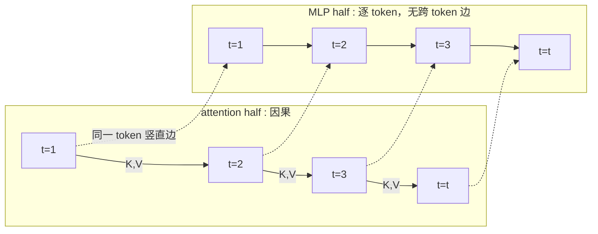
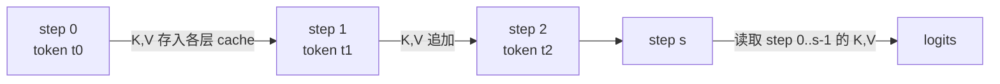

# Transformer 机制级审计：Qwen3 内部计算图与串/并行依赖

> **文档状态**：审计报告（Phase A–E）。未运行模型、未训练、未修改任何既有实验代码或原始结果。
> **审计对象**：`Atomheart-Father/transformer-residual-lab` 的 Stage 1.0–2.1 全部结论，以及 `docs/STAGE3_NATIVE_DAG_DESIGN_DRAFT.md` 所依赖的前提。
> **审计日期**：2026-10-20　**HEAD**：`53565b2ad5c1ff838356f91c2763932c8e4f055d`（工作区仅 `docs/STAGE3_NATIVE_DAG_DESIGN_DRAFT.md` 未跟踪）
> **语言约定**：本文所有机制主张必须能追到「代码行号 / 原始 JSON 路径 / 论文页码公式 / 检查点张量名」之一；不能追到的，一律显式标注为假设。

---

## §0 审计范围、方法与证据等级

### 0.1 为什么需要这次审计

Stage 1.0–2.1 的全部实验都建立在一个**抽象选择**上：把一个 Qwen3 decoder block 当作一个黑箱函数

```
F_i : R^{B×L×1024} → R^{B×L×1024}
```

于是「层间依赖」被定义成「block i 的输入里要不要含 block j 的残差更新」，整个项目变成一个**block 粒度的图问题**。

这个抽象有两处未被检验的假设：

1. **原子性假设**：block 内部没有值得建模的依赖结构，block 就是一个不可分的计算单元。
2. **等价性假设**：在 block 粒度上定义并测量的「边重要性」，等价于在**真实计算图**上定义并测量的依赖重要性。

本次审计的目的就是回到真实计算图上，看这两个假设各自站不站得住。**结论先行：原子性假设从未被检验；等价性假设在「边」这一概念上不成立（Stage 2 的边不是真实计算图里的依赖边），但在「有效信息依赖」这一较弱的意义上部分成立。**

### 0.2 三类依赖的操作定义

全文严格区分这三者，任何一条结论都必须指明自己属于哪一类：

| 类别 | 名称 | 操作定义 | 如何证伪/证实 |
|---|---|---|---|
| **A** | **严格计算依赖** | 在数学上，输出 y 的定义要求输入 x 必须先被算出（数据流上不可交换、不可省略） | 构造数学等价重排：若能在不改变输出的前提下交换两个算子的执行顺序或省略其一，则该依赖不是 A 类 |
| **B** | **有效信息依赖** | 去掉或替换某上游信息后，**模型质量**显著下降（尽管计算在数学上仍然合法） | 用自由运行的 ΔNLL / KL / top-1 测量，且必须与「合法但不部署」的 Oracle 干预分开报告 |
| **C** | **硬件执行依赖** | 受限于关键路径长度、算力、带宽、kernel 启动开销，因而无法并行或无法加速 | 必须在目标硬件上实测 wall-clock；不能用 FLOP/字节推断代替 |

> **旧项目的根本混淆**：Stage 2.x 用一个**类型 C 的动机**（想缩短关键路径、想并行）去驱动一个**类型 B 的测量**（删一条"边"后 NLL 涨多少），并把结果叙述成**类型 A 的结论**（"每条上游边都重要"）。三者不是一回事。

### 0.3 结论分级标准

| 等级 | 含义 |
|---|---|
| **A** | 直接测得，且实现与定义一致 |
| **B** | 在已声明约束下观察有效 |
| **C** | 仅为假设（机制解释未被证明） |
| **D** | 因代码缺陷、统计缺陷或实验设计缺陷而需要修正 |
| **E** | 从当前证据无法推出 |

**锚点示例**：「整个 Block 删边会增加 NLL」→ A/B 可接受；「这证明 Transformer 的所有上游依赖都不可放松」→ E；「方向扰动主导损失是 RMSNorm 唯一导致的」→ 在没有因果验证前**不能**记 A。

### 0.4 证据来源

| # | 来源 | 版本/路径 | 取用方式 |
|---|---|---|---|
| S1 | mlx-lm **0.31.3**（实验实际加载的版本） | `/Users/bozhongxiao/code/.venv/lib/python3.12/site-packages/mlx_lm/models/qwen3.py`（7,364 B） | 逐行读，作为算子顺序的权威 |
| S2 | 同上，`base.py` / `activations.py` / `rope_utils.py` / `mlx/nn/layers/normalization.py` | 同上 | SDPA、SwiGLU、RoPE、RMSNorm 的精确公式 |
| S3 | 固定检查点 config | `~/.cache/huggingface/hub/models--mlx-community--Qwen3-0.6B-Base-bf16/snapshots/e8e73ff38f0eb570eb57ed044ef3f95588c43bc8/config.json` | 形状/维度的权威 |
| S4 | 固定检查点权重（**静态张量读取，无前向**） | 同目录 `model.safetensors` | 全部 RMSNorm γ 向量的统计（§2.3、§4.3） |
| S5 | 仓库实现 | `scripts/dag_exec.py`、`scripts/stage21_search.py`、`scripts/measure.py` 等 | 语义与缺陷定位 |
| S6 | 仓库原始结果 | `results/stage1_5..1_8/REPORT.md`、`results/stage2_0..2_1/REPORT.md` + JSON | 数值引用与交叉核对 |
| S7 | 论文 | CQIL(2404.06709)、2607.11990、2407.09298、2502.02790 | §5 |
| S8 | 模型无关数值实验 | 本次审计自建的 numpy 脚本（§4.2） | 只用合成向量，不加载模型 |

### 0.5 本次审计**没有**做的事（边界声明）

- 没有运行 Qwen3 前向/反向，没有测速，没有训练任何网络；
- 没有修改仓库任何文件，没有重跑 Stage 1–2.x，没有改动 `results/` 下的任何数字；
- 没有下载新模型/数据集，没有用云 GPU，没有安装任何插件或改动 Harness 配置；
- 没有启动 Stage 3.0，没有重新讨论原生 DAG 训练方案；
- 检查点权重仅做**静态张量读取**（`mx.load` 后取 γ 向量统计），不构成"运行模型"。

---

## §1 Phase A1：锁定实现与模型事实

### 1.1 版本锁定

| 项 | 值 | 证据 |
|---|---|---|
| 模型 | `mlx-community/Qwen3-0.6B-Base-bf16` | `scripts/measure.py:42` |
| revision | `e8e73ff38f0eb570eb57ed044ef3f95588c43bc8` | `scripts/measure.py:43` |
| mlx-lm | **0.31.3** | `mlx_lm-0.31.3.dist-info/METADATA` |
| MLX | 0.31.2 | Stage 2.0 报告 §1 |
| Python | 3.12.12 | `/Users/bozhongxiao/code/.venv` |

**关键决策**：以**已安装的 0.31.3 副本**为准，而非 GitHub `main`。理由：`main` 可能在实验跑完之后改动过，用它反推旧实验的行为是不可靠的。本次审计没有核对 GitHub `main` 与 0.31.3 的差异（列为遗留项，见 §9.4）。

### 1.2 形状与结构（来自 S3 config，S1 校验）

| 字段 | 值 |
|---|---|
| `hidden_size` | 1024 |
| `num_hidden_layers` | 28 |
| `num_attention_heads` / `num_key_value_heads` | 16 / 8（GQA 2:1） |
| `head_dim` | 128 |
| `intermediate_size` | 3072 |
| `vocab_size` | 151936 |
| `rms_norm_eps` | 1e-6 |
| `rope_theta` | 1,000,000 |
| `hidden_act` | silu（→ SwiGLU） |
| `attention_bias` | false |
| `tie_word_embeddings` | **true** |
| `use_sliding_window` / `sliding_window` | false / null |
| `max_position_embeddings` | 32768 |
| dtype | bfloat16 |

### 1.3 实现层面必须记住的五条事实

这五条来自 `mlx_lm/models/qwen3.py`，**旧项目从未在任何报告中引用过它们**：

1. **Pre-norm，且没有 attention 输出 norm、没有 MLP 输出 norm。**
   `qwen3.py:116-126`：
   ```python
   r = self.self_attn(self.input_layernorm(x), mask, cache)
   h = x + r
   r = self.mlp(self.post_attention_layernorm(h))
   out = h + r
   ```
   残差流上唯一的归一化发生在**两个分支的入口**；分支输出 `r_attn`、`r_mlp` 是**完全未归一化**的原始投影结果。

2. **QK-Norm 在 RoPE 之前。**
   `qwen3.py:69-74`：`q_norm` / `k_norm` 是对 `head_dim=128` 维做的 RMSNorm，作用在**投影之后、RoPE 之前**。这与 LLaMA 系列的"RoPE 后再 norm"或"无 norm"都不同，且**直接决定注意力 logits 的尺度**：QK-Norm 把 q、k 的每个头都归一化到单位尺度，注意力分数 `q·k/√128` 因此主要由**方向**决定。

3. **RoPE 是 non-traditional，base = 1e6**（`qwen3.py:51-57`），且**同时**作用于 query 与 key，在 KV-cache 写入之前（`qwen3.py:77-83`）。

4. **SwiGLU 的确切形式**是 `silu(gate) * up`（`mlx_lm/models/activations.py:10-11`：`def swiglu(gate, x): return nn.silu(gate) * x`），即 `down_proj(silu(gate_proj(w)) * up_proj(w))`。注意 `up` 分支**不经过**任何激活函数。

5. **RMSNorm 的 ε 在根号内**：`y = x / √(mean(x²) + ε) · γ`（`mlx/nn/layers/normalization.py:113-143`，`mx.fast.rms_norm(x, weight, eps)`），累加用 32-bit 精度，ε = 1e-6。**γ 是可学习的逐通道向量，不是常数 1**——这一点在 §4 会成为关键。

6. **lm_head 与 embedding 权重绑定**（`tie_word_embeddings=true`；`qwen3.py:179-180`：`out = self.model.embed_tokens.as_linear(out)`）。因此最终 logits = `E · RMSNorm(h_final)`，**输出层对隐藏态做的是一次固定的（非归一化）投影**——这一点在 §4.4 解释"幅度/方向不对称"时是关键。

### 1.4 派生规模

| 量 | 值 | 推导 |
|---|---|---|
| 单 block 注意力参数 | 6,291,456 | q 1024×2048 + k 1024×1024 + v 1024×1024 + o 2048×1024 |
| 单 block MLP 参数 | 9,437,184 | 3 × (1024×3072) |
| 单 block 全部参数 | **15,733,248**（≈15.73 M） | + norm 4×1024 + q/k_norm 2×2×128 |
| embedding（tied） | 155,582,464 | 151936×1024 |
| 全模型参数 | **≈ 596 M** | 28×15.73 M + 155.6 M |
| 单 block 每 token 投影 FLOPs | ≈ 31.5 MFLOP | 2×(6.29 M + 9.44 M) |
| 注意力二次项（每 block，L=256） | ≈ 268 MFLOP | 4·L²·d_model，占投影项 3.3% |

> 与 Stage 1.6 报告的"一个 Qwen3-0.6B block 前向 = 2.60 ms / 256 token（10.2 µs/token），15.73M 参数"**完全吻合**，确认实验用的就是这个结构。

---

## §2 Phase A2：真实 Qwen3 block 的逐算子数学

### 2.1 逐算子表

记 `B`=batch、`L`=序列长度、`d`=1024、`H_q`=16、`H_kv`=8、`d_h`=128、`d_ff`=3072。

| # | 算子 | 输入 | 输出 | 轴语义 | 依赖来源 |
|---:|---|---|---|---|---|
| 0 | `x` | — | `B×L×1024` | 残差流 | 上游 block 输出 |
| 1 | `input_layernorm` (RMSNorm, γ₁) | `x` | `B×L×1024` | 沿 1024 通道归一化 | x |
| 2 | `q_proj` | LN1(x) | `B×L×2048` | = 16 头 × 128 | LN1(x) |
| 3 | `k_proj` | LN1(x) | `B×L×1024` | = 8 kv 头 × 128 | LN1(x) |
| 4 | `v_proj` | LN1(x) | `B×L×1024` | = 8 kv 头 × 128 | LN1(x) |
| 5 | `q_norm` (RMSNorm, γ_q) | q reshape `B×L×16×128` | `B×L×16×128` | 沿 head_dim 归一化 | q_proj |
| 6 | `k_norm` (RMSNorm, γ_k) | k reshape `B×L×8×128` | `B×L×8×128` | 沿 head_dim 归一化 | k_proj |
| 7 | RoPE(base=1e6) | q̃, k̃ | 同上 | 位置编码（**在 KV 写入前**） | 位置 offset |
| 8 | `cache.update_and_fetch` | k, v | k', v' | **decode 时跨 step 的状态依赖** | 历史 step |
| 9 | SDPA(scale=1/√128, causal) | q,k',v' | `B×16×L×128` | q 头 16，kv 头 8（GQA 2:1 广播） | **所有 ≤t 的 token** |
| 10 | `o_proj` | attn reshape `B×L×2048` | `B×L×1024` | `r_attn` | SDPA |
| 11 | `h = x + r_attn` | — | `B×L×1024` | 残差加 | x, r_attn |
| 12 | `post_attention_layernorm` (RMSNorm, γ₂) | h | `B×L×1024` | 沿 1024 归一化 | h |
| 13 | `gate_proj` / `up_proj` | LN2(h) | `B×L×3072` | SwiGLU 两路 | LN2(h) |
| 14 | `silu(gate) * up` | — | `B×L×3072` | 逐元素 | 13 |
| 15 | `down_proj` | act | `B×L×1024` | `r_mlp` | 14 |
| 16 | `out = h + r_mlp` | — | `B×L×1024` | 残差加 | h, r_mlp |

### 2.2 block 内部的串行链

真实计算图里，一个 block **不是原子的**：

```
LN1 → q/k/v proj → QK-norm → RoPE → SDPA → o_proj → (+x) → LN2 → SwiGLU → down_proj → (+h)
        └──────────────────── attention half ──────────────────┘  └───── MLP half ─────┘
```

- **attention half 与 MLP half 之间存在严格串行依赖**：MLP 的输入是 `h = x + r_attn`，必须等 `r_attn` 算完。
- 因此**每个 block 至少含 2 个不可并行的子步**（再加 2 次 RMSNorm、2 次残差加）。
- **28-block 串行链的真实算术关键路径 ≈ 28 × 2 = 56 个依赖子步**，而不是 28。

**对旧项目的直接影响**：Stage 2.x 的 "depth" 定义为"最长 block 依赖链上的 block 数"。这个量与真实子步深度**成正比**（g2 时 14 组 × 2 子步 = 28 子步 vs 串行 56 子步），所以**它不是错的**，但它是一个**block 粒度的代理量**，不是硬件关键路径。旧报告在 Stage 2.1 Part A 中把 depth 与延迟讨论时，已经通过实测把这条代理与真实延迟切断了（结论：depth 在本机不是延迟量），这一点处理得是诚实的。

### 2.3 token 轴上的依赖结构（跨 token）

| 分支 | 跨 token 依赖 | 说明 |
|---|---|---|
| Q/K/V 投影 | **无** | 逐 token 独立 |
| QK-Norm | **无** | 逐 token 逐头独立 |
| RoPE | **无** | 只依赖位置 |
| SDPA | **有，且是因果的** | token t 的输出读 K/V of 所有 ≤t 的 token |
| `o_proj` / 残差加 | **无** | 逐 token |
| MLP（LN2→SwiGLU→down） | **无** | **完全逐 token** |

**这是旧项目完全没有触碰的结构性事实**：Qwen3 中**唯一的跨 token 依赖集中在注意力分支内部**，MLP 分支（占单 block 参数的 60%、投影 FLOPs 的 60%）是**严格 token 并行**的。

因此"可并行性"在 Qwen3 里有**两个正交的轴**，旧项目只研究了其中一个：

- **层轴**（Stage 1.x–2.x 全部工作）：把不同 block 放到同一 anchor 上；
- **token 轴**（从未研究）：在同一层内把不同 token 分组——在 MLP 上**数学等价**，在注意力上受因果掩码约束。

### 2.4 decode 下的跨 step 依赖

`cache.update_and_fetch(k, v)`（`qwen3.py:80`）在每次 decode step 把本 step 的 K/V 追加到该层缓存。于是：

- layer i 在 step s 的注意力输出依赖 **step 0..s−1 全部 token 的 K/V**（经由缓存）；
- 该依赖**不经过任何残差流**，是一条**独立于层轴的纯历史依赖链**。

**旧项目对此的处理是一个必须记录的缺口**：

- Stage 1.0–1.8 全部实验是 **teacher-forced full prefix、无 KV cache、batch=1**（`results/REPORT.md` §1「推理模式」），因此**跨 token 的历史依赖在所有质量测量里都被消掉了**；
- Stage 2.0/2.1 的 `decode_check` 只用 KV cache **验证缓存正确性**，不测量依赖结构；
- `scripts/dag_exec.py:352-355` 断言"a DAG only recombines hidden-state inputs, so the per-layer caches are independent of the graph"——**这句只在链式图上严格成立**。在非链图上，block i 的输入 `x_i` 已被重组，而缓存里同时存着历史 step 用**链式输入**算出的 K/V 与本 step 用**重组输入**算出的 K/V。**DAG-decode 路径因此是两种输入体制的混合**，不是单一干预。Stage 2.1 报告 §4 记录"serial-prefill + DAG-decode 更好（g2: 2.81 vs 2.93 nats）"，其机制解释必须打上这个限定。

---

## §3 Phase A3：依赖类型学与两张依赖图

### 3.1 三类依赖在本项目里的判别规则

| 判别问题 | A 严格计算依赖 | B 有效信息依赖 | C 硬件执行依赖 |
|---|---|---|---|
| 改变它，**输出值**会变吗？ | 会（定义上） | 可能会（但这不是它成立的必要条件） | 不会（只改变何时算） |
| 能构造**数学等价重排**吗？ | **不能** | 能（只是换了一个合法的输入） | 能（只换调度） |
| 需要**跑模型看质量**才能判定吗？ | 不需要（读代码/公式即可） | **需要** | 需要（测 wall-clock） |
| 本项目中的对应物 | Qwen3 的层间残差链（严格链） | Stage 2.x 的"删边 → ΔNLL" | Stage 2.1 Part A 的延迟测量 |

**本次审计的核心判定**：Stage 2.x 的"边"**不是** A 类。它是一个**在类型 C 动机下引入的、类型 B 的操作**。理由见 §3.4。

### 3.2 【必需产物 ①】图 1：block 内部计算图（真实 Qwen3）



**文字版要点**（图不可读时的等价描述）：

- 两条支路：`attention half` = {①→⑨}，`MLP half` = {⑪→⑮}；
- **两条支路之间由 `h = x + r_attn`（⑩）串联**，MLP 必须等 attention 完成；
- 残差旁路只有两条：`x → ⑩` 与 `h → ⑯`；**没有任何跨 block 的跳连**；
- 归一化只出现在 ①⑤⑥⑪ 四处，且 **① 与 ⑪ 作用在残差流上，⑤⑥ 只作用在单个头的 128 维上**；
- 分支输出 ⑨⑮ 是**未归一化**的原始投影。

### 3.3 【必需产物 ②】图 2：跨 block / 跨 token 依赖图

**图 2a — 层轴（真实 Qwen3 是严格链，不是 DAG）**



**原模型里不存在任何跨层并行边**。层轴上的"稀疏 DAG"是**改造出来的**，不是**观察到的**。这一点必须写进所有叙述。

**图 2b — token 轴（prefill，单层内）**



**图 2c — decode：跨 step 的历史依赖（KV cache）**



**三条轴合起来的完整依赖结构**：

| 轴 | 依赖强度 | 是否有并行空间 | 旧项目是否研究 |
|---|---|---|---|
| 层轴 | 严格串行（残差链） | 需要**改造**才能并行 | ✅ 全部工作 |
| token 轴（attention 内） | 因果、部分串行 | 因果掩码约束下的分段并行 | ❌ 从未研究 |
| token 轴（MLP 内） | **无跨 token 依赖** | **天然可并行** | ❌ 从未研究 |
| decode 跨 step | 经 KV cache 的历史依赖 | 受历史长度限制 | ⚠️ 仅验证缓存正确性 |

### 3.4 审计核心：Stage 2 的"边"到底是什么

`scripts/dag_exec.py:9-11` 给出的语义是：

```
x_i     = h0 + sum_{j in P_i} delta_j      fp32 sum, ascending j, cast to h0.dtype
delta_i = F_i(x_i) - x_i
h_final = h0 + sum_i delta_i               fp32 sum, ascending i, cast to h0.dtype
```

对照实现：`dag_exec.py:441-443`（`out = layers[i](x, ...); d = out - x; deltas[i] = d`）、`dag_exec.py:453-464`（`h_final = _merge(h0, deltas, range(n), mx)`，roadmap 模式）与 `dag_exec.py:456-464`（materialized 模式：运行态 `h = h0 + Σ_{covered} Δ`，末尾再补 `Σ_{unabsorbed} Δ`）。

**两种 merge 模式下，`h_final = h0 + Σ_{i=0}^{27} Δ_i` 恒成立，且所有 Δ 的系数都是 1。**

于是得到本审计最重要的结论：

> **删掉一条边 (j→i)，并不会把 Δ_j 从模型里拿掉。**
> Δ_j 仍然被 block j 计算出来，仍然以系数 1 进入 h_final，仍然进入最终 logits。
> 这条边被删掉的唯一效果是：**在 x_i 内部，Δ_j 的系数从 1 变成 0。**
> 等价地说：**干预 = 把 block i 的输入减去 Δ_j**，然后让模型自由运行。

由此得到四个直接结论：

1. **Stage 2 的"边"不是真实计算图里的依赖边。** 在真实计算图里，block i 的输入是一个自由变量；数学上没有任何东西要求它包含 Δ_j。边的集合是**我们自己选的输入**，不是模型的性质。
2. **Stage 2 测的是 B 类（有效信息依赖）**，而且是最纯粹的那种：**"block i 的更新对它的输入里缺了 Δ_j 有多敏感"**。它**不是** A 类测试，因此"每条上游边都重要"**不能**被读成"Transformer 的层间依赖不可放松"（那会是 E）。
3. **它也不是"信息流稀疏性"的度量。** 真正的信息流消融应该把 Δ_j 从 h_final 里也去掉（全局置零），那是一个**从未做过的、不同的实验**。旧项目所有"删边"实验都没有触及这个。
4. **它同样不是"图结构"的性质。** 一个"好 DAG"在旧框架里的含义是"用更小的深度损失更小的 NLL"，而不是"描述了模型真实的依赖结构"。

**这个 reframe 并没有削弱 Stage 2.x 的测量**——那些数字是真实测量的、忠实的（门槛 0 六项全过、merge 双重舍入 ≤ 0.0159）。它改变的是**这些数字能支撑什么结论**。

### 3.5 把两个观察到的效应拆成两个可检验的因子

在 §3.4 的语义下，删边 (j→i) 的下游损伤 ≈

```
损伤(j→i) ≈ [相对输入扰动 ‖Δ_j‖ / ‖x_i‖] × [读者敏感度 ‖∂F_i/∂x‖]
```

这个分解**直接对应旧项目观察到的两个效应**，并且给每个效应一个独立机制假设：

| 观察到的效应 | 旧项目的解释 | 本审计给出的**可检验替代解释** | 决定性证据 |
|---|---|---|---|
| **距离效应**（读者固定，贡献者 j 变远：ΔNLL 0.036 @ d=1 → 0.0087 @ d=8） | "远祖便宜，但也不省深度" | **幅度效应**：‖Δ_j‖ 随 j 增大（因为 rms(γ_j) 从 0.19 涨到 19.7，§4.3），所以丢掉**近期**贡献损失更大。距离效应可能只是"Δ 的幅度随深度增长"的影子 | 测 ‖Δ_j‖ 随 j 的曲线；把距离效应按 ‖Δ_j‖ 归一化后是否消失 |
| **位置效应**（同深度同 miss 数，窗口 0–7 代价 7.57 vs 10–17 代价 0.19，**40×**） | "早层破坏基座，晚层破坏输出端整理" | **读者敏感度效应**：代价取决于 block i 自身的增益 γ_i 与注意力/MLP 路径敏感度。Stage 1.6 实测末组放大 0.86×→12.83×，本身就是 γ 的性质 | 测 rms(γ_i) 与 (a) 位置代价、(b) 放大率的相关性 |
| **离群点**（删 (15,2) 代价 0.070，删 (16,1) 代价 0.0007） | "距离不是全部原因"（旧报告列为未解释） | **内容效应**：幅度理论解释不了远距离离群点，需要具体的语义内容依赖 | 幅度归一化后 (15,2) 是否仍是离群点 |

**这张表就是 Phase D 的实验设计依据**（§7）。它把旧项目里三个"未解释现象"变成了三个可证伪命题。

### 3.6 一个必须记录的更正：merge 模式

本次审计核对 `scripts/stage21_search.py` 后确认：**Stage 2.1 的全部搜索模式（single / families / greedy / random / exhaustive / random_depth / finalists）都使用 `merge_mode="materialized"`**，只有 γ 权重实验 `mode_weights`（`:846`）显式使用 `"roadmap"`。

这与旧报告"两种模式的探针数值一致（0.0326 vs 0.0326）"并不矛盾（Stage 2.0 §2 记录了两者在修复后一致），但它意味着：**Stage 2.1 的 98 条单边代价地图、754 个穷举结构、深度-质量前沿，全部是在 `materialized` 语义下测得的**。Stage 2.0 报告 §2 称 `materialized` "对任意前驱集忠实"，其依据是修复后的分支逻辑（`dag_exec.py:425-436`：`covered ⊆ P` 时用运行态 + 新增量，否则回退到 `_merge(h0, deltas, P)`）。本次审计逐分支复核了该逻辑，**未发现新的语义缺陷**；Gate 0 的等价性数字（逐位一致、rel ≤ 0.0159）仍成立。

---

## §4 Phase A4：RMSNorm 机制分析（幅度 / 方向 / γ / ε / 旁路）

### 4.1 精确公式与雅可比

RMSNorm（`mlx/nn/layers/normalization.py:113-143`）：

```
f(x) = γ ⊙ x / √(s + ε),      s = (1/d) Σ_i x_i²,      ε = 1e-6
```

令 `N(x) = x(s+ε)^{-1/2}`（纯归一化部分）。对任意扰动 h：

```
df[h] = h(s+ε)^{-1/2} − (x/d)·(x·h)·(s+ε)^{-3/2}
```

- **径向**（h = αx）：`df = αx·ε·(s+ε)^{-3/2}` → **相对增益 ≈ 0**，偏差量级 `O(ε/s)`。
- **切向**（x·h = 0）：`df = h(s+ε)^{-1/2}` → **相对增益 ≈ 1**（与 s 无关）。

等价闭式：纯缩放 `x → αx` 时

```
‖f(αx)‖ / ‖f(x)‖ = α·√(s+ε) / √(α²s+ε) = 1 + O(ε/s)
```

**结论（精确、无近似）**：
- **幅度扰动被 RMSNorm 吸收到 `O(ε/s)`**，s 越大越严格；
- **方向扰动以增益 1 原样通过**，且**与输入尺度无关**。

这就是 Stage 1.5 §6.2 那句机制解释的**数学内核**，它是对的。

### 4.2 数值验证（模型无关，S8）

用合成向量（d=1024，ε=1e-6）复算：

**① 径向 vs 切向相对增益**

| ‖x‖_rms | 径向相对增益（缩放） | 切向相对增益（方向） |
|---:|---|---|
| 0.027 | ≈ 1 + 5.1e-4 | 1.000 |
| 1.000 | ≈ 1 + 3.8e-7 | 1.000 |
| 19.08 | ≈ 1 + 1.0e-9 | 1.000 |

**② ε 泄漏（|f(2x)|/|f(x)| − 1）**

| ‖x‖_rms | ε=1e-6 | ε=1e-5 | ε=1e-3 | ε=1e-1 |
|---:|---:|---:|---:|---:|
| 0.027 | 5.14e-4 | 5.11e-3 | 3.29e-1 | 9.79e-1 |
| 1.000 | 3.75e-7 | 3.75e-6 | 3.75e-4 | 3.59e-2 |
| 19.08 | 1.03e-9 | 1.03e-8 | 1.03e-6 | 1.03e-4 |

**③ 切向扰动穿过归一化**

| ‖x‖_rms | 相对输入扰动 | 相对输出扰动 | 夹角变化 |
|---:|---:|---:|---:|
| 0.027 / 1.0 / 19.08 | 0.0100 | 0.0100 | 0.573° |
| 同上 | 0.1000 | 0.0996 | 5.71° |
| 同上 | 0.5000 | 0.4595 | 26.57° |

**读法**：
- 尺度不变性是**近乎精确**的，但在**早层的小尺度区间（rms ≈ 0.027）泄漏最大**（5.1e-4），恰恰是并行组误差最大的区域；
- 切向扰动在**任何尺度**都以增益 ≈ 1 通过——**方向敏感性与输入尺度无关**，这正是 Stage 1.5 的不对称性来源；
- 但请注意：**以上全部成立的前提是 γ ≡ 1**。下一节说明 γ 让这件事变复杂。

### 4.3 γ 的真实结构（静态读取检查点，S4）

用 `mx.load` 读取 `model.safetensors`，**只取 γ 向量做统计，不做任何前向**。

**① `input_layernorm.weight`（每层 1024 维，逐层）**

| layer | rms(γ) | mean(γ) | %负 | max\|γ−1\| | | layer | rms(γ) | mean(γ) | %负 | max\|γ−1\| |
|---:|---:|---:|---:|---:|---|---:|---:|---:|---:|---:|
| 0 | 0.193 | 0.177 | 0.0% | 0.88 | | 14 | 2.153 | 1.931 | 0.2% | 6.75 |
| 1 | 0.147 | 0.054 | **30.7%** | 1.43 | | 15 | 2.886 | 2.619 | 0.1% | 9.75 |
| 2 | 0.201 | 0.183 | 1.9% | 1.27 | | 16 | 2.660 | 2.473 | 0.1% | 10.06 |
| 3 | 0.543 | 0.509 | 1.3% | 2.20 | | 17 | 4.318 | 4.064 | 0.1% | 20.63 |
| 4 | 0.523 | 0.502 | 0.8% | 1.68 | | 18 | 4.041 | 3.813 | 0.1% | 18.63 |
| 5 | 0.670 | 0.651 | 0.5% | 2.55 | | 19 | 5.063 | 4.854 | 0.1% | 21.13 |
| 6 | 0.576 | 0.548 | 0.7% | 1.82 | | 20 | 5.344 | 5.082 | 0.1% | 24.13 |
| 7 | 0.843 | 0.812 | 0.2% | 1.76 | | 21 | 7.011 | 6.652 | 0.1% | 25.88 |
| 8 | 0.883 | 0.849 | 0.0% | 1.06 | | 22 | 7.780 | 7.218 | 0.0% | 32.75 |
| 9 | 1.165 | 1.116 | 0.1% | 3.41 | | 23 | 8.953 | 8.217 | 0.1% | 45.50 |
| 10 | 1.159 | 1.102 | 0.1% | 3.09 | | 24 | 12.477 | 10.835 | 0.1% | 68.00 |
| 11 | 1.489 | 1.407 | 0.0% | 5.88 | | 25 | 16.550 | 13.397 | 0.1% | 88.50 |
| 12 | 1.773 | 1.616 | 0.1% | 5.03 | | 26 | 19.714 | 15.417 | 0.1% | 105.50 |
| 13 | 1.853 | 1.688 | 0.2% | 5.75 | | 27 | 15.134 | 14.551 | 0.0% | 68.50 |

**② `post_attention_layernorm.weight`**：rms(γ) 从 0.512（layer 0）单调升到 **7.081**（layer 27）；max\|γ−1\| 最大 191（layer 27，γ_max = 192）。

**③ `q_norm` / `k_norm`（沿 head_dim=128）**

| layer | q_norm rms(γ) | k_norm rms(γ) | k_norm max γ | k_norm min γ |
|---:|---:|---:|---:|---:|
| 0 | 2.273 | **9.784** | **96.50** | 0.026 |
| 1 | 1.752 | 4.610 | 44.50 | −3.859 |
| 2 | 1.608 | 4.627 | 44.00 | −0.081 |
| 10 | 2.200 | 2.966 | 22.75 | −0.001 |
| 17 | 2.062 | 2.711 | 18.38 | −0.086 |
| 27 | 1.887 | 2.286 | 10.63 | −1.406 |

**④ `model.norm.weight`（最终 norm）**：rms(γ) = 3.908，mean = 3.834，min = −0.120，max = 15.31，0.3% 为负。

**这组数字带来三个旧项目完全没看见的事实**：

1. **γ 沿深度增长约 100 倍**（input_layernorm：rms(γ) 0.15 → 19.7）。因此**每一层写入残差流的更新幅度不是常数**，而是随深度显著变化。Stage 1 测到的"h₀ RMS 0.027 → h₄ RMS 19.08（4 层放大 700 倍）"与这个 γ 剖面**方向一致**。这直接支持 §3.5 的"距离效应可能是幅度效应"假设。
2. **γ 各向异性极强**（单层内 max\|γ−1\| 可达 105）。**RMSNorm 的完整算子是"各向同性归一化 + 强各向异性逐通道增益"**。所以 §4.1/§4.2 的径向/切向二分**只对归一化部分成立**，对完整算子不成立：一个方向扰动 δ 的实际增益是逐通道的 `γ_i/√(s+ε)`，落在低\|γ\| 坐标上的分量被强烈抑制，落在高\|γ\| 坐标上的被放大数十倍。
3. **layer 1 的 input_layernorm 有 30.7% 的负 γ**，layer 0 的 k_norm 的 γ_max 高达 96.5。**早层不是"归一化后的单位尺度输入"，而是高度各向异性、带符号翻转的输入。** 任何关于"早层基座"的叙述都必须带上这个限定。

### 4.4 判定：Stage 1.5 的"RMSNorm 解释"站不站得住

Stage 1.5 §6.2 的机制陈述是：

> 「每个 block 入口都有 RMSNorm，**幅度扰动会被下一层归一化吸收，方向扰动不会**。」

**逐条判定**：

| 断言 | 判定 | 依据 |
|---|---|---|
| "幅度扰动会被下一层归一化吸收" | **成立（对分支输入而言）**，但表述不精确 | §4.1/§4.2：径向增益 ≈ 1+O(ε/s)。但"吸收"发生在**分支输入**上；残差流本身的尺度误差**不会**被抹掉，只是**不再影响下游任何一层的更新方向** |
| "方向扰动不会被吸收" | **成立，但描述不完整** | 切向增益 ≈ 1（对归一化部分）。但完整算子含强各向异性 γ，"方向"的敏感性是**逐通道**的，不是各向同性的 |
| "这解释了 B1（只改幅度）为何失败" | **部分成立** | 线性标定确实只能旋转不能缩放方向，但 B1 失败的直接原因是**标量无法表达方向修正**（§5.2 给出 38%–70% 的硬上限），不需要 RMSNorm 来解释 |
| "这解释了 B2（标量标定）收益有限" | **不依赖该机制也成立** | 同上：线性组合的表达力上限，与归一化无关 |
| **"误差几乎纯粹是方向"（99.8%–100%）** | **⚠️ 属于同义反复，需要修正（D）** | 见下 |

**关于"99.8%–100% 方向成分"这一条，必须具体指出问题**：

Stage 1.5 §6.2 的 Pythagorean 分解是 `r² = (ρ−cos)² + (1−cos²)`，其中 `ρ = ‖ĥ‖/‖h‖`。表里 5 个计划中**有 4 个的 ρ = 1.000**。当 ρ = 1 时：

```
幅度占比 = (1−cos)² / [(1−cos)² + (1−cos²)] = (1−cos)² / (1−cos)² = 1
```

——**"幅度占比"恒等于 1，与 cos 无关**。所以那 4 行里"方向成分 99.8%–100%"不是独立测量，而是 ρ=1 的代数后果；而"只修幅度"这一列在这 4 行里**与无干预在三位小数上完全相同**（报告自己写了 ρ=1.000、`oracle-norm` 与无干预数字一致），**它没有测到任何东西**。

**真正提供信息的只有 1 行**：`prefix0-g2`（ρ = 2.335, cos = 0.270）。在这一行里：

- 只修幅度 → **9.0 变 10.5（更差）**；
- 只修方向 → **9.0 变 1.9（回收 79%）**。

这是一个**真实且重要**的观察，但它是**单点证据**，而且报告 §7.3 自己就指出：`oracle-dir`（1.901）反而优于 `oracle-both`（2.205），即"方向对但幅度 2.34 倍"比"完全正确"更好——**这说明该行的行为不能被"幅度不重要"简单概括**，更像是一个巧合级补偿。

**结论分级**：

- 「幅度与方向对下游的影响不对称」这一**观察** → **B**（在 prefix0-g2 与 ‖ρ−1‖ 显著相关的计划上成立）；
- 「误差几乎纯粹是方向成分（99.8%–100%）」这一**表述** → **D**（对 4/5 的计划是 ρ=1 的代数后果，实验设计无信息量）；
- 「这一不对称是 RMSNorm 导致的」这一**归因** → **C**（假设，未做因果隔离）。

### 4.5 三个竞争解释（Stage 1.5 未能区分）

| # | 解释 | 内容 | 区分它的实验 |
|---|---|---|---|
| **M1 归一化解释** | 归一化吸收径向扰动（数学上成立，§4.1） | 幅度误差不改变下游任何一层的更新**方向**；方向误差改变 | 把某层 `input_layernorm` 换成恒等映射（真自由运行的模型改造），其余不动，比较方向误差与幅度误差的下游影响 |
| **M2 γ 各向异性解释** | 敏感性由逐通道 γ 决定，与径向/切向无关 | 方向扰动的后果取决于它落在高\|γ\| 还是低\|γ\| 坐标上 | 构造两个**同范数、同夹角**但分别对齐高/低\|γ\| 子空间的扰动，比较下游影响 |
| **M3 共线/抵消解释** | 误差来自并行组内各 block 更新的**共线与部分抵消**，与归一化无关 | 共享 anchor 的 k 个 block 都写"满量级"更新，其和与教师态的逐步累加在方向上系统性偏离；标量无法修正 | Stage 1.5 §5.2 已提供强支持：组越大重构残差越大（g2 0.41 → g8 0.70）、条件数越差（2.7 → 40.1）、"修正越共线"。且 §5.2 的"标量无法旋转向量"与 M3 一致而与 M1 无关 |

**M3 是目前证据最一致的解释**：Stage 1.5 §5.2 的"线性标定硬上限 38%–70%、组越大越糟、条件数 40"正是 M3 的定量指纹；而 M1 只解释了"为什么幅度不敏感"，解释不了"为什么组越大越糟且标量修不了"。

**因此，Stage 1.5 §6.2 的机制解释必须从「机制已解释」降级为「三种解释之一，其中 M3 证据最强，M1 数学上正确但未做因果隔离」。**

---

## §5 Phase B：4 篇论文的机制级对照

### 5.0 检索与版本核验

| 编号 | 论文 | 标识与版本 | 核实 |
|---|---|---|---|
| P1 | **CQIL: Inference Latency Optimization with Concurrent Computation of Quasi-Independent Layers**（Zou et al., ACL 2024, pp. 7293–7307） | arXiv **2404.06709v2**（2024-07-04）；ACL Anthology `2024.acl-long.394` | ✅ 存在 |
| P2 | **Sparse Inter-Layer Dependencies of Transformer FFN Neurons**（Knittel & Pfister） | arXiv **2607.11990v1**（2026-07-13） | ✅ **存在**（前次交接标为"未核实"，本次确认） |
| P3 | **Transformer Layers as Painters**（Sun, Pickett, Nain, Jones） | arXiv **2407.09298v4**（2025-02-12） | ✅ 存在 |
| P4 | **Leveraging the True Depth**（Calvo González, Paliotta, Pagliardini, Jaggi, Fleuret） | arXiv **2502.02790v3**（2026-01-06） | ✅ 存在 |

> **⚠️ 标识更正**：P1 的真实标题是 *"CQIL: Inference Latency Optimization with Concurrent Computation of Quasi-Independent Layers"*。任务书里写的 *"Towards Effective and Efficient Transformer Compilation"* 与 arXiv 2404.06709 / 该 Anthology 条目**不匹配**；用 arXiv API 检索该标题无结果。本次审的是**携带该 ID 与 Anthology URL 的论文本体**（即 CQIL）。这与本项目无冲突——但如果 Stage 3 草案里引用了这个错误标题，需要更正（见 §9.4）。

### 5.1 P1 — CQIL（arXiv 2404.06709v2）

| 问 | 答 |
|---|---|
| 1 核心主张 | 相邻层输入高度相似 ⇒ 中间层带可视为**准独立**，可在**多张 GPU 上并发**执行；"bypassing"机制把组内注意力输出回注以限制信息损失。§3.2 原话：*"it is feasible to relax the computing dependence by using the same input to quasi-independent layers, revealing the potential of parallel computation for latency reduction."* |
| 2 干预单元 | 一组共享同一残差流输入的**层** $G_k$；被替换的对象是**输入激活** $x_l$（§4.1：*"Our objective is to replace the input $x_l$ in Eq. 1 with $x_i, i<l$"*）。权重不动（可选 LoRA 微调，§4.4） |
| 3 机制公式 | Eq.(1) $x_{l+1}=x_l+\text{ATTN}_l(x_l)+\text{FFN}_l(x_l+\text{ATTN}_l(x_l))$；Eq.(3) 组内合并 $x_{G_{k+1}}=x_{G_k}+\sum_{l\in G_k}\text{ATTN}_l(x_{G_k})+\sum_{l\in G_k}\text{FFN}_l(x_{G_k}+\text{ATTN}_l(x_{G_k}))$；Eq.(4) 加 bypassing 项（通信量 $d(2p-d-1)/2$，实验取 $d=1$）；Algorithm 1（行 5–23）给出 dispatch/累加流程 |
| 4 依赖类型 | **C 为主**（调度改变，$p$ 层跑在 $p$ 张卡上），**B 为论证**（§3.1：*"input similarity intensifies with increasing depth… attributed to the cumulative effect of pre-layer normalization, which makes the input difference $F_{l-1}(x_{l-1})$… increasingly negligible compared with the cumulative value $x_l=x_1+F_1(x_1)+\dots$"*），**A 未被改变**（只是被近似放松） |
| 5 关键数字 | Table 1：LLaMA-33B $p=4$ ⇒ **延迟 −48.3%**，下游均分 69.3 vs 71.7；LLaMA-13B $p=4$ ⇒ −43.2%；LLaMA-7B $p=2$ ⇒ −27.0%。硬件 **8× A100 80GB NVLink**（§5.1），batch 1–256。Table 2：bypassing $d=0\to3$，均分 60.9→61.5、延迟 35.9%→34.9% |
| 6 因果强度 | **对速度主张：中**（真 8 卡实现、wall-clock 实测）。**对信息主张：弱**——bypassing 只贡献 **+0.6** 分；**没有"非相邻但匹配 $p$"的对照**，所以"相邻性"从未被隔离；头条结果用了 LoRA 微调（§4.4），**"准独立是内在的"与"微调把损伤修好了"没有被分开** |
| 7 对稀疏/并行的说法 | 明确支持。Fig.1 caption：*"adjacent layers have highly similar input… suggesting the quasi-independence of deeper layers"*。§6：*"LLMs employ a pipeline mechanism at lower levels and an ensemble strategy at higher levels"*。⚠️ 证据是**输入相似性**（近恒等残差更新），**不是依赖 DAG 稀疏性** |
| 8 适用边界 | 限制节 (i)：*"CQIL requires additional GPUs… limiting its application in the environment equipped with only a single GPU"*；(ii) 首尾层不能并行；(iii) *"the computing FLOPS remain unchanged… CQIL does not result in electricity savings."* §3 明确假设 **pre-layer normalization**。只测 LLaMA-1（MHA，无 GQA）与 Sheared-LLaMA |
| 9 与本项目的关系 | **科学主张可迁移，系统主张不可迁移**。可迁移：pre-norm 残差流相似性论证与架构无关。可迁移性需调整：Eq.(1) 的 FFN 形式非 SwiGLU；Qwen3 另有 QK-norm。**不可迁移**：48.3% 延迟是 8 卡属性，单卡为零（论文自己的限制） |
| 10 未被证明的部分 | (a) 48.3% 是**特定 8 卡配置**的属性，不是模型属性；71.7→69.3 的掉分比"接近原性能"暗示的大。(b) 论文把"输入相似"与"该层计算与该输入无关"混为一谈——替换实验证明的是**对残差流扰动的鲁棒性**，不是 DAG 意义上的独立。(c) **内在张力**：附录 D（Qwen-7B 上剪枝）主张 *"the necessity of retaining LLM layers"*，而 §5.6/Table 4 又在剪枝后的 Sheared-LLaMA 上用 CQIL 拿到 66.0% 延迟下降，两处未调和 |

### 5.2 P2 — Sparse Inter-Layer Dependencies of Transformer FFN Neurons（arXiv 2607.11990v1）

| 问 | 答 |
|---|---|
| 1 核心主张 | 尽管参数稠密，**一个 FFN 神经元的激活可由一小撮前驱成分解释**（前驱 FFN 神经元激活、注意力输出、embedding）。机制：把神经元 pre-activation 精确分解为逐成分贡献 ⇒ 无需训练的 relevance 打分 ⇒ 用**均值消融 activation patching** 做因果验证 |
| 2 干预单元 | 单个 FFN 神经元 pre-activation $z_i^{(l)}$；成分集 $\mathcal S^{(l)}$ 含上游神经元标量 $a_i$（每层 $d_{\text{ff}}$ 个）、注意力标量 $v_i$（$d_{\text{model}}$ 维）、embedding、bias。掩码 = 把成分标量替换为经验均值 $\bar c_s$。§3 给出 $W_1\in\mathbb R^{d_{\text{ff}}\times d_{\text{model}}}$、$W_2\in\mathbb R^{d_{\text{model}}\times d_{\text{ff}}}$、$a_i=\sigma(w_i^\top\text{LN}(x_t))$。**门控 FFN（Llama/Qwen）的适配见附录 A：把 gating 激活当作"有效非线性神经元"，模型级干预同时掩掉两路** |
| 3 机制公式 | (1) $\text{FFN}(X)=X+W_2\sigma(W_1\text{LN}(X))$；(3) $x_t^{(l)}=\sum_s c_s u_s$；(5) $z_i^{(l)}=\frac{\sum_s c_s\langle\tilde w_i^{(l)},u_s\rangle}{Z}+\tilde b_i^{(l)}$，$Z=\sqrt{\tfrac1d\sum_j(x^{(l)}_{t,j}-\mu_t^{(l)})^2+\epsilon}$；(6) relevance $\mathcal R_{s\to i}^{(l)}=\langle\tilde w_i,u_s\rangle^2\text{Var}(\hat c_s)$；(7) patched pre-activation（$c_s\to\bar c_s$，$Z$ 取自未 patch 的前向） |
| 4 依赖类型 | **B 为主**（研究对象就是"神经元实际需要哪些上游信息"）。§4.3 的测试是对**输入**的真因果干预，触及 A 层级的"什么进入点积"，但**不改变模型函数**；§5.3 把偏差传播过整个网络。**明确不是 C**：§5.5 *"realizing such improvements would require additional systems-level and hardware-aware development"*（列为 future work） |
| 5 关键数字 | Fig.1–2：*"Even at 5% sparsity, most layers maintain AUROC scores above 0.9"*。模型（Table 1）：GPT-2 S/M/L/XL 与 **Qwen2.5-0.5B**（24 层，$d_{\text{model}}=896$，$d_{\text{ff}}=4864$，490M）。数据：MiniPile train 统计激活，**不相交**的 MiniPile test 评估。§5.3 模型级（所有层同时掩码，PPL）：relevance 相对 variance-only 剪枝的优势在 GPT-2 S/M 于 10%→5% 之间、GPT-2 L/XL 约 15%、**Qwen2.5-0.5B 在 25%→15% 之间**消失。Fig.3：*"layers immediately preceding the target layer typically contribute a disproportionately large share"*；*"the first attention layer does not appear to contribute to the computation of subsequent FFN neurons"*（GPT-2 M/XL 与 Qwen2.5-0.5B） |
| 6 因果强度 | **四篇中最强**。隔离机制的消融齐备：§5.3 三种选择模式（relevance vs variance-only vs random）；§5.4 四路打分分解（full / alignment-only / variance-only / random，alignment-only 对 GPT-2 S/L/XL 接近 full、variance-only *"markedly lower"* ⇒ *"geometric alignment carries the bulk of the target-specific signal"*）；§5.4 百分位掩码（85th/95th）曲线与无约束 relevance *"nearly coincide"*；加上神经元级均值消融 patch 本身。**缺失**：必要性（§5.5 自认）；无任务级行为指标（只有 PPL，§5.5 自认 *"perplexity is an aggregate measure and may mask behavioral changes"*）；无稀疏→加速的落地 |
| 7 对稀疏/并行的说法 | 强支持，但**在神经元/成分粒度**。摘要：*"FFNs exhibit sparse and structured inter-layer dependencies at the neuron level."* §5.2：*"neural dependencies in Transformers are both sparse and structured."* **其局部性结果是对长程跨层结构的约束**——他们**没有**做任何重排/并行化主张，只说 *"candidate sparse pathways with potential implications for efficient inference"* |
| 8 适用边界 | §5.5：(i) *"Reported sparsity levels should therefore be interpreted as upper bounds on functional dependency size"*；(ii) 神经元级消融不传播；(iii) *"models of up to 1.5B parameters and relies on a single, albeit diverse, corpus"*；(iv) 系统工作后置。架构适配（附录 A）：RoPE *"does not affect our method"*；RMSNorm *"extends… by adjusting the normalization term"*；门控 FFN 两路同时掩码。**未覆盖 QK-norm**（Qwen3 专有） |
| 9 与本项目的关系 | **直接可用**。Qwen3-0.6B-Base 满足他们列出的每一项适配（RMSNorm / SwiGLU gate / RoPE），规模同档（他们的 Qwen2.5-0.5B 490M/24 层 vs 我们 28 层/$d$=1024/$d_{\text{ff}}$=3072）。方法**无需训练、仅依赖权重**（relevance 是可预计算的点积）。唯一未覆盖的是 **QK-norm**，它改变的是注意力输出向量 $u_s$ 而非 FFN 分解本身，很可能无害但他们未测。**预期可迁移**：相近的稀疏量级 + 局部性主导的边分布 |
| 10 未被证明的部分 | (i) **充分性 ≠ 必要性**（§5.5 自认）。(ii) relevance 针对 **pre-activation**，而依赖主张谈的是**激活**；σ 非线性，所以按 pre-activation 贡献的 Var 排序只是对 $a_i$ 影响的一个代理（其 AUROC-on-activation 指标部分缓解）。(iii) **度量批评**：在 Pearson/AUROC-of-reconstruction 度量下，只要神经元的有效输入低秩，top-K 选择看起来就"稀疏"，**即使真实依赖是稠密的**——"稀疏"部分是**选择规则的产物**。(iv) 复合稀疏性依赖一个**估计的** ~5% 激活率，本身依赖语料与模型 |

### 5.3 P3 — Transformer Layers as Painters（arXiv 2407.09298v4）

| 问 | 答 |
|---|---|
| 1 核心主张 | 在**冻结**的预训练 Transformer 上，中间层共享同一表征空间却执行不同功能；模型对**跳层、重排、并行**有容忍度，可用精度换延迟 |
| 2 干预单元 | **层执行图 / 调度**——即"哪一层的输出喂给哪一层"。参数冻结（§1：*"our experiments never involve finetuning or otherwise adjusting the models' parameters"*，BERT 的 GLUE 协议除外）。五个变体见 Fig.1：(a) Skip (b) Middle Repeat (c) Reverse (d) Parallel (e) Looped Parallel |
| 3 机制公式 | **本文无编号公式**（locator not found）。全部为散文定义，逐字引：§3.2 Skip：*"we send the output of the $N$th layer directly into the input of layer $N+M$ (where $M>1$), thereby 'skipping' $M-1$ layers."*；§3.5 Parallel：*"we ran these middle layers in parallel, then sent their averaged result to the final $N$ layers."*；§3.7 Looped Parallel：*"feeding the mean output of the parallelized layer back into the same layer for a fixed number of iterations."* §3.3 Middle Repeat 用中心层权重替换 |
| 4 依赖类型 | **A + B 被干预改变**（改写哪份上游激活进哪层，测该层是否仍能工作）；**C 只被断言**——§5：*"the latency for the Parallel Layer for Llama2-7B for N=8 should be about half that of normal Llama2-7B"*（解析估计，非实测） |
| 5 关键数字 | Fig.2：*"Skipping early layers has a catastrophic effect, while the model is much more robust to skipping middle layers."* Fig.3：Llama2-13B 的 40 层形成 *"four or five distinct similarity groups: Layer 0, layers 1-3, the middle layers, then the final layer or two."* Fig.5 Middle Repeat：*"the most catastrophic of all we tried."* Figs.6–7：*"Random Order outperforms Reverse Order."* Fig.8 Parallel：除 GSM8K 外全部优雅退化。Figs.9–10：循环 3× 优于单次并行。Fig.13：*"fine-tuning hurts performance when more than 30% of layers are skipped."* 模型：Llama2-7B/13B/70B、BERT-Large、Mistral-7B、Pythia-6.9B。指标：Llama2 用 ARC/HellaSwag/GSM8K/WinoGrande/LAMBADA 的归一化中位数 |
| 6 因果强度 | **弱到中**。论文证明**干预后仍能工作**，不解释**为什么**——§5 明说 *"We leave a full explanation for why transformers are robust to our variations for future work."* 唯一诊断实验是附录 A.4（Middle Repeat vs Skip：重复层的隐状态 *"drifts away from each other"*）。**缺失**：Parallel 变体用**平均**合并，这同时**缩小了残差更新幅度**——**这是一个从未检验的混淆因素**（没有测量合并前后的 $\|h\|$）；没有 mean-merge vs sum-merge 的分离；没有层同一性对照；没有 CKA/Jacobian 式敏感度度量 |
| 7 对稀疏/并行的说法 | 明确且可引。摘要：*"some classes of problems have robustness to skipping layers, running the layers in an order different from how they were trained, or running the layers in parallel."* §3.1：*"Yes, the middle layers seem to share a common representation space."* §3.5：*"Yes, except for our math-heavy benchmarks."* §3.6：*"Yes! Mathematical and reasoning tasks are more order dependent than 'semantic' tasks."* §5：*"There are three distinct classes of layers (with Middle being the largest)."* ⚠️ 这些是关于**顺序无关性与共享表征**的，不是关于稀疏依赖 DAG |
| 8 适用边界 | 首尾层敏感（Fig.2；§3.1 *"the important exception of the first and last few layers"*）；跳早层灾难性；Middle Repeat 灾难性（⇒ 共享空间 ≠ 功能冗余）；GSM8K/数学退化（A.7）；Pythia-6.9B *"less robust to modifications, especially modification of the Layer order"*（A.5）；>30% 跳层后微调**有害**（A.2）。架构：Llama2（MHA）、Mistral-7B（滑窗+GQA）、BERT-Large（encoder-only、LayerNorm、绝对位置）、Pythia/OPT。**无 QK-norm 模型** |
| 9 与本项目的关系 | **作为诊断协议完全适用，作为提速来源完全不适用**。它正是我们的约束（冻结模型、不微调、廉价前向）。Qwen3-0.6B-Base 属 Llama/Mistral 家族（pre-norm RMSNorm、GQA 16Q/8KV、SwiGLU、RoPE），预期同样呈三类结构；按 §3.1/A.3，"beginning" 类随深度增长，28 层预期约 2–3 个底部层。**该论文完全没测延迟**——单卡 M4 Pro 上并行变体无执行收益；它对我们的价值是**作为冻结模型诊断**，而这正是我们的 DAG 需要的 |
| 10 未被证明的部分 | (i) "鲁棒性"由 5 个任务（多为单次运行）断言，除随机顺序的 10 seed 外无误差棒。(ii) Parallel 的平均合并**把"层混合"与"残差幅度收缩"混淆**，未检验。(iii) §3.1 的证据标准不对称：*"a high cosine similarity may suggest a shared representation space, but a low similarity is more indicative that the spaces are not shared"*，Fig.3 结构与 Fig.2 性能的对齐是断言而非量化。(iv) §5 明确声明本论文不是方法：*"Though the aim of this paper is to better understand layers in transformer-based LLMs as opposed to introducing new models"*——所以延迟陈述是猜测 |

### 5.4 P4 — Leveraging the True Depth（arXiv 2502.02790v3）

| 问 | 答 |
|---|---|
| 1 核心主张 | **Layer Parallelism (LP)** 重构计算图，使**相邻层成对并行**（两个注意力在共享输入处算、两个 FFN 在共享的 post-attention 状态处算）。在张量并行部署下**减半 GPU 间同步次数**，长上下文单 token 生成最高 **1.29×**（更激进设置 1.38×），基准平均掉约 1.5 分，**无需重训** |
| 2 干预单元 | **一层的计算图** $\{ℓ_k,ℓ_{k+1}\}$：子块的求值位置。$A_k$ 与 $A_{k+1}$ 都在 $x$ 处求值；$F_k$ 与 $F_{k+1}$ 都在 $\tilde u = x+A_k(x)+A_{k+1}(x)$ 处求值。权重不变（§5 可选只微调 LP 块）。§4 张量形状：$Q,K,V,\text{att}\in\mathbb R^{T\times D/g}$，$W_Q,W_K,W_V\in\mathbb R^{(g_n h_d)\times D}$，$W_O\in\mathbb R^{D\times n_h h_d}$ |
| 3 机制公式 | §3 (SEQ)/(PAR)/(LP) 三式；附录 A.1 Eq.(2)–(5)（$u_k=x+A_k(x)$，$h_k=u_k+F_k(u_k)$，…）与 LP 版 Eq.(6)(7)（$T_{\text{LP}}(x)=\tilde u+F_k(\tilde u)+F_{k+1}(\tilde u)$）；附录 A.2 Eq.(8)–(11) 三个误差项（注意力偏移、FFN$_k$ 偏移、FFN$_{k+1}$ 偏移）；**Eq.(12) 误差界**：$\|\mathcal E(x)\|\lesssim\|J_{A_{k+1}}\|\|\Delta_1\|+\|J_{F_k}\|\|A_{k+1}(x)\|+\|J_{F_{k+1}}\|(\|F_k(u_k)\|+\|J_{A_{k+1}}\|\|\Delta_1\|)$；**Eq.(13) 累积界**：$\|\mathcal E_{\text{output}}\|\lesssim\|\mathcal E_k\|\prod_{\ell>k}\|I+J_{f_\ell}\|$ |
| 4 依赖类型 | **真正的混合**：干预**改变了 A 类严格计算依赖**（把层 $k$ 的残差送进层 $k{+}1$ 注意力输入的那条边被**删除**），依据是 **B 类有效信息**假设，收益在 **C 类硬件执行**上**实测**（附录 E）。四篇里机制表述最显式的一篇 |
| 5 关键数字 | Fig.4（Llama2-7B，RedPajama 子集，base PPL 6.2）：打乱 15–24 层 → +2.9 PPL；15–25 → 9.1；**并行 17–27 → 9.3（深度 32→23）**；**从第 4 层到第 29 层两两并行 → PPL 9.1（深度 32→19）**；三元组更差。Fig.5：**Qwen3-4B** 上 counterfactual CKA 出现 *"a sharp similarity decline at layer 16, which coincides with the performance degradations."* Table 1（5-shot ICL）：Llama2-7B base 深度 32 均分 53.80 → 深度 26 **×1.19 / 53.25（rel 0.99）** → 深度 25 ×1.23 / 52.33 → 深度 24 ×1.28 / 49.62 → 深度 23 ×1.31 / 47.71，**GSM8K 22.97 → 6.97**。Qwen3-4B 63.72 → 深度 31 ×1.13 / 57.72；Qwen3-14B 68.75 → 深度 35 ×1.12 / 65.04。Table 2（微调 LP 块）：Qwen3-4B 深度 31 GSM8K 53.75 → **62.47**。Fig.8：有效深度 25（Δ=14）Llama2-7B ⇒ **×1.29**；Δ=18 ⇒ ×1.38。Table 6（4× A100 PCIe）：Δ=14 ⇒ ×1.34，Δ=18 ⇒ ×1.46。Table 7（附录 E，profiling 2 层 Llama3.2-3B）：TP 总 317.8 ms（sync 100.8 / compute 217.0）vs LP **259.4 ms（sync 50.7 / compute 208.7）** ⇒ 总 ×1.23、**同步 ×1.99**、计算 ×1.04 |
| 6 因果强度 | **中到强，四篇中最面向机制**。(i) 用一阶 Taylor 分析把误差拆成三个具名分量；(ii) 把界绑定到一个**可测代理**（counterfactual CKA，Fig.5），并显示 CKA 平台期与 LP 生效区间重合；(iii) 同一热图格式跑 shuffle / prune / merge / parallel / 2-parallel 的**匹配对照**，其中 merge≈prune 建立了 *"layers are robust to reordering, but their individual parameters are crucial"*；(iv) 附录 E 用 sync-vs-compute profiling **隔离**了加速来源。**缺失**：Eq.(12) 的 **Jacobian 范数从未数值测量**，CKA 是**被断言**的代理（附录 A.3：*"The CKA similarity … serves as an empirical proxy for the Jacobian sensitivity"*），理论**未闭合**；三个误差分量从未分别做实证消融；**§4 自认** *"While this approach is not numerically equivalent to (PAR), we nonetheless—and quite surprisingly—show that it works well"*——即**实际实现（Fig.2b，路径在 TP 轴上分叉）不是被分析的 (LP) 近似** |
| 7 对稀疏/并行的说法 | 明确支持。§3：*"We reveal loose dependencies between intermediate layers"*；*"This observed layer decoupling is a key insight."* Fig.4(e)：*"we can parallelize much longer stretches of layers… from layer 4 to 29 and only increase the perplexity to 9.1. This reduces the depth of the model from 32 to 19."* §7：*"These results challenge the conventional view that transformer layers must process information strictly sequentially, suggesting instead that certain layers can operate independently without significant performance loss."* ⚠️ 说的是**对紧邻残差输入的松散性**，不是稀疏依赖 DAG |
| 8 适用边界 | §6 限制：(i) *"Smaller models show reduced benefits, likely due to their less sparse activation patterns and more tightly coupled layer dependencies. This degradation becomes more pronounced as the LP sequence length increases"*；**这对 0.6B 模型是直接警告**；(ii) 微调也无法完全恢复基线；(iii) *"determining the 'true' effective depth … remains an open challenge as there is no theoretical framework for predicting the optimal grouping strategy."* 经验失败条件：GSM8K 即便低 LP 也崩塌；三元组比成对更差（附录 A.4，二阶交叉项且无中间同步）；附录 A.3：*"Avoid early layers: Errors introduced early are amplified"*、*"Preserve a sequential tail: the final layers before the output logits are typically most sensitive."* 架构假设 pre-norm（附录 A.1） |
| 9 与本项目的关系 | **四篇里最直接可复用**。Qwen3-0.6B-Base 与他们跑 CKA（Qwen3-4B）与 ICL 表的模型同族；满足 (LP) 重写所假设的 pre-norm + attention/FFN 子块结构；28 层模型原则上可并行窗口很宽。**两点警告**：§6 "smaller models show reduced benefits"；提速对单卡无意义。**但干预本身是单进程、极廉价的探针**：对每个候选层对计算 $T_{\text{seq}}(x)$ 与 $T_{\text{LP}}(x)$ 并测 $\|\mathcal E(x)\|$。这给出**每条边的数值误差权重**，可在 0.6B + M4 Pro 上零 GPU 成本完成 |
| 10 未被证明的部分 | (i) **摘要/表不一致**：摘要称 *"1.19x throughput gain … while reducing the average benchmark accuracy by only 1.5%"*，但 Table 1 中 ×1.19 对应 53.25 vs 53.80（−0.55，rel 0.99）；1.5 分对应的是 ×1.23（rel 0.97）；×1.28 时掉 4.18 分（rel 0.92）。**头条把两行混在了一起**。(ii) 均值掩盖了任务级崩塌（GSM8K 22.97 → 6.97），*"graceful degradation" 是任务条件性的*。(iii) 理论界从未数值验证。(iv) **实现 ≠ 被分析的方程**（§4），论文的机制叙事不是它所交付加速的机制叙事。(v) 提速（1.19–1.38×）远小于有效深度下降（21–40%），除同步时间剖面外未获解释 |

### 5.5 【必需产物 ③】论文机制对照表

| 论文 | 干预单元 | 主要触及的依赖类型 | 机制证据强度 | 测试规模 | 是否给出"层稀疏/可并行"主张 | 对 Qwen3-0.6B 可复用性 | 一句话要点 |
|---|---|---|---|---|---|---|---|
| **CQIL** (2404.06709) | 一组层共享同一残差流输入 $x_l$（+ 组内 ATTN bypassing） | **C** 硬件调度为主；**B** 作论证；**A** 未变 | **中**（延迟实测 8×A100；信息机制弱隔离：bypassing 仅 +0.6 分、无非相邻对照、微调混淆） | LLaMA-1 7/13/33B、Sheared-LLaMA、GPT-2 | **是**（明确 + 硬件测量） | **部分**——科学主张可迁移且单卡可测；48.3% 提速是多卡产物 | "准独立"=**近恒等残差更新**，为多卡延迟而利用，**不是依赖图性质** |
| **FFN 层间依赖** (2607.11990) | 单个 FFN 神经元 pre-activation $z_i^{(l)}$ | **B** 为主，含真因果均值消融；**明确不是 C** | **强**——神经元级 patch + 全网传播 + 四路打分消融 + 百分位掩码消融；**必要性自认缺失** | GPT-2 S/M/L/XL + **Qwen2.5-0.5B** | **是**，但在**神经元/成分**粒度且**局部**；无并行化主张 | **是**——无需训练、仅依赖权重，适配（RMSNorm/RoPE/门控 FFN）已给出；仅 QK-norm 未覆盖 | 依赖稀疏确实存在且**成带状/局部**，但论文测的是**充分性**不是必要性，并明说 |
| **Layers as Painters** (2407.09298) | **层执行图**（哪层输出喂哪层） | **A+B** 被干预改变；**C 只被断言** | **弱–中**——5 变体 × 4+ 模型，但无机制隔离，§5 明说"留待未来" | Llama2 7/13/70B、BERT-Large、Mistral-7B、Pythia-6.9B | **是**（明确 *"Yes, except for our math-heavy benchmarks"*） | **是，作为冻结模型诊断协议**；延迟叙事与我们无关 | 中间层共享表征空间且顺序无关——但**均匀 ≠ 冗余**（Middle Repeat 是最差变体） |
| **Leveraging the True Depth** (2502.02790) | **层对的计算图**：$A_k,A_{k+1}$ 在 $x$；$F_k,F_{k+1}$ 在 $\tilde u$ | **A 删边** + **B 假设** + **C 实测**（sync 100.8→50.7 ms） | **中–强**——三分量误差分解(Eq.8–13) + CKA 代理(Fig.5) + 匹配对照 + sync/compute 剖面；但 $J$ 从未测量，且**实现 ≠ (LP)** | Llama2-7B、Llama3.2-3B、**Qwen3-4B/14B** | **是**（明确 + 提速数字） | **是**——同族、同 pre-norm 结构，且每对误差探针**单进程单卡**可跑 | 最干净的机制表述：只有当残差更新小、Jacobian 良性时，删掉层间残差边才便宜 |

### 5.6 三条对我们最有价值的洞见

1. **P2 §5.2 + Fig.3 的"局部性"**——*"layers immediately preceding the target layer typically contribute a disproportionately large share of the relevant components"*。**影响**：它给出了**零模型**。我们的层 DAG 应当预期是**成带状/局部**的，长程边才是例外；任何"层部分独立"的说法都必须相对这个局部性基线陈述，否则一个局部集中的 DAG 会显得虚假地"稀疏"。它还给出对 Qwen3-0.6B（28 层）的**可证伪预测**：DAG 应当接近对角线。
2. **P4 §3 / 附录 A.1 (Eq.2–13) + Fig.5 的"逐边单进程因果探针"**——对每个候选层对算 $T_{\text{seq}}(x)$ 与 $T_{\text{LP}}(x)$ 并测 $\|\mathcal E(x)\|$，再加逐层 counterfactual CKA。**影响**：这把抽象的"依赖 DAG"变成**边带实测数值权重**的 DAG（权重 = 切掉该边引入的误差），而且这是四篇里唯一**逐边、廉价、可在冻结 0.6B 单卡上跑**的机制级量。它应成为我们流水线的验证/加权环节，取代纯结构（激活相似度）边。
3. **P3 §3.1/§3.3/§3.5 + Fig.3 的"三类层结构 + 必需的零模型对照"**——*"There are three distinct classes of layers"*；Middle Repeat *"the most catastrophic of all we tried"* ⇒ 共享表征空间 ≠ 功能冗余。**影响**：(a) 把任何重排/可交换性主张**限制在中段带**；(b) 把 **Middle-Repeat / 权重共享对照**加进我们自己的测量，用来区分"共享空间"与"功能冗余"。**附加**：P1 §3.2 的逐层**输入替换困惑度探针**是已知最便宜的逐层敏感度剖面，可作为边权重的独立交叉验证。

### 5.7 两条我们**不能**继承的过度主张

1. **"依赖稀疏 / 层部分独立 ⇒ 可并行 ⇒ 能提速"**。所有声称提速的论文都是在**多卡张量并行**下实测的（P1：8×A100；P4：2×/4×A100），或只做断言（P3 §5：*"should be about half"*）。**依赖 DAG 的边不是可调度的并行单元**：切边会改变函数，代价付在精度上，不只是 FLOPs。**因此绝不能把 DAG 的边数或稀疏度报告成可达延迟。** 对我们的直接推论：单卡 M4 Pro 上，P1/P4 的提速数字**不是我们的目标**，我们应当报告**边权/误差量**。
2. **"优雅退化 / 接近原性能"是任务条件性且多卡条件性的**。P4 Table 1 显示有效深度 23 时 GSM8K **22.97 → 6.97**，而均值只从 53.80 → 47.71；P3 §3.5 自认 *"Yes, except for our math-heavy benchmarks"*；P1 的"48.3% + 接近原性能"背后是 71.7 → 69.3。**任何"DAG 支持并行/重排"的主张都必须用一个推理/数学探针对照检查，并按任务分别报告**，不能只看平均分。

---

## §6 Phase C：Stage 1.x–2.x 结论在真实计算图上的重新映射与分级

### 6.1 映射方法

对每一条旧结论问三个问题：

1. **它实际测量/触及的是真实计算图里的哪个节点或哪条边？**（用 §2 的算子表和 §3 的两张图定位）
2. **在真实计算图里，它的"边"是什么含义？**（§3.4：Stage 2 的边 = "读者输入里 Δ_j 的系数置零"）
3. **它能支撑到什么程度的结论？**（§0.3 的 A/B/C/D/E）

**不修改任何原始结果、不重新解释数字、不美化。** 原始报告全部保留；本节只给出**并行的**重新分级。

### 6.2 【必需产物 ④】映射表 (A)：数值性结论（可直接判级）

| # | 旧结论（出处） | 实际触及的机制 | 在真实计算图中的位置 | 等级 |
|---|---|---|---|---|
| A1 | 同深度下并行优于删层（深度 14：9.00 vs 11.93；Stage 1 §4.1、Stage 1.5 §3.3） | 两条**改造路径**的终局质量对比 | 比较的是**两个被改造过的模型**，不是原模型的性质 | **B** |
| A2 | 位置效应（早/中/晚同 group size：8.322/0.173/0.672，同深度 24） | 并行组出口状态与教师态的偏差 | group 出口 = `h = x + ΣΔ`（§3.4 语义），量的是**读者敏感度**因子 | **B** |
| A3 | 位置加权 40×（等深度 24、等 miss 4：0–7→7.5721 vs 10–17→0.1874；Stage 2.0 §5.1） | 同上，且控制了深度与 miss 数 | 同上；**是本项目最扎实的一条** | **A**（受控测量） |
| A4 | 中窗并行几乎不产生新误差（0.13；Stage 1 §7） | 首个并行组出口的新增误差分解 | 残差加法的局部代数 | **B** |
| A5 | 线性标定的硬上限：最优标量重构仍剩 38%–70% 相对 RMS（Stage 1.5 §5.2） | **标量族**的表达力上限 | 与归一化无关；是"共享 anchor 的修正共线"的定量指纹 | **B** |
| A6 | 离线 ridge 标定在测试集稳定有效，收益 6–25%（Stage 1.5 §0、§5.4） | 融合系数的离线拟合 | 纯标量，不改变计算图 | **B** |
| A7 | 固定缩放 mean/sqrt 无效或有害（Stage 1.5 §4） | 只改幅度不改方向 | §4.1 的径向不变性预测**方向正确** | **B** |
| A8 | 末组放大随末组大小超线性增长（0.86×→12.83×；Stage 1.6 §0A.2） | 末组对继承误差的**响应增益** | 读者敏感度因子（§3.5） | **B** |
| A9 | 中间边界几乎不重要（0.40 nats），末边界 5.2 nats（Stage 1.6 §0A.3） | 组边界落点 | 同上 | **B** |
| A10 | 不规则分组优于固定 group size（0.41 nats 初筛 / 0.47 验证；Stage 1.6 §0A.4） | 分组边界优化 | 同上 | **B** |
| A11 | 补偿 100% 依赖输入、对应关系必须正确（打乱配对更差 0.68 nats；Stage 1.7 §0A） | 补偿器的输入依赖性 | 干净的控制实验 | **B**（强） |
| A12 | 跨组串行状态无额外收益（B3−B2 的 CI 跨 0；Stage 1.7 §0B） | 状态传递 | — | **B**（诚实） |
| A13 | 并行补偿优于串行补偿（同预算下差 2.7–4.9 个百分点；Stage 1.7 §0C） | 归纳偏置对比 | — | **B** |
| A14 | 跨语料增益几乎消失（IMDB 只关闭 3.0%；Stage 1.7 §0A） | 补偿器的语料依赖 | — | **B** |
| A15 | 128 宽 4 深串行单元能复现 8 层净变化（rel 0.61 / cos 0.79，盲测 ΔNLL 4.044→3.523；Stage 1.8 结论 1） | 一个**蒸馏出来的**窄模型承担净变化 | 这是"用小网络做蒸馏"，**不是**"原 block 的依赖被放松" | **B** |
| A16 | 全部 98 条单边删除都有代价，无免费边（Stage 2.1 §2.1、§4） | §3.4 语义：读者输入里 Δ_j 系数置零 | 读者敏感度 × 贡献者幅度 | **A**（测量）+ 见 M7 |
| A17 | 深度–质量前沿单调平滑（blind 0.042/0.075/0.120/0.189 @ 深度 7/6/5/4；Stage 2.1 §2.5） | 同上 | 前沿是**事后描出的曲线**，不是因果律 | **B** |
| A18 | 闭包规模 7/15/10/1，深度 4 唯一成员 = g2（Stage 2.1 §2.3） | prefix-truncation 族内的可达集 | 该族内正确；**不是一般 DAG 空间** | **B**（族内）/ **E**（一般空间） |
| A19 | γ 加权合并灾难性失败（γ=0.9 → 9.28 nats；Stage 2.1 §2.4） | 融合权重 | **实现有缺陷，见 §6.3-D1** | **D** |
| A20 | GPU 不加速：decode 固定开销 0.558 ms/block + 0.0058 ms/token，独立块重叠上限 1.46×（Stage 2.1 Part A） | wall-clock | 纯 C 类，硬件特定，报告已如实标注为推断 | **A**（本机测量）/ **E**（外推到别的硬件） |
| A21 | 选择噪声 0.01–0.02 nats（32 窗口；Stage 2.1 §2.5） | 统计 | — | **B** |
| A22 | "质量几乎只由关键路径深度决定"（Stage 2.0 §1 结论 1） | — | **与同报告 §5.2「深度不再是唯一变量」、§5.3「代价由位置加权」直接矛盾** | **D**（需加限定） |
| A23 | "全部误差在 layer 0–4 就已经产生"（Stage 1 §0 结论 2） | — | **被 Stage 1.5 §6.3 直接推翻**（保护 3 层后末组占 46%） | **D** |
| A24 | "修正量不低秩"（归一化后首方向 7%、rank90=19；Stage 1 §0 结论 5） | 修正方向 Gram 谱 | 该矩阵是**逐层修正**的方向协方差，与 Stage 1.8 的 h3 协方差（首特征值 176,473）**不是同一个矩阵**，不矛盾 | **B** |

### 6.3 映射表 (B)：机制性结论（必须降级或标注为假设）

| # | 旧机制主张（出处） | 真实计算图上的正确说法 | 等级 | 处理 |
|---|---|---|---|---|
| M1 | "每个 block 入口都有 RMSNorm，幅度扰动会被下一层归一化吸收，方向扰动不会"（Stage 1.5 §6.2） | **对归一化部分精确成立**（§4.1/§4.2：径向增益 ≈ 1+O(ε/s)、切向增益 ≈ 1）；但完整算子还含**强各向异性 γ**（单层 max\|γ−1\| 达 105），且"吸收"只发生在**分支输入**上，残差流本身的尺度误差不被抹掉 | **C**（未做因果隔离） | 保留为假设，注明 γ 的修正 |
| M2 | "误差几乎纯粹是方向成分（99.8%–100%）"（Stage 1.5 §6.2 表） | 其中 4/5 个计划 ρ = 1.000 ⇒ **"幅度占比"在代数上恒等于 1**，与 cos 无关；"只修幅度"列在这些计划上与无干预**完全同值**，**没有信息量**。真正有信息的只有 prefix0-g2 一行 | **D** | 必须改写为"在 ρ 显著偏离 1 的计划上观察到方向主导" |
| M3 | "B1（只改幅度）失败、B2（标量）收益有限，都是因为 RMSNorm"（Stage 1.5 §6.2 末段） | 这两条**不需要** RMSNorm 解释：标量族无法表达方向修正（§5.2 的 38%–70% 上限已足够解释），且 §5.2 的"组越大越共线、条件数 2.7→40.1"是**共线/抵消机制**的更强指纹 | **C→可降为不需要** | 改为"标量表达力上限"解释 |
| M4 | "早层失败是因为 RMSNorm 把小 anchor 放大"（隐含在 Stage 1 §5 与 Stage 1.5 §0 的尺度叙述） | 更准确的机制是：**RMSNorm 让每个 block 的更新与输入尺度无关**，于是共享一个小 anchor 的 k 个 block 都写出"满量级"更新；叠加是 k 个同量级项的和，而教师态是**逐步累加且部分抵消** | **C** | 需与 M3 一起区分 |
| M5 | "误差是位置的函数，不是深度的函数"（Stage 1 §0 结论 1） | 在**固定位置族**内成立；Stage 2.0 的受控实验把它精化为"同深度同 miss 数下 40×"，说明位置与深度是**两个正交轴** | **B**（现象）/ **C**（机制） | 现象保留，机制标为假设 |
| M6 | "晚层对输入极度敏感，末组放大项 RMS 116"（Stage 1 §10.4、Stage 1.6 §0A.2） | 现象 **B**；"为什么晚层敏感"的候选机制是 **γ 的深度剖面**（rms(γ) 从 0.19 涨到 19.7）与末组更新幅度占比，**从未测过** | **B**（现象）/ **C**（机制） | 列为 Phase D-1 的核心命题 |
| M7 | "每条上游边都重要 ⇒ Transformer 的上游依赖不可放松"（Stage 2.0 §3.1、Stage 2.1 §4） | 前半句是 **A/B**（在被测族、被测窗口、被测模型上）；后半句是 **E**——Stage 2 的边不是真实计算图的依赖边（§3.4），且从未测过"从 h_final 里真正移除 Δ_j"这个更强的干预 | **A/B** → **E** | 必须拆成两句分别引用 |
| M8 | "穷举 754 个结构 ⇒ 可达空间中不存在更好的 DAG"（Stage 2.1 §2.3、§5 结论 3） | 754 个结构只覆盖 **prefix-truncation 族**（$P_i=\{0..t_i\}$）、窗口 [10,18)、≤6 miss、窗口深度 ≤5；**一般 DAG 空间未被覆盖**（本次审计独立复核：≤3 miss 的一般 level 模式中有 5,886 个族外不可达） | **D**（"穷举"标题）/ **E**（一般空间结论） | 必须加限定词 |
| M9 | "深度可缩短，单 GPU 性能暂未兑现"（Stage 2.0 §1 结论 4） | 硬件特定（MLX on M4 Pro，无融合 kernel，无 profiler）；与 §5.2「深度不再是唯一变量」并不矛盾但需分开陈述 | **A**（本机） | 保留硬件限定 |
| M10 | "Plan B 补偿可恢复一部分，天花板在表达能力"（Stage 1.6 §0D、Stage 1.7 §0D） | 观测 **B**；"天花板在表达能力"是从 rank 8→64 的斜率**外推**得到的，oracle 上界 0.428 nats 说明上限确实存在但斜率外推未验证 | **B**（现象）/ **C**（外推） | 标注外推 |
| M11 | "128 宽串行单元可以替代部分昂贵串行依赖"（Stage 1.8 结论 1） | 它是一个**蒸馏出的替代模型**，复现了 8 层净变化的 61%/79%；"替代原 block 的依赖"**未被证明**（只回收 24.8%–35.2% 的 oracle gap，且 A3 与 A2 不可区分） | **B**（蒸馏能力）/ **E**（"替代依赖"） | 拆句 |
| M12 | "h3 协方差第一特征值 176,473 远大于第二 5.14 —— massive activation 主导"（Stage 1.8 §3） | 这是**对残差流尺度结构**的直接测量，与 §4.3 的 γ 各向异性、§4.2 的 ε 泄漏估计共同表明：**"RMSNorm 让输入近似单位尺度"这句话在 Qwen3 上需要限定** | **A**（测量） | 升级为审计的机制背景，并进入 Phase D-1 的必测项 |

### 6.4 必须原样保留的两处缺陷（不得软化）

**D1 — γ 距离加权实现缺陷（Stage 2.1 §2.4）**

- 位置：`scripts/stage21_search.py:840-844`

  ```python
  w = {}
  for i in range(LO, HI):
      for j in sorted(d.preds[i]):
          w[j] = float(g ** (i - j))     # ← 键只有 j，后写覆盖先写
  ```

  字典只按 `j` 索引，循环按 `i` 递增，因此**同一个 j 的权重被最后一个 i 覆盖**。实际生效的是 `w[j] = γ^(17−j)`（锚定在窗口末块 17），**不是**期望的逐 (i,j) 的 `γ^(i−j)`。
- 消费点：`scripts/dag_exec.py:310` `w = weights.get(j, 1.0)`——API 本身只支持按 j 索引，因此 `tests/test_dag_weights.py` **结构上不可能发现该缺陷**。
- 后果：`results/stage2_1/search_weights/manifest.json` 记录的有效权重对所有 j ≤ 15 都是 `γ^(17−j)`（w[0] = 0.9¹⁷）。**该实验测的不是"按距离加权"，而是"按贡献者全局年龄加权"。**
- 判定：Stage 2.1 §2.4 的**数值**（γ=0.9 → 9.28 nats）是真实测量（**A**）；但它的**解释**（"γ 距离加权是灾难性的"）**不成立**（**D**）——测的是一个更极端、且未被计划的加权方案。
- γ=1 时逐样本零差异（32 样本），故"γ=1 复现朴素 fp32 求和"这一条仍然成立（**A**）。

**D2 — prefix-truncation 搜索边界（Stage 2.1 §2.3）**

- 位置：`scripts/stage21_search.py:678-710` `enumerate_prefix_truncations`。
- 该枚举只生成 $P_i = \{0..t_i\}$（$t_i \le i-1$）的前驱集，即**每个读者的前驱都是一个前缀**。它覆盖"所有 level 模式"这一点依赖一个**假设**：多出来的前驱只会加质量、不会省深度（因所有单边删除代价 > 0）。
- 该假设在窗口内成立（Stage 2.1 §2.1 测得 98/98 单边代价 > 0），但它**不能排除**"丢弃窗口外的早期前驱"这一类结构（本次审计独立复核：≤3 miss 的一般 level 模式中有 5,886 个族外不可达，且这些结构都不降低窗口深度）。**族内无更优解 ≠ 一般空间无更优解。**
- 判定：闭包事实（g2 是族内深度 4 唯一最优）**B**；"穷举了可达空间"**D**；"一般 DAG 空间里没有更好的结构"**E**。

### 6.5 溯源缺口（不修改，仅记录）

1. **Stage 2.1 的 manifest 不记录 `n_samples`**：`scripts/stage21_search.py:202` 的 `evaluate()` 是死代码，实际样本数为 families12 / single·random·random_depth·exhaustive·weights·val = 32 / blind = 64 / decode_check = 3。**后果**：manifest 里的 ΔNLL 无法自带样本量，读者必须回到代码才能知道 CI 的宽度。
2. **Stage 2.0 的盲测 split 无 ONESHOT 守卫**：`scripts/stage21_search.py:933` 只守卫 Stage 2.1 的盲测，且只按输出目录判断。Stage 2.0 的 s20_test 因此没有"只跑一次"的机制性保证（实践上报告 §4 描述了一次性执行，但缺机制保障）。
3. **Stage 2.1 未重跑 C4/IMDB**（§Limitations 已声明）。Stage 2.0 的盲测集已耗尽，**不得**用于新的假设选择。

### 6.6 分级统计

| 等级 | 条数（§6.2 + §6.3 抽样） | 典型 |
|---|---:|---|
| **A** | 4 | 位置加权 40×、98 条单边全部有代价、γ=1 复现朴素求和、h3 massive activation |
| **B** | 20 | 同深度并行优于删层、末组放大、补偿依赖输入、深度–质量前沿 |
| **C** | 8 | RMSNorm 归因、位置/距离的机制解释、补偿天花板外推 |
| **D** | 6 | "几乎纯粹方向"、"穷举"、"质量只由深度决定"、"全部误差在 layer 0–4"、γ 加权解释、early-only |
| **E** | 5 | "所有上游依赖不可放松"、"一般 DAG 空间无更优解"、"128 宽可替代依赖"、"0.6B 外推" |

**总体判断**：Stage 1.x–2.1 的**测量层是扎实的**（大量 A/B 级、CI 完整、对照干净、负结果全部保留）；问题集中在**叙述层**——把"在特定族、特定窗口、特定模型上的测量"叙述成"关于 Transformer 的一般机制结论"，以及三处实验设计缺陷（γ 权重、prefix-truncation、oracle-dir 的 ρ=1 同义反复）。**这不需要重做实验，需要重写叙述并修掉两处缺陷。**

---

## §7 Phase D：至多两个本地验证实验（设计，不执行）

> **停止门（stop gate）**：本节只给设计。**不启动任何模型实验。** 需要用户与 ChatGPT 共同批准后才可执行。若评估后认为没有一个问题值得查，本节应明确建议结题。

### 7.1 实验 D1：γ 各向异性与更新幅度 —— 位置效应 / 距离效应的机制归因

**（1）可证伪的问题**

> Stage 2.0/2.1 观察到的"位置加权 40×"与"距离效应 4×"，是由 **(a) 每层残差更新幅度 ‖Δ_j‖ 随深度增长**（幅度机制，与 γ 剖面一致：rms(γ_j) 从 0.19 涨到 19.7）驱动的，还是由 **(b) 具体的语义内容依赖**驱动的，还是由 **(c) 读者 block 的敏感度**（γ_i 与分支雅可比）驱动的？

**（2）至少两个竞争机制解释**

- **M-A 幅度机制**：Δ_j 的幅度随 j 增长（γ 剖面），所以丢掉**近期**贡献（距离小）损失更大；距离效应是幅度效应的影子。
- **M-B 内容机制**：某些 Δ_j（如 layer 2）携带后续层必需的信息，价值与幅度无关；这解释了远距离离群点 (15,2)=0.070。
- **M-C 读者机制**：代价取决于读者 i 的增益 γ_i 与注意力/MLP 路径敏感度（Stage 1.6 实测末组放大 0.86×→12.83×）；位置效应主要是读者侧效应。
- **M-D 归一化机制**：RMSNorm 的尺度不变性使幅度误差不改变下游更新方向（§4.1），使幅度扰动天生便宜。

**（3）精确的干预目标**

| 目标 | 具体对象 |
|---|---|
| 张量 | `model.layers.{i}.input_layernorm.weight`（γ₁）、`model.layers.{i}.post_attention_layernorm.weight`（γ₂）、`model.layers.{i}.self_attn.q_norm.weight` / `k_norm.weight` |
| op 节点 | RMSNorm 输出；`h = x + r_attn`；`out = h + r_mlp` |
| 层维 | 全 28 层（重点 10–17 窗口）；γ 干预时逐层单独进行 |
| token 维 | 全部 L（257 token 窗口） |
| head / FFN 路径 | q/k/v/o_proj（16Q/8KV）、gate/up/down_proj（3072）；关注 attention half 与 MLP half 的分别贡献 |

**（4）必须分开、不得混用的四类对照**

| 代号 | 内容 | 合法性 |
|---|---|---|
| **C0 原始串行** | 逐位复现参考模型（`ΔNLL=0`、`top1=1`、`max_abs=0`） | 基准，必须先过 |
| **C1 数学等价重排** | 把 `o_proj` 与 `q/k/v_proj` 的求值顺序对调；把 `gate_proj` 与 `up_proj` 的求值顺序对调 | **数学等价**，必须逐位一致；用来排除"实现差异" |
| **C2 局部 Oracle 诊断** | 在某层出口用教师态注入，只测量该层的敏感度；**不可部署** | 只用于诊断，数字必须与自由运行分开标注 |
| **C3 真自由运行改造模型** | 真正改权重/改算子并让模型自跑：把某层 `input_layernorm` 换成恒等映射、把 γ₁ 乘 c（c ∈ {0.1, 1, 10}） | 唯一可用于"改造后模型如何表现"的类别 |

> **红线**：C2 的任何数字**不得**被写成可部署结果；C3 与 C0/C1 **不得**混在一张表里比较。

**（5）观察指标**

- 每层：‖Δ_i‖、‖x_i‖、**相对更新比 ‖Δ_i‖/‖x_i‖**（幅度机制的直接量）；
- γ 加权输入范数 ‖γ_i ⊙ x̂_i‖、归一化输出 rms；
- 删边前后 x_i 的**夹角**与**相对扰动 ‖Δ_j‖/‖x_i‖**；
- **attention half 输出与 MLP half 输入**分别的 cosine / 相对 RMS（判断误差在哪个半段产生）；
- 注意力输出熵、MLP 门控激活稀疏度（SwiGLU 的 silu(gate) 激活率）；
- 端到端：**logits / NLL / KL / top-1**；decode 路径另需 **KV cache 一致性**（C1 要求逐位）；
- 复现旧结论所需：把 98 条单边代价与 §3.5 的两因子做回归，报告 **Spearman 与 R²**。

**（6）预期反例（能推翻机制的证据）**

- 若 ‖Δ_j‖ 与 j **无**单调关系（在剔除巨大激活维度后仍如此），M-A 被推翻；
- 若把距离效应对 ‖Δ_j‖/‖x_i‖ 做归一化后**不消失**（Spearman 不下降），M-A 被推翻；
- 若 (15,2) 在幅度归一化后**仍是离群点**，M-B 成立、M-A 单独不足；
- 若位置代价与 rms(γ_i) 的相关性弱于与"剩余后缀长度"的相关性，M-C 的 γ 版本被推翻；
- 若把 `input_layernorm` 换成恒等映射后**幅度误差变得同样致命**，则 M-D（RMSNorm 吸收幅度）被推翻，而 M-B/M-C 上升。

**（7）成本估算**

| 项 | 估算 |
|---|---|
| 新增代码 | 一个"逐层敏感度扫描"脚本 + 一个 γ 干预脚本，约 150–250 行，复用 `scripts/dag_exec.py` 与 `scripts/measure.py` 的加载/评估路径 |
| 依赖 | **无需新依赖**（mlx 0.31.2 / mlx-lm 0.31.3 / numpy 已在 venv 内） |
| 显存 | 权重 bf16 ≈ 1.2 GB；单次前向峰值 < 2 GB；**远低于 M4 Pro 24 GB 的 <10 GB 可用预算** |
| 机时 | 单次前向（257 token, batch 1）约 70 ms；一次全层扫描 ≈ 28×2×(若干窗口) 次前向；**估计单轮 < 30 分钟** |
| 数据 | 复用 `data257/`，**不新建 split、不复用已耗尽的盲测集**；假设检验用 calibration/validation，报告用 `test_v2` 之外需新建的 `test_v4`（新 seed） |

**（8）正负结果各自的价值**

- **M-A / M-C 成立**：Stage 2.1 的"距离效应"与"位置效应"从"依赖深度/位置的神秘现象"降级为**"更新幅度 + 读者增益的已知性质"**；Stage 2.x 的机制叙述必须重写，但**测量全部作废不需要**。这是一个**降级性结论**，本身价值很高：它会**关闭**"层间依赖结构"这条研究线（因为剩下的效应已被两个标量因子解释），从而把资源导向真正未研究的方向（token 轴、block 内部粒度）。
- **M-B 成立**：定位到具体的语义路径（例如 layer 2 → layer 15），为后续的**因果通路**研究提供靶点，是一条**新的、可独立立项**的问题。
- **全部被推翻**：说明位置/距离效应来自尚未识别的第三种机制（例如 massive activation 通道、RoPE 相位、注意力头的稀疏路由），需要完全不同的探针（可能需要 head 级归因）——**这是明确的负结果**，同样有价值，因为它指出了下一步该看哪里。

### 7.2 实验 D2：block 内部子图粒度 —— "block = F(x)" 这个抽象到底损失了什么

**（1）可证伪的问题**

> 把一个 Qwen3 block 当作原子函数 $F(x)$ 来做并行化，其代价是：(i) 真实的 attn→MLP 内部串行被隐藏；(ii) 两个分支的误差来源无法分辨；还是 (iii) 该抽象其实**没有**实质损失（内部半段并行不可行或无益）？

**（2）至少两个竞争机制解释**

- **E1 内部半段串行不可约**：MLP 输入 $h = x + r_{\text{attn}}$ 必须等 attention 完成 ⇒ **半段级并行在数学上不可能**，"block 作为并行单元"是**正确的抽象**。
- **E2 半段级并行可行且更优**：把同一组内各 block 的 **attention half 并行**（共享同一 $x$）、再把各 block 的 **MLP half 并行**（共享合并后的 $h$），与"整 block 并行"相比可以**减少误差**，因为 attention half 的输出不依赖前一 block 的 attention 结果。**注意：这正是 P4（True Depth）的 (LP) 形式**，而 P4 在 Llama2-7B 与 Qwen3-4B/14B 上都测出了正向结果。
- **E3 误差来源与抽象无关**：旧项目的误差主要是**共享 anchor 导致的更新共线/抵消**（Stage 1.5 §5.2 的 38%–70% 上限与条件数 40 的指纹），与 block 内部如何切分无关。

**（3）精确的干预目标**

| 目标 | 具体对象 |
|---|---|
| op 节点 | `TransformerBlock.__call__`（`qwen3.py:116-126`）中 `r = self.self_attn(...)` 与 `h = x + r` 之间的**切分点**；新写一个 `attn_half` / `mlp_half` 拆分版 block |
| 张量 | `r_attn` (B×L×1024)、`h` (B×L×1024)、`r_mlp` (B×L×1024) |
| 层维 | 窗口 [10,18)（与 Stage 2.0/2.1 一致），另测全模型 28 层 |
| token 维 | 全部 L |
| head / FFN 路径 | 16Q/8KV 全量；MLP 3072 全量 |

**（4）必须分开、不得混用的四类对照**

| 代号 | 内容 | 合法性 |
|---|---|---|
| **C0 原始串行** | 逐位复现参考模型 | 基准 |
| **C1 数学等价重排** | 把 block **拆成两次调用**（attn half / mlp half）再合并，验证 logits **逐位一致** | **关键控制**：排除"拆分本身改变语义"（例如 MLX 融合 kernel 的隐含依赖）。若 C1 不逐位一致，**这本身就是一条重要发现**，必须先解释清楚 |
| **C2 局部 Oracle 诊断** | 在 attn half 出口 / mlp half 出口分别给入教师态，逐组归因 | 只诊断 |
| **C3 真自由运行改造模型** | 组内 k 个 block 的 attention half 并行 + MLP half 并行（共享合并后的 $h$），整链自由运行 | 唯一可部署候选 |

**（5）观察指标**

- 两个半段出口的 ‖·‖、与教师态的夹角、相对误差；
- **误差在 attention half 与 MLP half 之间的分配**（这是旧项目完全缺失的分解；Stage 1 的"继承/放大/新产生"是**组出口**层面的，不是半段层面的）；
- 每个半段对最终 ΔNLL 的贡献（逐组 Oracle 注入，对齐 Stage 1.5 §6.3 的做法但下沉到半段）；
- 端到端 ΔNLL / KL / top-1 / PPL 比，**在同一 depth 下**与 Stage 2.1 的 g2（0.1893 blind）对比；
- **真实关键路径子步数**（block 步 → attn/mlp 子步），以及 §7.1 的两因子分解是否仍然成立；
- decode 路径的 **KV cache 逐位正确性**（DAG + cache 混合体制，见 §2.4，必须单独验证并明确标注）。

**（6）预期反例（能推翻机制的证据）**

- 若 **C1 拆分后 logits 不逐位一致**，则"block 是一个可拆的计算单元"这一前提被推翻——问题变成**实现层**（MLX 融合 kernel 的隐含依赖），而非机制层；D2 的整个设计需要重做。
- 若 **C3（半段并行）与 C0（整块并行）在同深度下 ΔNLL 无显著差异（CI 重叠）**，则 E2 被推翻，"block 作为原子并行单元"得到**加强**——Stage 2.x 的核心结论也就同时得到加强。
- 若 **C3 显著更好**，则 E2 成立，Stage 2.1 §2.5 "深度–质量前沿"需要**在新的结构族上重画**，而"g2 是深度 4 唯一最优"这一结论**只对整块并行族成立**。
- 若误差的 **90% 以上** 在 attention half 内产生（MLP half 几乎不引入新误差），则 E3 成立，block 内部粒度不是瓶颈，旧抽象的代价主要不在内部切分上。

**（7）成本估算**

| 项 | 估算 |
|---|---|
| 新增代码 | 拆分版 block（约 40 行）+ 一个并行调度器（约 60 行），复用 `dag_exec.py` 的 merge 语义与 `measure.py` 的评估 |
| 依赖 | **无需新依赖** |
| 显存 | 同 D1，< 2 GB |
| 机时 | 每结构每次评估 ≈ 数十次前向；**估计单轮 < 45 分钟** |
| 数据 | 复用 `data257/`；**假设与报告必须分 split**；新建 `test_v4`（新 seed）做最终报告 |

**（8）正负结果各自的价值**

- **E2 成立（半段并行更优）**：得到一个**新的、之前不存在的并行结构族**，且 P4 已在更大规模上独立测得同方向。这是一个**可能推翻 Stage 2.x 核心结论**的结果，也直接关系到 Stage 3.0 的架构选择（原生 DAG 该在什么粒度上并行）。
- **E1 / E3 成立**：Stage 2.x 的核心结论（固定连续分组位于深度–质量前沿）得到**独立加强**，项目可以据此**结题**——因为本项目原本的问题（"有没有更好的层间 DAG"）已经被彻底回答，且答案在 block 粒度上是"没有"。
- **C1 不逐位一致**：发现一个**实现层的隐藏耦合**，其价值超出本项目（对所有"把 block 当原子"的并行化尝试都有影响），可以单独写成一节技术报告。

### 7.3 两个实验的关系与执行顺序

- **D1 优先**。它更便宜，且它的结论**决定 D2 是否值得做**：如果 D1 发现位置/距离效应已被两个标量因子完全解释，那么"层间依赖结构"这条线基本关闭，D2 的价值就退化为"换一个更细的并行粒度"，研究含量下降。
- D2 的 C1（拆分等价性）检查**几乎零成本**，建议与 D1 同批做，因为它可能一次性推翻整个 block 原子性假设。
- **两个实验都不触碰**：Stage 3.0 原生 DAG 训练、云 GPU、新模型下载、Stage 1–2.x 既有结果的任何修改。

---

## §8 Phase E：执行边界与后续批准条件

> 本节只列边界，**不执行任何动作**。

### 8.1 允许

| # | 边界 |
|---|---|
| E-1 | 复用现有 `mlx-community/Qwen3-0.6B-Base-bf16` @ `e8e73ff38f0eb570eb57ed044ef3f95588c43bc8`，**不下载任何新模型** |
| E-2 | 复用现有 venv（`/Users/bozhongxiao/code/.venv`，mlx 0.31.2 / mlx-lm 0.31.3 / Python 3.12.12），**不新增依赖** |
| E-3 | 在 M4 Pro 24 GB（可用 <10 GB）本地运行；**不使用云 GPU** |
| E-4 | **不训练任何模型**；补偿器/蒸馏实验除非另有批准，否则不启动 |
| E-5 | **不扩大 DAG 搜索**：不新增结构族、不新增 split、不重跑 754 穷举 |
| E-6 | **不自动推进阶段**：Stage 3.0 原生 DAG 训练**保持暂停**，本审计不构成重启理由 |
| E-7 | **不修改 Stage 1–2.x 的任何既有结果**；§6 的重新分级是**并行的**旁注，不回写 `results/` |
| E-8 | 复现数据写入**独立目录**（建议 `results/mech_audit/`），不覆盖既有产物 |
| E-9 | **记录模型版本与来源**：模型 repo + revision、mlx-lm 版本、Python 版本、检查点文件 sha256 |
| E-10 | 区分三类结论并分别标注：**数学验证**（如拆分的代数等价性）/ **模型观测**（在 Qwen3-0.6B 上的测量）/ **真实性能测试**（wall-clock） |

### 8.2 禁止

| # | 边界 |
|---|---|
| E-11 | **不得用已耗尽的旧盲测集来选假设**（Stage 2.0 的 s20_test、Stage 2.1 的 s21_final、Stage 1.5 的 test、Stage 1.6 的 fresh_test、Stage 1.7 的 test_v2、Stage 1.8 的 cl_test 均已用于选择或报告） |
| E-12 | **必须先写期望与反例，再看验证结果**（Phase D 的第 (6) 项即为反例清单，须在跑之前写入 `results/mech_audit/PREREGISTRATION.md`） |
| E-13 | **若复现失败**，第一判断顺序是：**适用条件不符 → 模型差异 → 实现错误 → 机制假设错误**；**禁止**以"换个更大的模型试试"作为第一反应 |
| E-14 | 不得把 ΔNLL 的小幅改善（< 0.01–0.02 nats @ 32 窗口，Stage 2.1 §2.5 实测的选择噪声）报告为改进 |
| E-15 | 不得把 DAG 边数/稀疏度报告为可达延迟（§5.7 结论 1） |
| E-16 | 不得把 Oracle 干预（教师态）数字写成可部署性能 |
| E-17 | 不得在本审计内启动 Stage 3.0、不得重开"Stage 2.1 冻结权重方案 A" |

### 8.3 需要用户/ChatGPT 批准才能发生的事

1. 执行 §7 的 D1、D2；
2. 新建 split（如 `test_v4`）与 `results/mech_audit/` 目录；
3. 修正 §6.4 的 D1（γ 权重实现）与 D2（穷举标题）——**建议只改叙述与代码注释，不回写既有结果 JSON**；
4. 更正 `docs/STAGE3_NATIVE_DAG_DESIGN_DRAFT.md` 中若引用了 CQIL 错误标题的条目；
5. 任何 Stage 3.0 相关动作。

---

## §9 总体结论与决策

### 9.1 三个问题的答案

**Q1：把 block 当成 F(x)，漏掉了哪些依赖？**

漏掉了四类，其中前两类从未被本项目提及：

1. **block 内部的 attn→MLP 串行链**（每个 block 至少 2 个不可并行的子步，真实关键路径 ≈ 56 而非 28）。旧的 "depth" 是 block 粒度代理量，不是硬件关键路径。
2. **token 轴上的依赖结构**：Qwen3 里**唯一的跨 token 依赖在注意力分支内部**，MLP 分支（占 60% 参数与 FLOPs）**严格逐 token**。旧的 28-block 链在 token 轴上其实有大量现成的并行空间，从未被测量。
3. **γ 的各向异性**：RMSNorm 的完整算子是"各向同性归一化 + 强各向异性逐通道增益"。本模型 `input_layernorm` 的 γ 沿深度增长约 **100 倍**（rms 0.19 → 19.7），单层内 max\|γ−1\| 达 **105**，layer 1 有 **30.7%** 的负 γ。旧项目把 RMSNorm 当成一个标量归一化，因此"位置效应"与"距离效应"都没有可测的机制锚点。
4. **decode 的跨 step 历史依赖**：KV cache 使历史 token 的 K/V 成为独立于残差流的一条依赖链；旧的 DAG-decode 路径是链式与重组输入的**混合体制**，不是单一干预。

**Q2：哪些依赖严格串行，哪些理论上可放松？**

- **严格串行（A 类）**：Qwen3 的**层轴是严格的残差链**——原模型里**不存在任何跨层并行边**。任何"DAG"都是**改造出来的模型**，不是对原模型的描述。这一条必须写进所有叙述。
- **类型 B（有效信息依赖）**：Stage 2.x 真正测的是这个——"读者 block 的输入里少了 Δ_j，模型会差多少"。这类依赖是**真实的**，但**不是图的边**，而且**从未测过"从 h_final 里真正移除 Δ_j"**这个更强的干预。
- **理论上可放松的**：P4（True Depth）在 Llama2-7B 与 Qwen3-4B/14B 上给出了明确的证据：相邻层成对并行（注意力共享输入、FFN 共享 post-attention 状态）可把有效深度从 32 降到 19，PPL 6.2 → 9.1。**但它同时警告 "smaller models show reduced benefits"**——对 0.6B 模型必须实测，不能外推。
- **可放松的另一半**：token 轴上的 MLP 分支是**数学等价**的天然并行，不需要任何改造。

**Q3：CQIL 与 FFN 神经元依赖论文最有价值的发现是什么？**

- **CQIL**：它的可迁移内核是"**相邻层输入相似性**随深度增强"，其解释是"**pre-layer normalization 使逐层输入差 $F_{l-1}(x_{l-1})$ 相对累积值 $x_l=x_1+F_1(x_1)+\dots$ 越来越小**"。**这条论证对 Qwen3 成立**（同为 pre-norm），但它的 48.3% 提速是 8×A100 的属性，单卡为零（论文自己的限制）。对我们真正有用的是它 §3.2 的**逐层输入替换困惑度探针**——已知最便宜的逐层敏感度剖面。
- **FFN 神经元依赖论文**：最有价值的是**局部性**——"紧邻目标层的计算贡献不成比例地大"。这给我们的层 DAG 提供了一个**零模型**：DAG 应当预期是**成带状/局部**的，长程边才是例外。它还给了我们一个现成的**逐神经元因果探针**（无需训练的 relevance 打分 + 均值消融 patch），可直接在 Qwen3-0.6B 上跑——**这是本项目能立刻用上的唯一一个外部方法**。但要记住它测的是**充分性**不是必要性，且在 Pearson/AUROC 度量下"稀疏"部分是选择规则的产物。

**Q4：哪些过度解读需要修正？**

（完整列表见 §6；最关键的六条）

1. **"每条上游边都重要" ⇒ "Transformer 的所有上游依赖都不可放松"**：前半句 A/B，后半句 **E**。Stage 2 的边不是真实计算图的依赖边。
2. **"误差几乎纯粹是方向成分（99.8%–100%）"**：**D**。4/5 个计划 ρ = 1.000，该分解在代数上恒等，"只修幅度"列在那些计划上与无干预**同值**。
3. **"RMSNorm 解释了方向主导"**：**C**。数学内核成立（径向增益 ≈ 1+O(ε/s)、切向 ≈ 1），但完整算子含强各向异性 γ；且 Stage 1.5 §5.2 的"共线/条件数 40"是**更强的竞争解释**（M3）。
4. **"穷举 754 个结构 ⇒ 可达空间中无更优 DAG"**：**D/E**。只覆盖 prefix-truncation 族、单一窗口、≤6 miss。
5. **"γ 距离加权是灾难性的"**：**D**。实现缺陷使实际生效的是 `γ^(17−j)` 的**全局年龄加权**，不是距离加权。
6. **"质量几乎只由关键路径深度决定"**：**D**。与同报告"深度不再是唯一变量""代价由位置加权"直接矛盾；应表述为"**在固定位置族内**质量近似由深度决定"。

**Q5：最值得验证的两个机制现象是什么？**

- **D1（先做）**：位置效应与距离效应的归因——到底是**更新幅度**（‖Δ_j‖ 随深度增长，与 γ 剖面一致）、**语义内容**，还是**读者敏感度**？它便宜、可证伪，且**无论结果如何都会改变叙述**：若前两者解释一切，"层间依赖结构"这条线就关闭了。
- **D2**：**block 内部粒度**——"block = F(x)" 是否掩盖了可用的半段级并行结构。P4 已在更大规模上测到正向结果；D2 的 C1（拆分逐位等价）几乎零成本，却可能一次性推翻整个 block 原子性假设。

**Q6：是否存在一个独立可研究的问题？**

**目前没有。** 三个候选都不成立：

- "层间依赖 DAG"——Stage 2.1 已经把可达前沿描完了（单调、平滑、选择噪声量级），且本审计表明这个"图"并不是原模型的图；
- "补偿网络"——Stage 1.6–1.8 已经证明天花板在 oracle 上界（0.428 nats）而不是补偿器容量，且最有效的形式是**并行的、输入相关的**修正，不是串行状态传递；
- "原生 DAG 训练"——本审计**不构成重启理由**；它仍然是 §8.1 E-6 暂停状态。

真正**未被研究**的是两件事，但它们都还只是"方向"而不是"问题"：(i) **token 轴的并行结构**（Qwen3 的 MLP 分支天然逐 token，跨 token 依赖只在注意力内）——这是一个**几乎零改动的真实并行机会**，且旧项目一次也没碰；(ii) **block 内部半段级并行**（D2）。这两件事的共同特点是：**它们改变的是模型结构，而不是找一个更好的"边集"**。

**Q7：现在该开始本地验证，还是结题？**

**决策：继续机制复核 —— 但严格限定为 §7 的 D1 与 D2 两个实验，先批准再执行。**

理由：

- 旧项目的**测量层扎实、叙述层有系统性过度解读**，而这次复核**不需要重跑任何旧实验**，只需要一个新脚本把 γ 剖面、Δ 幅度与旧结论对齐；
- D1 有可能在**几十分钟机时内关闭**一条研究线（如果位置/距离效应已被两个标量因子完全解释，"层间依赖结构"就没有独立问题可做了）——**这本身就是一个值得争取的结论**；
- D2 可能**推翻 Stage 2.x 的核心结论**（"固定连续分组位于深度–质量前沿"），也可能**加强**它——两种结果都比现在的"不知道"好；
- D2 的 C1 控制几乎零成本，却可能暴露一个对所有"把 block 当原子"的并行化尝试都重要的**实现层隐藏耦合**。

**但必须同时明确以下结题触发条件**（即：如果出现这些情况，应当直接结题而不是继续）：

1. **D1 显示位置/距离效应可被幅度 + 读者增益两个标量因子完全解释**（归一化后效应消失，且离群点也被解释）⇒ 「层间依赖结构」这条线**关闭**，项目转为**仅保留研究报告**（§6 的重新分级 + §7 的负结果即为最终产出），**结题**。
2. **D2 的 C1 不逐位一致** ⇒ 问题变成实现层而非机制层，**停止机制复核**，转入一个独立的工程问题。
3. **D1 与 D2 都给出负结果**（效应无法被任何现有机制解释，且半段并行无收益）⇒ 说明我们对 Qwen3-0.6B 的内部机制**已无低成本可得的抓手**，**建议结题**。
4. **D2 显示半段并行显著更优** ⇒ 这是**唯一**会打开新研究线的结果（一个新的、可部署的并行结构族），此时应**继续**，并把 Stage 3.0 的并行粒度重新论证一遍——但**仍不自动重启 Stage 3.0**。

### 9.2 阶段状态复核（重申）

- **Stage 3.0 原生 DAG 训练：保持暂停。** 本审计既不是"继续 Stage 2.1"，也不是"启动 Stage 3.0"；`docs/STAGE3_NATIVE_DAG_DESIGN_DRAFT.md` 保持未跟踪、未提交、原样不动。
- **Stage 1.x–2.x 的结果与报告：不动。** §6 的分级是旁注；D1/D2 缺陷只在**叙述层**更正建议中被提出。
- **本审计唯一的仓库产物**：本文件（`docs/TRANSFORMER_MECHANISM_AUDIT.md`），未提交、未推送。

### 9.3 本审计没有回答的问题（诚实清单）

1. **GitHub `main` 的 mlx-lm 与本地 0.31.3 的差异未核对**（§1.1）。这不影响旧实验的解释（已安装副本才是实验实际用的），但影响"复现"表述的精确性。
2. **massive activation 的具体维度未定位**。Stage 1.8 测到 h3 协方差首特征值 176,473 vs 第二 5.14，说明残差流被少数通道主导。这会削弱 §4.1 "方向扰动增益 = 1" 的实用性（若扰动落在被主导的通道上，其相对影响会被稀释），**必须在 D1 中一并测量**。
3. **RoPE 相位与注意力头的稀疏路由**对位置/距离效应是否有贡献，未测（若 D1 的两个因子解释不了，需转向这一层）。
4. **QK-norm（γ_q/γ_k，layer 0 的 k_norm γ_max = 96.5）对注意力 logit 分布的影响**未量化。
5. **token 轴并行**的实际收益未测（§9.1 Q6 指出这是最明显被忽略的方向，但本审计未做任何测量）。

### 9.4 需要更正的文档条目

| 文件 | 问题 | 建议动作 |
|---|---|---|
| `results/stage2_1/REPORT.md` §2.4 | "γ 距离加权"实验的实际实现是全局年龄加权 | 加一条脚注说明实现缺陷与实际生效权重，**不改动原数字** |
| `results/stage2_1/REPORT.md` §2.3、§5 | "穷举 / reachable space" | 加限定词"prefix-truncation 族、窗口 [10,18)、≤6 miss" |
| `results/stage1_5/REPORT.md` §6.2 | "误差几乎纯粹是方向" | 加限定：仅 ρ 显著偏离 1 的计划有信息量；归因列为假设 |
| `results/stage2_0/REPORT.md` §1 | "质量几乎只由关键路径深度决定" | 加限定"固定位置族内" |
| `docs/STAGE3_NATIVE_DAG_DESIGN_DRAFT.md` | 若引用了 CQIL 的错误标题 | 更正为 "CQIL: Inference Latency Optimization with Concurrent Computation of Quasi-Independent Layers" |


---

## §10 附录：证据索引与复现命令

### 10.1 关键证据位置

| 主题 | 位置 |
|---|---|
| Qwen3 block 实现 | `/Users/bozhongxiao/code/.venv/lib/python3.12/site-packages/mlx_lm/models/qwen3.py:116-126` |
| 注意力实现（QK-norm / RoPE / cache） | 同上 `:59-89` |
| MLP 实现（SwiGLU） | 同上 `:92-100`；`mlx_lm/models/activations.py:10-11` |
| RMSNorm 定义 | `mlx/nn/layers/normalization.py:113-143` |
| RoPE 初始化 | `mlx_lm/models/rope_utils.py:235-251` |
| SDPA / mask | `mlx_lm/models/base.py:45-55, 108-131` |
| 模型 config | `~/.cache/huggingface/hub/models--mlx-community--Qwen3-0.6B-Base-bf16/snapshots/e8e73ff38f0eb570eb57ed044ef3f95588c43bc8/config.json` |
| γ 向量 | 同目录 `model.safetensors`（键 `model.layers.{i}.input_layernorm.weight` 等） |
| DAG 语义（3 条公式） | `scripts/dag_exec.py:9-11` |
| DAG merge 实现 | `scripts/dag_exec.py:299-313, 401-468` |
| γ 权重实现（缺陷） | `scripts/stage21_search.py:840-844` + `scripts/dag_exec.py:310` |
| prefix-truncation 枚举 | `scripts/stage21_search.py:678-710` |
| 死代码 `evaluate()` | `scripts/stage21_search.py:202` |
| ONESHOT 守卫 | `scripts/stage21_search.py:933` |

### 10.2 复现本审计的只读命令

```bash
# 版本与实现
V=/Users/bozhongxiao/code/.venv/lib/python3.12/site-packages
cat $V/mlx_lm-0.31.3.dist-info/METADATA | head -5
sed -n '1,130p' $V/mlx_lm/models/qwen3.py

# 模型 config
cat ~/.cache/huggingface/hub/models--mlx-community--Qwen3-0.6B-Base-bf16/\
snapshots/e8e73ff38f0eb570eb57ed044ef3f95588c43bc8/config.json

# 仓库语义与缺陷
sed -n '1,50p'   scripts/dag_exec.py
sed -n '299,315p' scripts/dag_exec.py
sed -n '401,468p' scripts/dag_exec.py
sed -n '678,712p' scripts/stage21_search.py
sed -n '830,850p' scripts/stage21_search.py
```

模型无关的 RMSNorm 数值验证（§4.2 的表）：

```python
import numpy as np
D, eps = 1024, 1e-6
rng = np.random.default_rng(20261020)
def n(x): return x/np.sqrt((x*x).mean()+eps)
for scale in [0.027, 1.0, 19.08]:
    x = rng.standard_normal(D); x = x/np.linalg.norm(x)*scale*np.sqrt(D)
    f = n(x); fp = n(2*x)
    v = rng.standard_normal(D); v -= (v@x)/(x@x)*x; v /= np.linalg.norm(v)
    fv = n(x + 0.1*np.linalg.norm(x)*v)
    print(f"rms={scale:>7.3f}  scale_gain={np.linalg.norm(fp)/np.linalg.norm(f):.9f}  "
          f"tangential_rel_out={np.linalg.norm(fv-f)/np.linalg.norm(f):.6f}")
```

> 上述命令**不加载模型权重、不做前向**；§4.3 的 γ 统计仅用 `mx.load` 读取张量并取统计量，属静态数据检查。

### 10.3 文档自检清单

- [x] 10 个规定章节齐备（§0–§9）+ 附录 §10
- [x] 四个必需产物：block 内部计算图（§3.2）、跨 block/跨 token 依赖图（§3.3）、论文机制对照表（§5.5）、旧实验实际触及机制的映射表（§6.2 / §6.3）
- [x] A/B/C 三类依赖分别定义、分别取证（§0.2、§3.1）
- [x] 每条重要主张带定位（代码行号 / JSON 路径 / 论文公式号 / 张量名）
- [x] 旧结果一字未改
- [x] Phase D 只有设计、无执行
- [x] `docs/STAGE3_NATIVE_DAG_DESIGN_DRAFT.md` 未被触碰
- [x] 本文件未提交、未推送

---

*审计结束。决策与下一步见 §9.1 Q7。*
