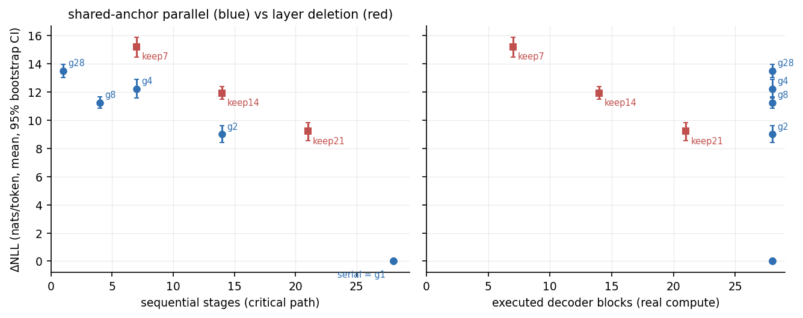
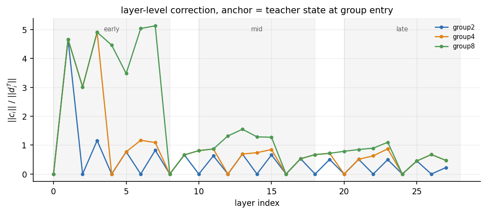
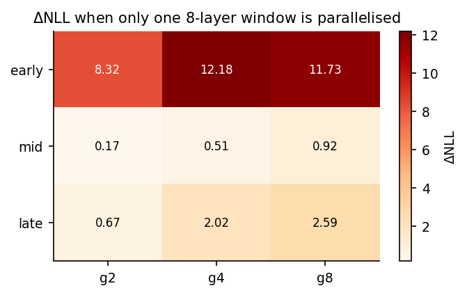
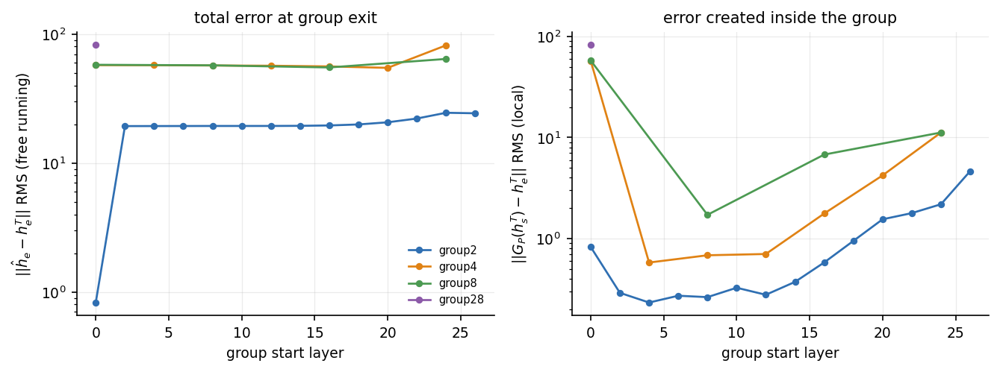
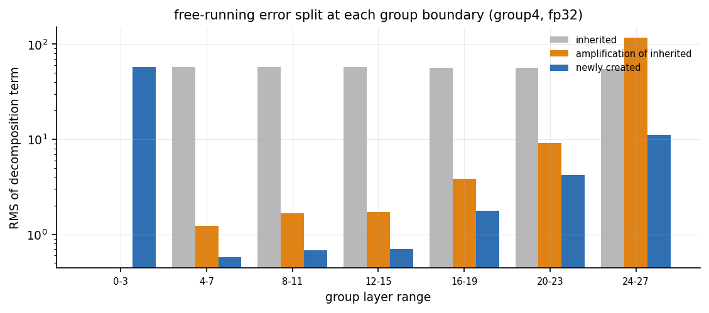
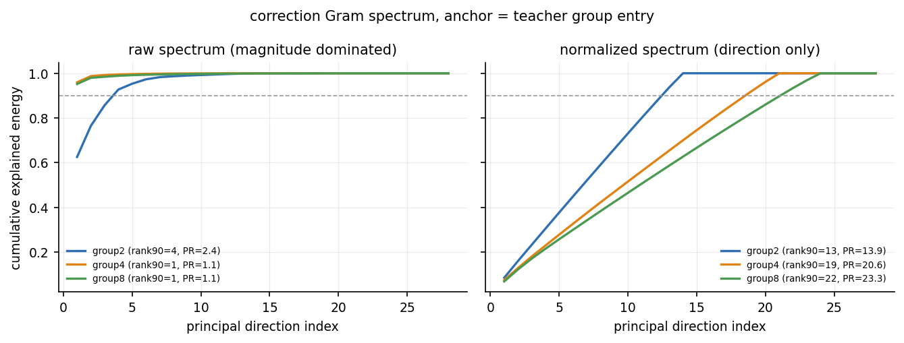

# Stage 1 初步报告：串行与共享 anchor 并行残差的误差性质

> **状态：MEASURED（smoke 规模）** · 2026-10-19
> 样本：WikiText-2 calibration 16 × 129 token（预测 128 token）· 单 seed
> 本报告只回答「打破串行依赖时误差是什么性质」，不训练任何补偿网络，不做 DAG 搜索，不做 GPU 并发优化。

## 0. 结论摘要

1. **误差不是深度的函数，而是位置的函数。** 28 层全部两两并行（+9.00 nats）与只并行中间 8 层中的 2 对（+0.17 nats）相差 52 倍，而后者只少掉 4 个串行阶段。
2. **全部误差在 layer 0–4 就已经产生。** group2 在第 4 层时自由运行误差已达 19.34，与隐藏态自身 RMS（19.08）同量级；此后 24 层既没有抵消也没有显著放大。
3. **全局并行不优于同深度删层。** group2（28 blocks / 深度 14 / +9.00）≈ keep-21（21 blocks / 深度 21 / +9.22），但多用了 7 个 block 的计算。
4. **局部并行远优于同深度删层。** 只改中窗的 g4（28 blocks / 深度 22 / +0.51）对比 keep-21（21 blocks / 深度 21 / +9.22），误差低 18 倍。
5. **修正量不低秩。** 原始 Gram 看似 rank-1（首方向 96% 能量），归一化为相关矩阵后 rank90=19、首方向仅 7%。低秩是早层幅度造成的伪影，不是方向冗余。

## 1. 环境与可复现性

| 项 | 值 |
|---|---|
| 设备 | Apple M4 Pro / 24 GB / macOS 26.6.2 |
| Python | 3.12.12（`/Users/bozhongxiao/code/.venv`） |
| MLX / MLX-LM | 0.31.2 / 0.31.3 |
| 模型 | `mlx-community/Qwen3-0.6B-Base-bf16` @ `e8e73ff38f0eb570eb57ed044ef3f95588c43bc8` |
| 数据集 | `Salesforce/wikitext` `wikitext-2-raw-v1` @ `b08601e04326c79dfdd32d625aee71d232d685c3` |
| 切分 | calibration 16 / validation 8 / test 8 窗口，`seq_len=129`，seed 20261019 |
| 结构 | 28 层 / hidden 1024 / 16Q-8KV / vocab 151936 / tied embedding |
| 推理模式 | teacher-forced full prefix，**无 KV cache**，batch=1 |

tokenizer 直接取自模型仓库同一 revision，避免 tokenizer 与权重错配。`data/data_manifest.json` 记录两个 revision、corpus sha256、每条窗口的 `tokens_sha256`。

## 2. S0 等价性（闸门）

16/16 样本上，`model(ids)` 与手工 28 层串行：

- logits `max_abs_diff = 0.0`、`rms_diff = 0.0`、`cosine = 1.0`
- `ΔNLL = 0.0`、`top1 = 1.000`

**逐位一致**，不是「在容差内」。因此后续所有差异都来自计算图，不来自 mask / RoPE / norm / tied head 的错用。

## 3. 数值对照（bf16 vs fp32 累加）

`group1` 是纯数值控制：数学上等于串行，只是走 `a + (B(a)-a)` 的分组路径再累加。

- `group1` 在 fp32 与 bf16 两种累加下 `ΔNLL = 0.000`，最终态误差 `0.0`。
- 全部 20 个变体上，fp32 与 bf16 的 `ΔNLL` 最大差 **0.0099 nats**，平均 0.0021。

结论：本实验中的差异是**结构误差**，不是舍入误差；两者相差 3 个数量级。原因是 `B(a)-a` 在 `h` 与 `B(a)` 接近时按 Sterbenz 引理精确可表示，加回后能还原 `B(a)`。

## 4. 主结果（fp32 累加，16 样本均值，95% bootstrap CI）

`blocks` = 实际执行的 decoder block 数；`depth` = 串行阶段数（关键路径）。二者都不是时延。

| 变体 | blocks | depth | ΔNLL | 95% CI | KL | top1 | PPL 比 |
|---|---:|---:|---:|---|---:|---:|---:|
| serial | 28 | 28 | 0.000 | — | 0.000 | 1.000 | 1.00× |
| group1 | 28 | 28 | 0.000 | — | 0.000 | 1.000 | 1.00× |
| window-mid-g2 | 28 | 24 | **0.173** | [0.145, 0.204] | 0.177 | 0.752 | 1.19× |
| window-mid-g4 | 28 | 22 | **0.513** | [0.461, 0.564] | 0.518 | 0.618 | 1.67× |
| window-late-g2 | 28 | 24 | 0.672 | [0.574, 0.779] | 0.659 | 0.550 | 1.96× |
| window-mid-g8 | 28 | 21 | 0.924 | [0.838, 1.015] | 0.927 | 0.504 | 2.52× |
| window-late-g4 | 28 | 22 | 2.023 | [1.796, 2.302] | 1.972 | 0.355 | 7.56× |
| window-late-g8 | 28 | 21 | 2.585 | [2.404, 2.774] | 2.657 | 0.382 | 13.3× |
| window-early-g2 | 28 | 24 | 8.322 | [7.686, 8.919] | 8.380 | 0.017 | >1000× |
| group2 | 28 | 14 | 8.999 | [8.400, 9.601] | 9.077 | 0.014 | >1000× |
| delete-keep21 | 21 | 21 | 9.217 | [8.535, 9.824] | 9.188 | 0.010 | >1000× |
| group8 | 28 | 4 | 11.249 | [10.852, 11.649] | 11.361 | 0.003 | >1000× |
| window-early-g8 | 28 | 21 | 11.732 | [11.304, 12.148] | 11.903 | 0.007 | >1000× |
| delete-keep14 | 14 | 14 | 11.930 | [11.478, 12.371] | 12.002 | 0.000 | >1000× |
| window-early-g4 | 28 | 22 | 12.177 | [11.750, 12.644] | 12.363 | 0.007 | >1000× |
| group4 | 28 | 7 | 12.216 | [11.558, 12.887] | 12.264 | 0.001 | >1000× |
| group28 | 28 | 1 | 13.493 | [13.021, 13.939] | 13.494 | 0.000 | >1000× |
| delete-keep7 | 7 | 7 | 15.215 | [14.480, 15.893] | 15.388 | 0.000 | >1000× |

教师 NLL = 3.136（token p50 = 2.118，p95 = 9.341）。



左图横轴是关键路径：**同深度下，局部并行的误差比删层低一个数量级**。右图横轴是真实计算量：全局并行用了全部 28 个 block，质量却与只用 21 个 block 的删层相当。

## 5. A. 残差分布：哪里最危险



`||c_i|| / ||d_i^T||`（修正量相对该层真实更新）：

- **组首层恒为 0**：该层读到的就是自己的真实输入，误差由组内后续层产生。因此曲线呈锯齿状，这是定义决定的，不是测量异常。
- **layer 1 = 4.66**，group4 的 layer 2/3 = 3.01/4.91，group8 的 layer 4–7 = 3.48–5.13。
- 中层 10–19 稳定在 0.51–0.87，晚层 20–27 在 0.45–1.10。

也就是说：**中层修正量不是小量，它是该层真实更新的 50–90%**。它之所以看起来无害，是因为这些层的更新本身只占隐藏态 RMS 的 2–5%（19.1 → 0.3 量级），叠加 4 层后仍是小扰动。

早层的机制不同：`h_0` 的 RMS 只有 0.027，`h_4` 已达 19.08，**4 层内放大约 700 倍**。共享 `h_0` 的 4 个 block 各自按 RMSNorm 归一化后写出满量级更新，求和后与真实状态完全不在一个尺度上。

## 6. B. 并行程度与误差：拐点在哪里



| 窗口 | g2 | g4 | g8 |
|---|---:|---:|---:|
| early [0,8) | 8.322 | 12.177 | 11.732 |
| mid [10,18) | **0.173** | **0.513** | **0.924** |
| late [20,28) | 0.672 | 2.023 | 2.585 |

- 中窗内组大小从 2→4→8，误差 0.17→0.51→0.92，**单调但很浅**；8 层全并行仍只 +0.92 nats。
- 早窗在 g2 时就已崩（8.32），g4/g8 饱和在 12 左右——**没有渐进拐点，只有悬崖**。
- 全局 group2→4→8→28 为 9.00→12.22→11.25→13.49，**非单调且饱和**。一旦早层被破坏，组大小几乎不再重要。

## 7. C. 误差累积：新产生 vs 传播进来



在每个组边界做精确可加分解 `ĥ_e − h_e^T = 继承 + 放大 + 新产生`（fp32 下恒等式残差 < 1e-5）：



- **group2**：组 [0,2) 新产生 0.828，而该处教师状态 RMS 只有 0.358；组 [2,4) 把继承的 0.828 **放大 23 倍**到 19.34。此后 12 个组的出口误差在 19.3–24.5 之间徘徊——**既不抵消，也不爆炸**。
- **group4**：第一个组直接新产生 57.44；之后继承项恒为主导，放大项从 1.24 缓慢升到 116（最后一组）。
- 结论：**误差由第一组一次性决定，后续层主要是在搬运和缓慢放大，而不是持续制造新误差。** 这解释了为什么 group2 与 group28 的最终 NLL 相差不到 5 nats，尽管关键路径相差 14 倍。

## 8. D. 误差结构：低秩是伪影



以各并行组的教师入口为 anchor 构造 `G_ij = Σ <c_i, c_j>`：

| plan | 原始 rank90 | 原始首方向 | 归一化 rank90 | 归一化首方向 | 归一化 PR |
|---|---:|---:|---:|---:|---:|
| group2 | 4 | 63% | 13 | 8% | 13.9 |
| group4 | 1 | 96% | 19 | 7% | 20.6 |
| group8 | 1 | 95% | 22 | 7% | 23.3 |

原始 Gram 看起来「一个方向解释 96%」，但那是因为 layer 1–3 的修正幅度比中层大一个数量级。**把每层归一化为单位方差后，谱几乎满秩**，首方向只剩 7%。

因此本轮数据**不支持**「所有层的补偿目标共享少数方向」这一假设。它也不排除「同一层内跨 token 低秩」——那是另一个矩阵，本轮没有构造。

## 9. E. 模型能力与删层对照

见第 4 节表格。要点：

- 中窗 g2 的 PPL 只升 1.19 倍，KL 0.177，top1 仍有 75%。
- 同深度的删层（keep-21）PPL 升超过 1000 倍。
- 全局 group2 与 keep-21 质量相当（9.00 vs 9.22），但 group2 多用 7 个 block。

## 10. 异常与未解释现象

1. **全局非单调**：group4（12.22）比 group8（11.25）更差。CI 几乎不重叠（[11.56,12.89] vs [10.85,11.65]）。可能来自第一组 [0,4) 与 [0,8) 的不同局部误差（57.44 vs 57.80）在后续传播中的交互，本轮数据不足以判定。
2. **window-early-g2（8.32）优于 group2（9.00）**：早窗破坏后，其余层保持串行反而略好。说明「既然已经坏了，后面继续并行只会多引入误差」。
3. **window-early-g4（12.18）≈ group4（12.22）**：早窗贡献了几乎全部误差，其余 20 层串行或并行几乎没有区别。
4. **最后一组放大项 RMS 达 116**：group4 的 [24,28) 继承误差 54.7、出口 81.8，但放大项本身 RMS 为 116，说明该组对输入扰动的响应远大于扰动本身。晚层对输入高度敏感，与 True Depth / Painters 报告的「最后几层特殊」一致。

## 11. 限制（必须在引用数字时同时引用）

- 16 个样本、单一数据集（英文 WikiText-2）、单 seed、129 token、teacher forcing、无 KV cache。
- bootstrap CI 只反映 16 个样本的抽样不确定性，不是显著性检验。
- 所有「depth」都是逻辑关键路径，**不是时延**。本轮没有任何并发执行或测速。
- 早层结论依赖 Qwen3-0.6B 的特定激活尺度，不能直接外推到其他模型。
- 只测了「组内共享同一 anchor」这一种融合规则（`a + Σ(B_i(a) − a)`），没有测平均、缩放或 learned 融合。

## 12. 对 Plan B 的含义（仅结论，不执行）

- 补偿目标在**早层是 3–5 倍于原更新的大修正**，不是小扰动；中层是原更新的 50–90%。「小网络补一点」的直觉只在后者成立。
- 归一化后修正方向不集中，**不支持「单个共享低秩头」**；若要训练，B1（层级标量）和 B3（小串行）比 B2（一次性低秩）更符合本轮证据。
- 最便宜的下一步不是训练，而是：固定 layer 0–9 串行，只并行 10–17，在 64 样本 / 256 token 上复测；同时对早层单独做尺度校正实验（sum vs mean），判断早层失败是幅度问题还是方向问题。

## 13. 产物清单

```
results/smoke/
  manifest.json          运行配置、plan 定义、blocks/depth
  samples.jsonl          每样本 × 每变体的质量指标
  groups.jsonl           每样本 × 每组 的入口/局部/出口误差与三项分解
  layers.jsonl           每样本 × 每层 的修正统计
  gram_group{2,4,8}.npy  原始修正 Gram
  gram_group{2,4,8}.json 原始与归一化谱
  summary.csv            变体级聚合 + bootstrap CI
  group_summary.csv      组级聚合
  layer_summary.csv      层级聚合
  summary.md             自动生成的表格
  figures/*.png          本报告全部图表
```

复现：

```bash
python scripts/prepare_data.py --out data --seq-len 129 --calibration 16 --validation 8 --test 8
python scripts/measure.py --input data/calibration.jsonl --max-samples 16 --output results/smoke
python scripts/summarize.py --input results/smoke
python scripts/make_figures.py --run results/smoke
```
