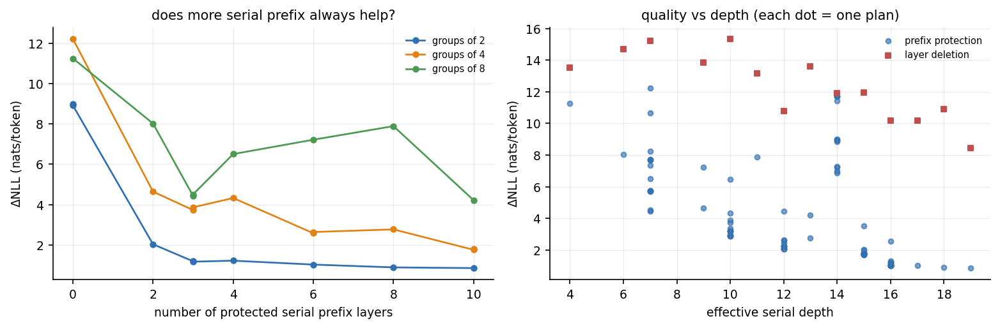
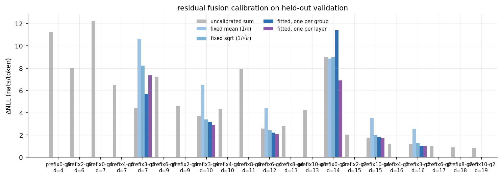
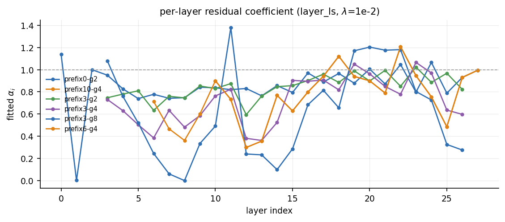
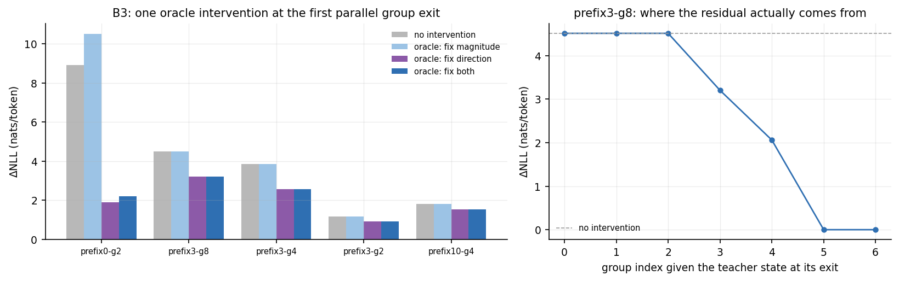

# Stage 1.5 报告：关键层保护、并行深度扫描与低成本残差标定

> 状态：MEASURED · 2026-10-19
> 数据：WikiText-2 · 64×257 calibration / 32×257 validation / 64×257 test · 单 seed 20261019
> 权重冻结，不训练任何网络，不做 DAG 搜索，不宣称任何加速。本阶段结束后暂停，不进入 Plan B。

## 0. 结论摘要

**问题一：保护几层之后，串行深度能压到多少？**

保护 3 层（prefix3）是拐点。在这之后：

| 组大小 | 有效深度 | 测试集 ΔNLL | PPL 倍数 | 说明 |
|---|---:|---:|---:|---|
| g2 | 16 | **0.961** | 2.64× | 28→16，深度降 43%，代价不到 1 nat |
| g4 | 10 | 3.020 | 21.7× | |
| g8 | 7 | 4.566 | 112× | |

- 深度压缩存在一个硬拐点：**深度 16 是「几乎无损」的极限**（ΔNLL < 1），再往下每一步都变陡。
- 保护超过 3 层收益递减：g2 从 prefix3（1.191）到 prefix10（0.854）只再降 0.34，却多花 7 个串行层。**3 层之后，缩小 group size 比加长前缀更划算。**
- 关键反直觉结果：`prefix10-g4`（深度 15，1.827）**不如** `prefix3-g2`（深度 16，1.118）。前者多保护 7 层、少一层深度，质量却更差。这说明**组大小是比前缀长度更强的一阶变量**。

**问题二：只调残差融合系数，能挽回多少？**

- 固定缩放（B1）基本无效甚至有害：`mean` 在 6 个计划中 5 个更差；`sqrt` 2 个更好、4 个更差。
- 离线 ridge 标定（B2，per-layer α）在测试集稳定有效，但收益有限：

| 计划 | 未标定 | 标定后 | 绝对收益 | 相对收益 |
|---|---:|---:|---:|---:|
| prefix3-g2 (d=16) | 1.118 | **0.961** | −0.157 | −14% |
| prefix10-g4 (d=15) | 1.827 | **1.724** | −0.103 | −6% |
| prefix6-g4 (d=12) | 2.581 | **2.094** | −0.487 | −19% |
| prefix3-g4 (d=10) | 3.994 | **3.020** | −0.974 | −24% |
| prefix0-g2 (d=14) | 9.148 | **6.862** | −2.286 | −25% |

- 结论：标定对**激进结构**帮助更大（最多 25%），对**已经很好的结构**帮助很小（6–14%）。它不能救早层问题（prefix0-g2 仍剩 6.86 nats）。
- 原因在下节：线性标定有硬上限。用最优 α 重构真实组输出，相对残差仍有 **38%–70%**。

**B3：早层失败是幅度问题还是方向问题？答案：方向，几乎纯粹是方向。**

在第一个并行组出口做三种 oracle 干预（仅诊断，用教师态，不可部署）：

| 计划 | 无干预 | 只修幅度 | 只修方向 | 两者都修 |
|---|---:|---:|---:|---:|
| prefix0-g2 | 8.919 | **10.508（更差）** | **1.901** | 2.205 |
| prefix3-g8 | 4.511 | 4.511 | 3.202 | 3.202 |
| prefix3-g4 | 3.865 | 3.865 | 2.563 | 2.563 |
| prefix3-g2 | 1.172 | 1.172 | 0.912 | 0.912 |
| prefix10-g4 | 1.816 | 1.816 | 1.532 | 1.532 |

- `prefix0-g2` 的并行输出在第 1 层就 **范数是真实的 2.34 倍、余弦只有 0.27**。但把范数修正到正确值反而更差（9.0 → 10.5），只修方向就能把误差从 9.0 压到 1.9（回收 79%）。
- 其余计划在第一个并行组出口的范数已经正确（ρ=1.000），相对误差只有 1.6%–8.4%，误差几乎全部是方向成分（99.8%–100%）。
- 机制解释：每个 block 入口都有 RMSNorm，**幅度扰动会被下一层归一化吸收，方向扰动不会**。这也直接解释了 B1 `mean` 为何有害——它只改幅度，把还有用的信号一起缩小了。
- 拟合出的 α 在方向最错的地方趋向 0（prefix0-g2 的 layer 1 α=0.00，layer 2 α=0.02）。最小二乘的意思是「这一层别加了」，而不是「加少一点」。**标量无法旋转向量。**

**B3 补充：修掉第一个并行组之后，剩余误差主要来自最后一组。**

对 `prefix3-g8` 逐组给入教师态（oracle）：

| 组 | 层区间 | 给入教师态后的 ΔNLL | 该组贡献 |
|---|---|---:|---:|
| 0,1,2 | 串行前缀 | 4.511 | 0 |
| 3 | [3,11) | 3.202 | 1.31（29%） |
| 4 | [11,19) | 2.060 | 1.14（25%） |
| 5 | [19,27) | **0.000** | **2.06（46%）** |
| 6 | [27] | 0.000 | 0 |

这修正了 Stage 1 的叙述：在 `prefix0` 系列里误差确实由 layer 0–4 决定，但**一旦保护了前 3 层，最大单一来源变成最后一组 [19,27)**，占 46%。这与 Stage 1 测到的「晚层放大项 RMS 达 116、对输入扰动极敏感」一致。**要再压深度，必须先解决最后一组。**

## 1. 环境与可复现性

| 项 | 值 |
|---|---|
| 设备 | Apple M4 Pro / 24 GB / macOS 26.6.2 |
| Python | 3.12.12（`/Users/bozhongxiao/code/.venv`） |
| MLX / MLX-LM | 0.31.2 / 0.31.3 |
| 模型 | `mlx-community/Qwen3-0.6B-Base-bf16` @ `e8e73ff38f0eb570eb57ed044ef3f95588c43bc8` |
| tokenizer | 同模型仓库同 revision（`Qwen2Tokenizer`，vocab 151643） |
| 数据集 | `Salesforce/wikitext` `wikitext-2-raw-v1` @ `b08601e04326c79dfdd32d625aee71d232d685c3` |
| 切分 | calibration 64 / validation 32 / test 64，`seq_len=257`（预测 256 token），seed 20261019 |
| 结构 | 28 层 / hidden 1024 / 16Q-8KV / tied embedding |
| 推理模式 | teacher-forced full prefix，无 KV cache，batch=1，fp32 累加 |

### 1.1 已修复：`revision=None`

Stage 1 的 `measure.py` 把 pinned SHA 写进了 manifest，但 `load()` 实际收到 `revision=None`，也就是**记录的和加载的不是同一个提交**。现在：

```python
if args.revision is None:
    raise SystemExit("refusing to run with an unpinned model revision")
```

默认值就是 pinned SHA，传 `None` 直接拒绝运行。本报告全部数字均在此修复后重跑。

### 1.2 数据划分（calibration / validation / test 严格分离）

- **calibration 64×257**：只用于拟合 α。α 在教师组入口状态上拟合，拟合完立刻冻结。
- **validation 32×257**：只用于在 sum / group_ls / layer_ls / λ 之间做选择。选择结果写入 `results/stage1_5/selection.json`。
- **test 64×257**：只在选择冻结后跑一次，不做任何二次挑选。

`prefix3-g8` 在验证集上 `layer_ls` 是 7.656（远差于 sum 的 4.511），因此按规则选了 `sum`，**没有**在测试集上试 `layer_ls`。这是刻意的：避免用测试集反选。

## 2. S0 闸门

每个样本、每次运行都先验证 `model(ids)` 与手工 28 层串行逐位一致（`ΔNLL = 0`、`top1 = 1.000`、`rms_diff ≤ 1e-2`），否则抛错中止。本阶段全部运行均通过，无一例外。

## 3. 实验 A：前缀保护 + 并行深度扫描

### 3.1 全网格（calibration 16×129，筛选用）

ΔNLL（nats/token），括号内为有效深度：

| prefix | g2 | g4 | g8 |
|---:|---:|---:|---:|
| 0 | 8.999 (d=14) | 12.216 (d=7) | 11.249 (d=4) |
| 2 | 2.035 (d=15) | 4.643 (d=9) | 8.020 (d=6) |
| 3 | 1.191 (d=16) | 3.731 (d=10) | 4.432 (d=7) |
| 4 | 1.222 (d=16) | 4.328 (d=10) | 6.507 (d=7) |
| 6 | 1.028 (d=17) | 2.583 (d=12) | 7.218 (d=9) |
| 8 | 0.889 (d=18) | 2.773 (d=13) | 7.891 (d=11) |
| 10 | 0.854 (d=19) | 1.760 (d=15) | 4.221 (d=13) |



左图是这张表的关键读法：**「多保护几层」不是单调有效的**。

- g2：8.999 → 2.035（p2）→ 1.191（p3），之后几乎平掉。
- g4：12.216 → 4.643 → 3.731，p3→p4 反而变差（3.73 → 4.33）。
- g8：11.249 → 8.020 → 4.432，然后 **p3→p4 恶化到 6.507，p6 7.218，p8 7.891，直到 p10 才回到 4.221**。

g8 的这条曲线是本次最重要的异常（见 §7.1）：prefix 3 和 prefix 4 的**有效深度都是 7**，差别只在组边界落点，质量却差 2.07 nats。**前缀长度不是充分统计量，必须同时报告具体分组。**

右图是散点（不是曲线）：同一深度下并行的点全部远低于删层的方块。

### 3.2 测试集主结果（64×257，95% bootstrap CI，4000 次重采样）

| 变体 | blocks | depth | ΔNLL | 95% CI | KL | top1 | PPL 倍数 |
|---|---:|---:|---:|---|---:|---:|---:|
| serial | 28 | 28 | 0.000 | — | 0.000 | 1.000 | 1.00× |
| prefix3-g2 + layer_ls | 28 | 16 | **0.961** | [0.926, 0.998] | 0.988 | 0.528 | 2.64× |
| prefix3-g2 | 28 | 16 | 1.118 | [1.076, 1.160] | 1.138 | 0.504 | 3.11× |
| prefix10-g4 + layer_ls | 28 | 15 | 1.724 | [1.668, 1.780] | 1.704 | 0.359 | 5.76× |
| prefix10-g4 | 28 | 15 | 1.827 | [1.770, 1.887] | 1.796 | 0.362 | 6.40× |
| prefix6-g4 + layer_ls | 28 | 12 | 2.094 | [2.039, 2.149] | 2.102 | 0.307 | 8.33× |
| prefix6-g4 | 28 | 12 | 2.581 | [2.514, 2.649] | 2.563 | 0.278 | 13.7× |
| prefix3-g4 + layer_ls | 28 | 10 | 3.020 | [2.938, 3.101] | 3.034 | 0.247 | 21.7× |
| prefix3-g4 | 28 | 10 | 3.994 | [3.883, 4.105] | 3.993 | 0.170 | 61.1× |
| prefix3-g8 | 28 | 7 | 4.566 | [4.449, 4.686] | 4.553 | 0.132 | 112× |
| prefix0-g2 + layer_ls | 28 | 14 | 6.862 | [6.665, 7.058] | 6.983 | 0.043 | 1540× |
| prefix0-g2 | 28 | 14 | 9.148 | [8.869, 9.443] | 9.208 | 0.019 | 20700× |
| delete-keep16 | 16 | 16 | 9.336 | [9.023, 9.654] | 9.418 | 0.006 | 36900× |
| delete-keep12 | 12 | 12 | 9.907 | [9.616, 10.191] | 10.001 | 0.010 | 53400× |
| delete-keep15 | 15 | 15 | 12.317 | [12.137, 12.495] | 12.481 | 0.000 | 292000× |
| delete-keep14 | 14 | 14 | 12.572 | [12.398, 12.745] | 12.724 | 0.000 | 368000× |
| delete-keep10 | 10 | 10 | 15.484 | [14.833, 16.149] | 15.575 | 0.000 | — |
| delete-keep7 | 7 | 7 | 15.973 | [15.436, 16.538] | 16.100 | 0.000 | — |

教师 NLL = 2.494（257 token 窗口）。

`prefix3-g8` 的 `layer_ls` 按验证集规则被排除，因此表中只有未标定版本。

### 3.3 并行 vs 删层：两个轴分开比（修正 Stage 1 的比较错误）

Stage 1 报告里写过「`group2` ≈ `keep-21`，但多用 7 个 block」，这是错的：`group2` 有效深度 14、`keep-21` 有效深度 21，**不同深度**；同时 28 blocks vs 21 blocks，**block 数也不同**。那句话在两个轴上都对不上。现在每个实际达到的深度都有严格对齐的删层基线：

| 深度 | 并行（blocks=28） | 删层 | 并行优势 |
|---:|---|---|---:|
| 7 | prefix3-g8 4.566 | keep7 15.973 | **11.41** |
| 10 | prefix3-g4 3.994 / +ls 3.020 | keep10 15.484 | 11.49 / 12.46 |
| 12 | prefix6-g4 2.581 / +ls 2.094 | keep12 9.907 | 7.33 / 7.81 |
| 14 | prefix0-g2 9.148 / +ls 6.862 | keep14 12.572 | 3.42 / 5.71 |
| 15 | prefix10-g4 1.827 / +ls 1.724 | keep15 12.317 | 10.49 / 10.59 |
| 16 | prefix3-g2 1.118 / +ls 0.961 | keep16 9.336 | 8.22 / 8.37 |

**同深度下并行全胜，优势 3.4–12.5 nats。** 这一结论在 64 样本测试集上稳定成立，CI 与删层完全不重叠。

关于 block 预算：删层在定义上不可能用满 28 个 block，所以这个轴上没有删层基线。能说的只有：并行花 100% 的 block 换到深度 16，删层花 57% 的 block（keep16）换到深度 16 但质量差 8.2 nats。**并行是用算力换深度，这个汇率在深度 16 以上是可以接受的；再往下就不划算了。**

### 3.4 深度压缩的边界

| 预算 ΔNLL | 最优方案 | 有效深度 | 相对 28 层 |
|---:|---|---:|---:|
| ≤ 0.5 | **未达到** | — | — |
| ≤ 1 | prefix3-g2 + layer_ls | 16 | −43% |
| ≤ 2 | prefix10-g4 + layer_ls | 15 | −46% |
| ≤ 3 | prefix6-g4 + layer_ls | 12 | −57% |

**0.5 nats 以内做不到**，这是本轮最硬的边界。在 0.6B 模型上，28 层里至少需要保留 16 个串行阶段才能把质量损失压到 1 nat 以下。

## 4. 实验 B1：固定缩放（validation 32×257）

三种融合规则：`sum`（原式）、`mean`（1/k）、`sqrt`（1/√k）。

| 计划 | depth | sum | mean | sqrt |
|---|---:|---:|---:|---:|
| prefix0-g2 | 14 | 8.919 | **8.853** | 8.977 |
| prefix3-g8 | 7 | **4.511** | 10.658 | 8.234 |
| prefix3-g4 | 10 | 3.865 | 6.471 | **3.375** |
| prefix6-g4 | 12 | 2.642 | 4.456 | **2.421** |
| prefix10-g4 | 15 | **1.816** | 3.525 | 1.974 |
| prefix3-g2 | 16 | **1.172** | 2.536 | 1.296 |



- `mean`：6 个计划里 5 个显著更差（最多差 6.1 nats）。唯一「更好」的 prefix0-g2 只差 0.065，在噪声内。
- `sqrt`：2 好 4 差，方向不一致，不能作为通用规则。
- 与 B3 一致：**固定缩放只动幅度，而幅度本来就不是主要问题**。缩小残差只会让后续层拿到的信号变弱。

## 5. 实验 B2：离线 ridge 标定

### 5.1 方法

对每个组，用校准集的**教师组入口状态**构造方程：

`h_e^T ≈ a + Σᵢ αᵢ (Bᵢ(a) − a)`

累正规方程 `A = ΣXᵀX`、`b = ΣXᵀy`、`yᵀy`，解 `(A + λ·scale·I)α = b + λ·scale·1`（正则化向 α=1 收缩），裁剪到 [0,2]。两种粒度：`group_ls`（每组一个标量）、`layer_ls`（每层一个标量）。

λ 按固定规则选 1e-2，**不看测试集**。α 拟合完立即冻结，自由运行时不再接触教师态。

### 5.2 线性标定的硬上限

用最优 α 重构真实组输出，剩余相对 RMS：

| 计划 | 组数 | 重构残差 min | max | mean | 最大条件数 |
|---|---:|---:|---:|---:|---:|
| prefix3-g2 | 13 | 0.230 | 0.564 | 0.412 | 2.7 |
| prefix10-g4 | 5 | 0.234 | 0.635 | 0.467 | 7.7 |
| prefix6-g4 | 6 | 0.234 | 0.758 | 0.516 | 7.7 |
| prefix3-g4 | 7 | 0.352 | 0.755 | 0.578 | 8.8 |
| prefix0-g2 | 14 | 0.020 | 0.583 | 0.380 | 183 |
| prefix3-g8 | 4 | 0.534 | 0.835 | 0.701 | 40.1 |

**即使给最优标量，线性组合也只能把真实组输出重构到 38%–70% 相对 RMS。** 这是 B2 类方法的理论上限，也解释了为什么测试集上只能回收 6%–25%。

注意趋势：组越大，重构残差越大（g2 0.41 → g4 0.52–0.58 → g8 0.70），条件数也越差（2.7 → 8.8 → 40.1）。共享同一 anchor 的 block 越多，它们的修正越共线，**线性标定恰好在最需要它的地方失效**。

### 5.3 验证集选型（冻结于 `selection.json`）

| 计划 | sum | group_ls | layer_ls | 选择 |
|---|---:|---:|---:|---|
| prefix0-g2 | 8.9187 | 11.6899 | 6.8868 | layer_ls |
| prefix3-g8 | **4.5114** | 5.7421 | 7.6561 | **sum** |
| prefix3-g4 | 3.8654 | 3.1854 | 2.8979 | layer_ls |
| prefix6-g4 | 2.6416 | 2.2150 | 2.0659 | layer_ls |
| prefix10-g4 | 1.8160 | 1.7944 | 1.6979 | layer_ls |
| prefix3-g2 | 1.1715 | 1.0217 | 1.0044 | layer_ls |

`prefix3-g8` 上 `layer_ls` 明显过拟合（4.51 → 7.66）。原因见 §5.2：该计划只有 4 个组、每组 8 层、条件数 40，拟合出来的 α 有一个被裁到边界（`n_clipped=1`），迁移失败。

### 5.4 测试集确认

见 §0 表格。全部 5 个被选中的计划在测试集上都保持增益，没有出现验证集与测试集方向相反的情况。



α 的形态本身就是证据：`prefix0-g2` 在 layer 1–2 的 α 落到 0.00 / 0.02，即最小二乘要求**彻底关掉**这两层的并行贡献；layer 11 却要到 1.38（补偿前面的欠账）。这不是「稍微调一下」，这是「有的层必须删掉」。中层 α 稳定在 0.75–1.0，说明中层并行贡献基本可用。

## 6. 实验 B3：幅度还是方向

### 6.1 干预设计

在**第一个真正含多个 block 的组**的出口，用教师态做一次 oracle 干预，之后全部自由运行：

- `oracle-norm`：`h ← h · (‖h^T‖ / ‖h‖)`，只修幅度，保留方向
- `oracle-dir`：`h ← ‖h‖ · (h^T / ‖h^T‖)`，只修方向，保留幅度
- `oracle-both`：`h ← h^T`，上限

**这些干预用到教师态，只用于诊断，不是可部署方法。** 权重仍然冻结，没有任何训练。

同时给出平方相对误差的精确勾股分解：

`r² = ‖ĥ−h‖²/‖h‖² = (ρ−cos)² + (1−cos²)`，其中 `ρ = ‖ĥ‖/‖h‖`

- 幅度占比 `(ρ−cos)²/r²`
- 方向占比 `(1−cos²)/r²`

### 6.2 结果（validation 32×257）

| 计划 | 无干预 | 只修幅度 | 只修方向 | 两者都修 | ρ | cos | r | 幅度占比 | 方向占比 |
|---|---:|---:|---:|---:|---:|---:|---:|---:|---:|
| prefix0-g2 | 8.919 | **10.508** | **1.901** | 2.205 | 2.335 | 0.270 | 2.278 | 82.0% | 18.0% |
| prefix3-g8 | 4.511 | 4.511 | 3.202 | 3.202 | 1.000 | 0.996 | 0.084 | 0.2% | 99.8% |
| prefix3-g4 | 3.865 | 3.865 | 2.563 | 2.563 | 1.000 | 0.999 | 0.037 | 0.0% | 100.0% |
| prefix3-g2 | 1.172 | 1.172 | 0.912 | 0.912 | 1.000 | 1.000 | 0.016 | 0.0% | 100.0% |
| prefix10-g4 | 1.816 | 1.816 | 1.532 | 1.532 | 1.000 | 0.998 | 0.059 | 0.1% | 99.9% |



三点读法：

1. **`prefix0-g2`：只修幅度更差，只修方向回收 79%。** 并行输出在第 1 层范数是真实值的 2.34 倍、余弦 0.27。修好范数但保留近正交方向，等于造了一个「大小对、方向错」的向量，比原来更糟。修好方向、保留 2.34 倍幅度，反而好得多——因为下游 RMSNorm 会把幅度归一化掉。
2. **其余计划的幅度本来就是对的。** ρ=1.000，`oracle-norm` 与无干预在三位小数上完全相同。相对误差只有 1.6%–8.4%，但其中 99.8%–100% 是方向成分。
3. **`oracle-both` 与 `oracle-dir` 相同**，说明修完方向后该边界已无可修——剩余误差全部由后续并行组产生。

机制：**每个 block 入口的 RMSNorm 让模型对输入幅度近似不变，对输入方向高度敏感。** 这一条同时解释了 B1 失败（只改幅度）和 B2 收益有限（标量不能旋转）。

### 6.3 逐组归因：修掉第一组之后还剩什么

对 `prefix3-g8`（7 个组），依次在每组出口给入教师态：

| 组 | 层区间 | 大小 | 给入教师态后 ΔNLL | 该组贡献 |
|---:|---|---:|---:|---:|
| 0 | [0,1) | 1 | 4.511 | 0 |
| 1 | [1,2) | 1 | 4.511 | 0 |
| 2 | [2,3) | 1 | 4.511 | 0 |
| 3 | [3,11) | 8 | 3.202 | 1.31（29%） |
| 4 | [11,19) | 8 | 2.060 | 1.14（25%） |
| 5 | [19,27) | 8 | **0.000** | **2.06（46%）** |
| 6 | [27,28) | 1 | 0.000 | 0 |

- 组 0–2 是串行前缀，本来就没有误差，给教师态无效——这是逻辑自洽性检查，通过。
- **最后一组 [19,27) 是最大单一来源，占 46%。** 它比第一个并行组 [3,11) 的 29% 更严重。
- 这与 Stage 1 的晚窗测量一致（`window-late-g8` 2.59，末组放大项 RMS 116），也说明 **Stage 1 的「误差由 layer 0–4 决定」只在 prefix0 系列成立**。一旦保护了前 3 层，瓶颈就转移到尾部。

## 7. 异常与未解释现象

### 7.1 g8 的前缀扫描非单调（最重要）

`prefix3-g8`（深度 7，4.432）比 `prefix4-g8`（深度 7，6.507）好 2.07 nats，而两者**有效深度完全相同**。继续加前缀到 6/8 反而更差（7.218 / 7.891），直到 prefix10 才回到 4.221。

两者唯一的区别是组边界落点：

- prefix3-g8：[3,11) [11,19) [19,27) 然后 layer 27 单独
- prefix4-g8：[4,12) [12,20) [20,28) 没有尾部单层

假设：伤害取决于**哪个层落在哪一组**，尤其是最后一组是否包含 layer 27。这与 §6.3「最后一组贡献 46%」和 Stage 1「末组放大项 RMS 116」一致。但本轮没有做边界对齐的受控实验，**不足以判定**。这是下一阶段最值得查的一条。

### 7.2 删层质量对保留层数非单调

测试集：`keep16` 9.336 < `keep12` 9.907 < `keep15` 12.317 < `keep14` 12.572 < `keep10` 15.484。保留 12 层好于保留 14/15 层。

`even_keep` 是按等间距取层的确定性规则，保留层数不同则具体层完全不同。这再次说明**「保留多少层」不是删层质量的主变量，「保留哪些层」才是**。因此 §3.3 的同深度比较必须逐深度单独对齐，不能靠插值。

### 7.3 prefix0-g2 的 oracle-dir 优于 oracle-both

8.919 → oracle-dir 1.901，但 oracle-both（直接给教师态）是 2.205。**给一个「方向正确但幅度 2.34 倍」的状态，比给完全正确的状态更好。**

可能原因：后续并行组系统性地欠/过冲，一个偏大的入口恰好抵消了一部分。这属于巧合级补偿，不构成方法，但提醒我们「让每个边界都精确」未必是端到端最优目标。

### 7.4 失败的路线（明确记录，避免重复）

| 尝试 | 结果 | 判断 |
|---|---|---|
| `mean` 固定缩放 | 6 个计划 5 个更差 | 放弃 |
| `sqrt` 固定缩放 | 2 好 4 差，方向不一致 | 放弃 |
| `group_ls` 每组一个标量 | 多数计划劣于 `layer_ls`，prefix0-g2 明显更差（11.69） | 粒度太粗 |
| `layer_ls` 用于 prefix3-g8 | 验证集 4.51 → 7.66 | 条件数 40，过拟合，按规则排除 |

## 8. 限制（引用数字时必须同时引用）

- 单一模型（Qwen3-0.6B-Base）、单一数据集（英文 WikiText-2）、单 seed、teacher forcing、无 KV cache、batch=1。
- test 64 个窗口 × 256 token ≈ 16k 预测 token，CI 只反映窗口抽样不确定性，不是显著性检验。
- **所有 depth 都是逻辑关键路径，不是时延。本轮没有任何并发执行或测速，不宣称加速。**
- 256 token 的窗口比 128 token 更能暴露误差累积，但仍远短于真实生成长度；长上下文行为未测。
- B3 的三种干预都使用教师态，**是诊断不是方法**。`oracle-dir` 的 1.9 nats 不能作为任何可实现方案的成绩。
- α 只在 calibration 的 64 个窗口上拟合。分布外文本的迁移性未测。
- 早层结论依赖 Qwen3-0.6B 的特定激活尺度（`h_0` RMS 0.027 → `h_4` 19.08，4 层放大 700 倍），不能直接外推到其他模型或归一化方案。

## 9. 对 Plan B 的判断（仅结论，不执行）

1. **不要再做标量标定。** B1 全线失败，B2 上限 38%–70% 重构残差、实际只回收 6%–25%。继续在 α 上调 λ 或换正则化不会有质变。
2. **补偿机制必须能改方向，不是改幅度。** B3 给出了直接证据：修方向回收 79%，修幅度为负收益。任何「小网络学一个缩放」的设计方向就是错的。若要做，目标应是**预测缺失的方向分量**（例如从 anchor 预测下一层真实的残差方向），而不是预测系数。
3. **优先目标是最后一组，不是最前一组。** 保护 3 层之后，46% 的剩余误差来自最后一组 [19,27)。Stage 1 的「早层最危险」在 prefix≥3 时已不成立。
4. **深度的现实边界是 16/28（−43%）@ ΔNLL≈1。** 想再往下走，仅靠「保护前缀 + 共享 anchor」不够；要么改融合规则（非线性），要么接受更大的质量损失。
5. **下一个最便宜的实验不是训练**，而是 §7.1 的边界对齐受控实验：固定深度 7，只移动组边界，看质量如何变化。如果确认「最后一组包含 layer 27 是致命的」，那么一个纯结构性的改动（末尾保留 1–2 层串行）就能免费拿到 2 nats。这比训练任何补偿头都便宜。

## 10. 产物与复现

```
results/stage1_5/
  screen/           16×129 全网格（21 个 prefix 计划 + 每个深度的删层基线）
  val_all/          32×257 验证集（sum/mean/sqrt + group_ls/layer_ls × 4 个 λ）
  test_all/         64×257 测试集（选定子集，选择已冻结）
  coeffs/           24 个 α 文件（6 计划 × 2 粒度 × 4 λ），含重构残差与条件数
  b3/               32×257 B3 干预（5 计划 × 4 模式）
  b3_scan/          prefix3-g8 逐组归因（7 组 × oracle-both）
  selection.json    验证集选择结果（冻结）
  figures/          fig_prefix_scan / fig_calibration / fig_alpha / fig_b3
```

复现：

```bash
# 数据（pinned revisions，见 data257/data_manifest.json）
python scripts/prepare_data.py --out data257 --seq-len 257 \
    --calibration 64 --validation 32 --test 64

# A：前缀扫描 + 每个深度的删层基线
python scripts/measure.py --preset stage1_5 --input data257/calibration.jsonl \
    --max-samples 16 --output results/stage1_5/screen

# B1：固定缩放
python scripts/measure.py --input data257/validation.jsonl --max-samples 32 \
    --plans prefix0-g2,prefix3-g8,prefix3-g4,prefix6-g4,prefix10-g4,prefix3-g2 \
    --fusion sum,mean,sqrt --group-records none --output results/stage1_5/val_fusion

# B2：拟合 α（只用 calibration）
python scripts/calibrate.py --input data257/calibration.jsonl --max-samples 64 \
    --plan prefix3-g2 --scheme layer_ls --lambda-rel 0.01 \
    --out results/stage1_5/coeffs/prefix3-g2__layer_ls__lam0.01.json

# B3：幅度 vs 方向
python scripts/diagnose_b3.py --input data257/validation.jsonl --max-samples 32 \
    --plans prefix0-g2,prefix3-g8,prefix3-g4,prefix3-g2,prefix10-g4 \
    --output results/stage1_5/b3

# 汇总与绘图
python scripts/summarize.py --input results/stage1_5/test_all
python scripts/make_figures.py --run results/stage1_5/val_all \
    --coeffs results/stage1_5/coeffs --figdir results/stage1_5/figures \
    --b3 results/stage1_5/b3 --b3-scan results/stage1_5/b3_scan
```
