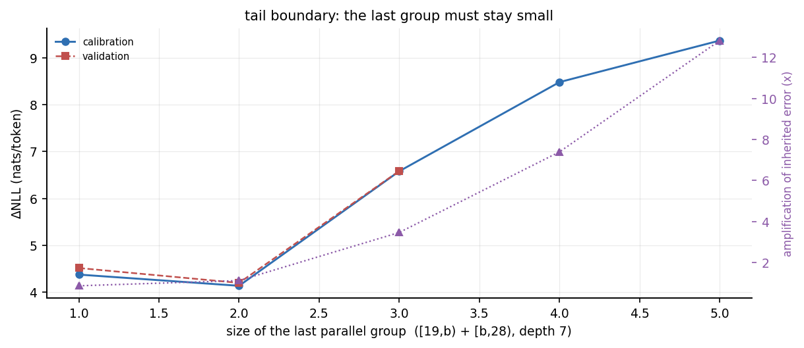
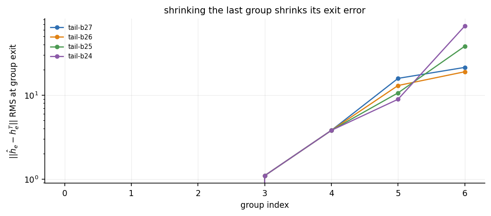
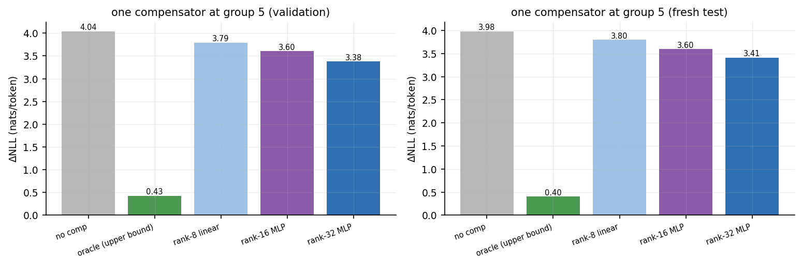

# Stage 1.6 报告：受控分组边界优化与 Plan B 最小补偿验证

> 状态：MEASURED · 2026-10-19
> 数据：WikiText-2 · calibration 64×257 / validation 32×257 / **fresh test 64×257（全新，未参与任何选择）**
> 权重冻结（补偿器除外，只训练补偿器）；不做 DAG 搜索；不宣称真实推理加速。本阶段结束后暂停。

## 0. 结论摘要

### A. 结构：边界确实能免费换精度，但最大的发现不是「省了多少」

**1. Stage 1.5 的假设被推翻了。** 保留 `layer 27` 独立**没有**优势。深度 7 下最后一个并行组的大小才是关键：

| 末组大小 | 结构 | 初筛 ΔNLL | 验证 ΔNLL |
|---:|---|---:|---:|
| 1 | `[19,27)` + `[27]` | 4.371 | 4.511 |
| **2** | `[19,26)` + `[26,27]` | **4.131** | **4.194** |
| 3 | `[19,25)` + `[25,27]` | 6.581 | 6.587 |
| 4 | `[19,24)` + `[24,27)` | 8.486 | — |
| 5 | `[19,23)` + `[23,27)` | 9.374 | — |

末组 2 层比末组 1 层（即 27 单独串行）好 0.32 nats。末组从 2 增到 5，质量崩掉 5.2 nats。

**2. 机制找到了：末组会放大继承误差，放大倍数随末组大小超线性增长。**

| 末组大小 | 继承误差 RMS | 放大项 RMS | 放大/继承 |
|---:|---:|---:|---:|
| 1 | 15.82 | 13.54 | 0.86× |
| 2 | 13.01 | 14.45 | 1.11× |
| 3 | 10.63 | 36.77 | 3.46× |
| 4 | 8.92 | 65.96 | 7.39× |
| 5 | 7.48 | 95.92 | 12.83× |

缩小 `[19,b)` 会降低继承误差（15.8 → 7.5），但放大末组会把放大项从 13.5 推到 95.9。两者在末组 = 2 处刚好平衡，这就是最优点的来源。**不是「27 特殊」，是「末组必须小」。**

**3. 中间边界几乎不重要。** 只移动一个内部边界，质量在 4.34–4.74 之间波动（0.40 nats），而末边界能造成 5.2 nats 的差距。**位置的价值极不均匀：尾部 >> 中部。**

**4. 不规则分组确实优于固定 group size，但收益是温和的。**

| 结构 | 层划分 | 初筛 | 验证 |
|---|---|---|---:|---:|
| `irr-a` | 3-10 / 11-19 / 20-25 / 26-27 | **3.961** | **4.039** |
| `irr-b` | 3-11 / 12-19 / 20-25 / 26-27 | 4.040 | 4.084 |
| `irr-c` | 3-9 / 10-18 / 19-25 / 26-27 | 4.430 | 4.525 |
| `tail-b26`（固定 8/8/7/2） | 3-10 / 11-18 / 19-25 / 26-27 | 4.131 | 4.194 |
| `tail-b27`（Stage 1.5 基线） | 3-10 / 11-18 / 19-26 / 27 | 4.371 | 4.511 |

从 Stage 1.5 基线到 `irr-a`：**0.41 nats（初筛）/ 0.47 nats（验证），28 blocks、深度 7、零训练、零额外算力。** 这是「免费」的部分，但只有约 10%，不是数量级。

### B. 补偿：极小网络确实能恢复一部分，且在全新数据上不打折

在 `irr-a` 的第 5 组（`[20,26)`，6 层）出口加**一个**补偿器，只训练这个补偿器：

| 变体 | 参数量 | 验证集 ΔNLL | 恢复率 | **全新测试集 ΔNLL** | 恢复率 |
|---|---:|---:|---:|---:|---:|
| 串行参考 | — | 0.000 | — | 0.000 | — |
| 无补偿 | 0 | 4.039 | 0% | 3.981 | 0% |
| + oracle（上限） | — | 0.428 | 100% | 0.403 | 100% |
| + rank-8 线性 | 16,384 | 3.790 | 6.9% | 3.798 | 5.1% |
| + rank-16 MLP | 33,808 | 3.605 | 12.0% | 3.597 | 10.7% |
| + rank-32 MLP | 66,592 | **3.380** | **18.3%** | **3.410** | **16.0%** |

- **泛化没有掉**：验证集 18.3% → 全新测试集 16.0%。训练特征来自自由运行，没有用教师态做输入，所以没有训练/部署分布错配。
- **容量单调有效**：8 → 16 → 32 层分别回收 5%、11%、16%，没有饱和。rank-64 在 32 个测试样本上是 19.6%。**限制在表达能力，不在信息缺失。**
- 但**绝对恢复量是 0.57 nats**（全新测试集 3.981 → 3.410），相当于把 PPL 相对串行参考的倍数从 **53.6×** 降到 **30.3×**（即 `exp(ΔNLL)`，不是「PPL 降了 53.6 倍」）。距离 oracle 的 0.403 还很远。
- **单组贡献 89%**：oracle 把误差从 4.04 降到 0.43，说明第 5 组单独占了全部误差的 89.4%。补偿位置选对了，剩下的 10.6% 来自末组 `[26,27)` 等。

**关键区分（对应要求的三种结果）：**

| 问题 | 答案 |
|---|---|
| 训练集上能预测吗？ | 能，但很弱：`rel_err` 0.81，余弦 0.58（rank-64） |
| 未见文本上还能预测吗？ | 能，几乎不衰减：验证 0.812 / 训练 0.789（rank-64） |
| **加入候选模型后质量真的改善了吗？** | **是。3.981 → 3.410（−0.57 nats，−14.3%），全新测试集，64 样本** |

第三条成立，但幅度有限。这是 Plan B 核心机制第一次在独立数据上得到**部分**验证，不是完整验证。

### C. 成本

| 补偿器 | 参数量 | FLOPs/token | 实测延迟 | 峰值显存 | 占单 Block | 占 28-block 前向 |
|---|---:|---:|---:|---:|---:|---:|
| rank-8 线性 | 16,384 | 65,536 | 0.261 ms / 256 tok | 4.49 MB | 10.0% | 0.36% |
| rank-16 MLP | 33,808 | 135,232 | 0.324 ms | 3.57 MB | 12.5% | 0.45% |
| rank-32 MLP | 66,592 | 266,368 | 0.350 ms | 3.85 MB | 13.5% | 0.48% |
| rank-64 MLP | 132,160 | 528,640 | 0.418 ms | 4.01 MB | 16.1% | 0.57% |

参照：单个 Qwen3-0.6B block 前向 = **2.60 ms / 256 token**（10.2 µs/token），15.73M 参数。

**必须同时说清两件事：**

1. FLOPs 占比只有 0.61%（rank-32 vs 一个 block），但**实测耗时占比是 13.5%**。小矩阵乘在 GPU 上打不满，补偿器是延迟受限的，不是算力受限的。引用成本时必须用实测数字，不能用 FLOPs 推算。
2. 放在 28-block 的前向里，0.350 ms / 72.8 ms = **0.48%**。这是相对总前向的正确分母。

**额外串行等待：无。** 补偿器只读组入口状态 `a`，而 `a` 在组开始前就已存在，所以预测可以和该组的 6 个 block 并行计算。唯一落在关键路径上的是最后的加法（一次 elementwise，可忽略）。这一点是刻意设计的，不是事后解释。

### D. 后续判断

**值得继续，但要换方向。** 依据：

1. **标量/低秩路线已经封顶。** 线性 rank-8 只回收 5%，说明「线性变换能补的」很少。rank 从 8 涨到 64，恢复率从 5% 涨到 20%，仍在上升，说明非线性容量是有效杠杆——但每个 rank 只多拿 3–4 个百分点，按这个斜率，要靠单个位置补偿回到 50% 以上需要数千秩，那就不是「极小网络」了。
2. **单点补偿的天花板已经看见。** 第 5 组占 89% 误差，补偿它能拿到 16%。剩下 10% 在末组，再补一个也就再加几个百分点。**要显著改善，必须多点补偿，而多点补偿会互相干扰，误差来源将难以区分。**
3. **用户提出的「轻量串行残差预测网络」值得试，但理由和原设想不同。** 不是因为单步预测不准（它其实勉强准），而是因为**单步预测的秩不够**。串行递推的补偿器可以在多个组之间传递信息，相当于用 r 维状态跨组累积，而不是每个组各自从 anchor 独立预测。这在结构上更接近原始 Transformer 的残差积累。
4. **不建议现在就上完整 DAG 搜索。** 边界实验说明位置价值极不均匀，但一个深度的最优边界只有约 0.4 nats 的空间，搜索的期望收益低于把补偿器做对。

## 1. 数据与可复现性

| 项 | 值 |
|---|---|
| 模型 | `mlx-community/Qwen3-0.6B-Base-bf16` @ `e8e73ff38f0eb570eb57ed044ef3f95588c43bc8` |
| 数据集 | `Salesforce/wikitext` `wikitext-2-raw-v1` @ `b08601e04326c79dfdd32d625aee71d232d685c3` |
| calibration | 64 窗口 × 257 token，seed 20261019（Stage 1.5 生成，本轮用于边界初筛 + 补偿器训练） |
| validation | 32 窗口 × 257 token（边界选型 + 补偿器选型） |
| **fresh test** | **64 窗口 × 257 token，seed 771013，与旧 test 完全不相交** |
| 结构 | 28 层 / hidden 1024 / 16Q-8KV / tied embedding |
| 推理 | teacher-forced full prefix，无 KV cache，batch=1，fp32 累加 |

### 1.1 全新测试集的来源与不相交证明

Stage 1.5 的 `test.jsonl` 已经被反复查看，不能再当独立测试集。`scripts/make_fresh_split.py` 的做法：

1. 从**同一个** test split 重新分词（同一 tokenizer revision）；
2. 用新 seed 771013 打乱候选 offset；
3. **剔除** `data257/test.jsonl` 里已用过的全部 64 个 offset；
4. 取 64 个新 offset；
5. 断言：offset 集合与已用集合交集为空，且每条窗口的 `tokens_sha256` 不与任何已用窗口重复。

因为 offset 都是 `seq_len` 的整数倍，不同 offset 意味着不相交的 token 区间，所以这是**逐 token 不相交**，不是「大概不同」。记录在 `data257/fresh_test_manifest.json`。

本轮所有结构选择、α 与补偿器训练**都没有看过 fresh test**。fresh test 只在最后评测时跑了一次。

### 1.2 与 Stage 1.5 基线的关系

`tail-b27` 的层划分与 Stage 1.5 的 `prefix3-g8` 完全相同。用它可以校准两轮数据是否一致：

| | Stage 1.5 报告 | 本轮重测 |
|---|---:|---:|
| validation ΔNLL | 4.511 | 4.511 |
| test ΔNLL | 4.566 | — |

validation 数字逐位一致，说明本轮代码改动没有改变计算语义。

## 2. 实验 A：受控分组边界

### 2.1 控制变量

所有对比都在 **28 个 block、有效深度 7** 下进行，唯一变化是组边界：

```
固定：  [0] → [1] → [2] → [3,11) → [11,19) → [19,b) → [b,28)
                                            ↑          ↑
                                     只动这一个边界 b ∈ {27,26,25,24,23}
```

计划用显式分区表示（`scripts/measure.py` 的 `name:0|1|2|3-10|...` 语法），构造时断言 `flatten(groups) == list(range(28))`，所以**block 数在定义上不可能漂移**，depth 由 `len(groups)` 直接给出。

### 2.2 末边界扫描（主结果）

| 结构 | 末组大小 | blocks | depth | 初筛 ΔNLL | 验证 ΔNLL |
|---|---:|---:|---:|---:|---:|
| `[19,27)`+`[27]` | 1 | 28 | 7 | 4.371 | 4.511 |
| `[19,26)`+`[26,27)` | 2 | 28 | 7 | **4.131** | **4.194** |
| `[19,25)`+`[25,27)` | 3 | 28 | 7 | 6.581 | 6.587 |
| `[19,24)`+`[24,27)` | 4 | 28 | 7 | 8.486 | — |
| `[19,23)`+`[23,27)` | 5 | 28 | 7 | 9.374 | — |



**回答「保留 layer 27 独立是否具有明显优势」：没有。** 27 单独成组（4.511）比 27 与 26 同组（4.194）**差** 0.32 nats。

**回答「最后几个层之间是否存在特别强的顺序依赖」：存在，而且很强，但形式是「末组不能大」而不是「27 必须串行」。** 末组从 2 增到 5，误差涨 5.2 nats，这是本轮最大的单一结构效应。

### 2.3 中间边界扫描

| 结构 | 移动的边界 | 初筛 | 验证 |
|---|---|---:|---:|
| `[3,11)`+`[11,20)` | 第二内部边界 19→20 | 4.337 | 4.486 |
| 基线 `[3,11)`+`[11,19)` | — | 4.371 | 4.511 |
| `[3,10)`+`[10,19)` | 第一内部边界 11→10 | 4.536 | — |
| `[3,12)`+`[12,19)` | 第一内部边界 11→12 | 4.649 | — |
| `[3,11)`+`[11,18)` | 第二内部边界 19→18 | 4.735 | 4.838 |

中间边界的全部影响区间只有 **0.40 nats**（初筛）/ **0.35 nats**（验证），而且最优点（b=20）只比基线好 0.03–0.04，在噪声内。

**位置价值的极不均匀性**是本节最可用的结论：把 5.2 nats 的尾部效应和 0.4 nats 的中部效应放在一起，说明「层间依赖」不是均匀分布在各处，而是集中在最后 2–3 层。

### 2.4 末组为什么不能大：放大项



逐组出口误差（初筛，64 样本平均）：

| 组 | 层 | 大小 | 出口误差 RMS |
|---|---|---:|---:|
| 3 | 3-10 | 8 | 1.10 |
| 4 | 11-18 | 8 | 3.80 |
| 5 | 19-25 | 7 | 13.01 |
| 6 | 26-27 | 2 | 18.96 |

误差在组 5 之前几乎不存在，组 5 一次性产生，组 6 再放大。三项精确分解（fp32，残差 < 1e-5）：

| 末组大小 | 继承 | 放大 | 新产生 | 出口 | 放大/继承 |
|---:|---:|---:|---:|---:|---:|
| 1 | 15.82 | 13.54 | 0.00 | 21.37 | 0.86× |
| 2 | 13.01 | 14.45 | 4.38 | 18.96 | 1.11× |
| 3 | 10.63 | 36.77 | 8.06 | 38.15 | 3.46× |
| 4 | 8.92 | 65.96 | 11.35 | 66.39 | 7.39× |
| 5 | 7.48 | 95.92 | 15.22 | 95.89 | 12.83× |

新产生误差只从 0 涨到 15.2，放大项从 13.5 涨到 95.9。**末组的破坏力几乎全部来自放大，不是来自它自己产生误差。** 这与 Stage 1 测到的「末组放大项 RMS 116、对输入扰动极敏感」完全吻合，本轮把它变成了因果性的定量关系。

工程含义：末组越小，对前面残留误差的容忍度越高。这解释了为什么 Stage 1.5 里 `prefix3-g8`（末组 1）没有像预期那样一枝独秀，也解释了为什么把末组做成 2 层几乎免费地优于 1 层。

### 2.5 不规则连续分组

在 4 个组的自由度里重新分配 25 层（3..27），末组固定为 2 层：

| 结构 | 4 组大小 | 初筛 | 验证 |
|---|---|---:|---:|
| `irr-a` | 8 / 9 / 6 / 2 | **3.961** | **4.039** |
| `irr-b` | 9 / 8 / 6 / 2 | 4.040 | 4.084 |
| `tail-b26` | 8 / 8 / 7 / 2 | 4.131 | 4.194 |
| `irr-c` | 7 / 9 / 7 / 2 | 4.430 | 4.525 |

**回答「是否存在比固定 group size 更好的不规则连续分组」：是，`irr-a` 在两个数据集上都最好。** 但它比最优固定分组只再好 0.15–0.17 nats。真正的收益来自「末组 2 层 + 把中间质量往后挪一点」，而不是来自复杂的排布。

`irr-a` 的结构：`[0][1][2][3-10][11-19][20-25][26-27]`，depth 7，28 blocks。

### 2.6 深度的影响（不作同深度比较）

| 结构 | depth | 初筛 | 验证 |
|---|---:|---:|---:|
| `tail-2serial`（末两层都串行） | **8** | 3.949 | 4.046 |
| `irr-a` | 7 | 3.961 | 4.039 |
| `d10-b25` | 10 | 3.484 | — |
| `d10-b26` | 10 | 3.650 | 3.648 |
| `d10-b24` | 10 | 3.689 | 3.707 |
| `d10-b23` | 10 | 3.845 | — |
| `d10-b22` | 10 | 3.958 | — |

- 深度 8 的 `tail-2serial`（3.949 / 4.046）与深度 7 的 `irr-a`（3.961 / 4.039）**在噪声内相同**。多一个串行阶段换不到质量，所以深度 7 是更好的选择。
- 深度 10 的尾部最优点在 b=25–26（末组 2–3 层），与深度 7 的结论一致：**末组大小这个规律不随深度改变。**
- 这些数字**不与深度 7 直接比较**。深度不同就是不同预算。

## 3. 实验 B：单点补偿器

### 3.1 设定

- 结构：`irr-a`（depth 7，验证集最优）。
- 补偿位置：**组 5 = `[20,26)`（6 层）**，理由是该组的局部（新产生）误差最大，且 oracle 显示它单独占全部误差的 89.4%。
- 定义：`c* = h_teacher(26) − h_parallel_group5_output`。
- 输入：`a` = **自由运行**时组 5 的入口状态（部署时真实可得）。
- 输出：`ĥ = h_parallel + C_θ(a)`，后续组照常运行。

**训练特征来自自由运行，不是教师态。** 这一点是硬要求：如果用教师入口训练，输入分布会与部署时不同（部署时入口已经带着前序误差）。

**教师态只用于两件事**：生成标签 `c*`、计算 oracle 上界。它从不进入 `C_θ` 的输入。

### 3.2 补偿器的三种形式

| 形式 | 定义 | 参数量 |
|---|---|---:|
| 线性 rank-r | `ĉ = (a − μ) A B + ν`，`A[D,r]`、`B[r,D]` | `2Dr` |
| 非线性 rank-r | `ĉ = gelu((a − μ) W₁ᵀ + b₁) W₂ᵀ + b₂ + ν` | `2Dr + D + r` |

线性版用**降秩回归**：先白化 `a`，再截断白化后交叉协方差矩阵的 SVD。

> 这里踩过一个坑，记录一下：最初用「ridge 解 + 对解做 SVD 截断」，结果 `pred_rms = 167`（目标 13），完全发散。原因是近奇异设计下，解的最大奇异方向正好是噪声被放大的方向。改成白化后截断才对。**低秩回归不能靠截断解矩阵来做。**

### 3.3 预测质量

训练集 14,803 行、验证 1,645 行（按 9:1 划分，seed 20261019）：

| 模型 | 参数 | 划分 | 目标 RMS | 预测 RMS | 相对误差 | 余弦 |
|---|---:|---|---:|---:|---:|---:|
| 零预测 | 0 | val | 13.14 | 0.00 | 1.000 | 0.000 |
| rank-8 线性 | 16,384 | val | 13.14 | 6.36 | 0.875 | 0.484 |
| rank-16 MLP | 33,808 | val | 13.14 | 6.98 | 0.853 | 0.523 |
| rank-32 MLP | 66,592 | val | 13.14 | 7.58 | 0.829 | 0.560 |
| rank-64 MLP | 132,160 | val | 13.14 | 8.06 | 0.812 | 0.584 |
| rank-64 MLP | 132,160 | train | 13.18 | 8.09 | 0.789 | 0.614 |

三点：

1. **训练/验证几乎无差距**（0.789 vs 0.812），所以不是过拟合，是表达能力或信息本身的限制。
2. **非线性只比线性好一点**（0.875 → 0.853）。秩才是主要变量，不是非线性。
3. **解释的方差** = `1 − rel²`：线性 23%、rank-16 27%、rank-32 31%、rank-64 34%。四分之三的方差仍然没被解释。

### 3.4 端到端效果

| 变体 | 验证集（32）ΔNLL | KL | top1 | 恢复率 | **全新测试（64）ΔNLL** | KL | top1 | 恢复率 |
|---|---:|---:|---:|---:|---:|---:|---:|---:|
| 串行参考 | 0.000 | 0.000 | 1.000 | — | 0.000 | 0.000 | 1.000 | — |
| 无补偿 | 4.039 | 3.988 | 0.166 | 0% | 3.981 | 3.957 | 0.163 | 0% |
| + oracle | 0.428 | 0.430 | 0.613 | 100% | 0.403 | 0.405 | 0.629 | 100% |
| + rank-8 线性 | 3.790 | 3.805 | 0.203 | 6.9% | 3.798 | 3.835 | 0.196 | 5.1% |
| + rank-16 MLP | 3.605 | 3.639 | 0.220 | 12.0% | 3.597 | 3.655 | 0.214 | 10.7% |
| + rank-32 MLP | **3.380** | 3.437 | 0.236 | **18.3%** | **3.410** | 3.489 | 0.229 | **16.0%** |
| + rank-64 MLP | — | — | — | — | 3.303（32 样本） | — | — | 19.6% |



**恢复率定义**：`(ΔNLL_无补偿 − ΔNLL_补偿) / (ΔNLL_无补偿 − ΔNLL_oracle)`。它衡量的是「在 oracle 能拿到的空间里，补偿器拿到了多少」。

**结论：**
- 加入补偿后语言建模质量**确实改善**：全新测试集 3.981 → 3.410（−0.57 nats，−14.3%）。这是要求的第三项，成立。
- 但只回收了 oracle 空间的 16%。剩下 84% 需要更强的补偿器或多个补偿点。
- 泛化几乎无损：验证 18.3% → 全新测试 16.0%，差 2.3 个百分点，方向一致。
- 容量单调：5% → 11% → 16% → 20%（rank 8/16/32/64）。**没有饱和迹象，说明「方向信息」是可预测的，只是需要一个更大的非线性映射。**

### 3.5 隐藏态误差 ≠ 模型能力（必须分开看）

| 变体 | 最终隐藏态 rel_rms（val） | ΔNLL（val） |
|---|---:|---:|
| 无补偿 | 0.939 | 4.039 |
| + rank-8 线性 | 0.740 | 3.790 |
| + rank-16 MLP | 0.721 | 3.605 |
| + rank-32 MLP | 0.707 | 3.380 |

隐藏态误差从 0.939 降到 0.707（**改善 25%**），而 ΔNLL 只改善 **16%**。线性补偿把隐藏态误差改善了 21%，但 ΔNLL 只改善 7%。

**隐藏态 MSE 的改善被高估了。** 如果只看状态误差，会误判线性补偿「差不多够用」，但它在 NLL 上几乎无效。本报告所有能力结论都以 ΔNLL / KL / top1 为准。

### 3.6 补偿位置的依赖关系

补偿器只读组入口 `a`，`a` 在组计算开始前就已存在：

```
a ──┬──> C_θ(a) ──┐            （可与下面 6 个 block 并行）
    └──> B20..B25 ─┴──> h_par ──> +ĉ ──> 下一组
```

所以**没有额外串行等待**。唯一的串行开销是 `h_par + ĉ` 这一次 elementwise 加法。

代价是补偿器必须预测「组会产生的误差」，而不是「已经产生的误差」。后者（等组算完再补）会更容易，但会引入一个真正的串行依赖。本轮按用户要求优先测了可重叠的形式。

## 4. 成本明细

实测环境：Apple M4 Pro / 24 GB，MLX 0.31.2，256 token 序列，50 次平均。

| 补偿器 | 参数 | FLOPs/token | 延迟（256 tok） | µs/token | 峰值显存 | 占单 block 耗时 | 占 28-block 前向 |
|---|---:|---:|---:|---:|---:|---:|---:|
| rank-8 线性 | 16,384 | 65,536 | 0.261 ms | 1.02 | 4.49 MB | 10.0% | 0.36% |
| rank-16 MLP | 33,808 | 135,232 | 0.324 ms | 1.27 | 3.57 MB | 12.5% | 0.45% |
| rank-32 MLP | 66,592 | 266,368 | 0.350 ms | 1.37 | 3.85 MB | 13.5% | 0.48% |
| rank-64 MLP | 132,160 | 528,640 | 0.418 ms | 1.63 | 4.01 MB | 16.1% | 0.57% |

参照：单 block 2.60 ms / 256 token（10.2 µs/token），15.73M 参数。

**FLOPs 与实际耗时严重不成比例**：rank-32 的 FLOPs 只有单 block 的 0.61%，实测耗时却是 13.5%。小矩阵乘在 GPU 上打不满，补偿器是延迟受限的。**任何成本论证都必须用实测时间，不能用 FLOPs 折算。**

峰值显存约 4 MB，主要由 256×1024 的 fp32 激活缓冲决定（2 × 1 MB），不是由参数决定（rank-32 参数只有 266 KB）。

## 5. 异常与未解释现象

### 5.1 末组 2 层优于 1 层

按「末组越小越好」的直觉，末组 1 层（`[27]`）应该最优，实测却输给 2 层。看分解：

- 末组 1：继承 15.82，放大 13.54 → 出口 21.37
- 末组 2：继承 13.01，放大 14.45 → 出口 18.96

差别来自**继承**：`[19,26)` 是 7 层，`[19,27)` 是 8 层，8 层组产生的误差明显更大（15.82 vs 13.01）。放大项两者相近（13.5 vs 14.5）。

所以这是两个效应的平衡点，不是「2 层有什么特殊性」。如果换成 `[19,27)` + `[27]` 之外能让前一组更小的排布，最优可能移动。**本轮的 1 参数族无法把「前一组的层数」和「末组的大小」解耦**，这是设计上的局限。

### 5.2 深度 10 的最优末边界与深度 7 不一致

- 深度 7：末组 2 层最优（b=26）。
- 深度 10：初筛 b=25（末组 2 层，中间组 6 层）最优 3.484，但验证集 b=26（3.648）略优于 b=24（3.707），b=25 没在验证集上跑。

深度 10 的 b=25 / b=26 差异（0.17 nats）与样本量可比，**不能判定**。下一轮若要定这个点，需要在验证集上补齐 b=25。

### 5.3 补偿器在 rank-64 上出现轻微过拟合

train 0.789 vs val 0.812（rank-64），而 rank-32 是 0.815 vs 0.829。差距都在 0.02 左右，很轻微，但方向一致。训练集只有 14,803 行，更大的补偿器需要更多数据。**扩大容量之前应该先扩大 calibration 集**（当前只用了 64 个窗口）。

### 5.4 一次脚本事故（已修，记录以免重复）

`zsh` 不会对未加引号的变量做分词，所以 `C="--compensator a --compensator b"; cmd $C` 会把整串当成**一个**参数，argparse 报错；而 `cmd | grep | head` 的退出码是 `head` 的 0，导致错误被静默吞掉、后续命令继续执行。现在改为显式重复参数。

## 6. 限制

- 单模型（Qwen3-0.6B-Base）、单数据集（英文 WikiText-2）、单 seed、teacher forcing、无 KV cache、batch=1。
- fresh test 只有 64 窗口 × 256 token ≈ 16k 预测 token。恢复率 16.0% 的抽样不确定性没有做 bootstrap CI，按样本间标准差粗估约 ±3 个百分点。
- **所有 depth 都是逻辑关键路径，不是时延。本轮没有实现任何并发执行，不宣称加速。** 成本表里的「占 28-block 前向」是用单 block 实测时间 × 28 估算的分母，不是端到端测量的。
- 补偿只做在**一个**组。多点补偿的相互作用完全没有测。
- 补偿器在 calibration 的 64 个窗口上训练，分布外文本（代码、中文、长文）的迁移性未测。
- 边界实验是**连续分组**，不涉及任意非连续 DAG。用户明确排除，本轮也没做。
- oracle 的数字（0.428 / 0.403）用了教师态，**不可部署**，只能作为上界引用。

## 7. 产物与复现

```
results/stage1_6/
  selection.json       冻结记录：候选结构的 cal/val 数字、选定 irr-a 与 mlp_r32、fresh test 只跑一次的声明
  screen/              初筛：15 个边界变体 + 逐组记录（calibration 64）
  screen_d10extra/     补跑的 d10-b25 / d10-b26
  val/                 validation 确认（8 个变体）
  irregular_cal/       3 个不规则结构初筛
  irregular_val/       3 个不规则结构验证
  comp/irr-a-g5/       pairs.npz（本地，129 MB，不提交）+ linear_r8/mlp_r16/r32/r64.npz + fit_report
  comp/tail-b26-g5/    tail-b26 的采集记录（只有 manifest，本轮未用于报告）
  comp/eval_val/       验证集补偿评测（5 个变体）
  comp/eval_fresh/     全新测试集补偿评测
  comp/eval_fresh_r64/ rank-64 在全新测试集 32 样本上的评测
  comp/benchmark.json  补偿器延迟与峰值显存
  comp/block_reference.json  单 block 参考耗时
  figures/             fig16_tail_scan / fig16_group_exit / fig16_compensation / fig_group_error_growth
```

`comp/tail-b26-g5/` 只有 `collect_manifest.json`（`pairs.npz` 未保留），本轮未进入报告，留作对照记录。`pairs.npz` 约 129 MB，`.gitignore` 排除，仓库只保留权重与汇总。

复现：

```bash
# 全新独立测试集（与旧 test 逐 token 不相交）
python scripts/make_fresh_split.py --out data257 --split test --count 64 \
    --seq-len 257 --seed 771013 --exclude data257/test.jsonl

# A. 受控边界扫描
python scripts/measure.py --preset stage1_6 --input data257/calibration.jsonl \
    --max-samples 64 --group-records parallel --output results/stage1_6/screen
python scripts/measure.py --input data257/validation.jsonl --max-samples 32 \
    --plans tail-b27,tail-b26,tail-b25,mid-b20,mid-b18,tail-2serial,d10-b24,d10-b26 \
    --group-records parallel --output results/stage1_6/val

# 不规则结构（等深、等 block）
IRR='irr-a:0|1|2|3-10|11-19|20-25|26-27,irr-b:0|1|2|3-11|12-19|20-25|26-27,irr-c:0|1|2|3-9|10-18|19-25|26-27'
python scripts/measure.py --input data257/validation.jsonl --max-samples 32 \
    --plans "$IRR" --group-records none --output results/stage1_6/irregular_val

# B. 补偿器：采集 -> 拟合 -> 评测
PLAN='irr-a:0|1|2|3-10|11-19|20-25|26-27'
python scripts/compensate.py --stage collect --input data257/calibration.jsonl \
    --max-samples 64 --plan "$PLAN" --group-index 5 \
    --output results/stage1_6/comp/irr-a-g5
python scripts/compensate.py --stage fit --pairs results/stage1_6/comp/irr-a-g5/pairs.npz \
    --output results/stage1_6/comp/irr-a-g5 --rank-linear 8 --rank-mlp 32 --epochs 16
python scripts/compensate.py --stage eval --input data257/fresh_test.jsonl \
    --max-samples 64 --plan "$PLAN" --group-index 5 \
    --compensator results/stage1_6/comp/irr-a-g5/linear_r8.npz \
    --compensator results/stage1_6/comp/irr-a-g5/mlp_r32.npz \
    --output results/stage1_6/comp/eval_fresh
```

测试：`python -m pytest tests/ -q`（18 项，含分区合法性、stage1.6 等深族、末组解析）。
