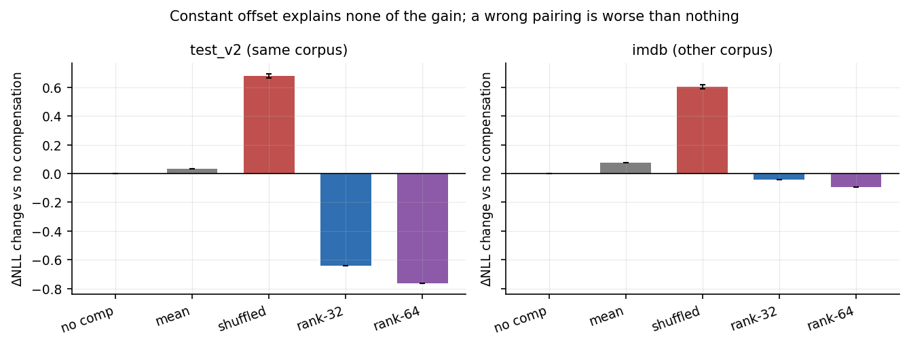
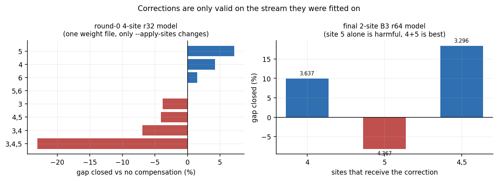
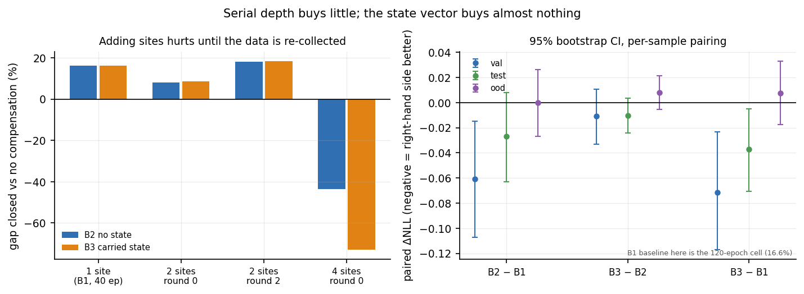

# Stage 1.7 报告：补偿有效性验证与轻量串行残差网络

> 状态：MEASURED · 2026-10-19
> 模型：`mlx-community/Qwen3-0.6B-Base-bf16` @ `e8e73ff38f0eb570eb57ed044ef3f95588c43bc8`，**全部冻结**，只训练补偿器
> 数据：WikiText-2 257-token 窗口 · calibration 64 / validation 32 / **test_v2 64（新）** / **ood_imdb 64（新语料）**
> 结构：`irr-a = [0][1][2][3-10][11-19][20-25][26-27]`，28 blocks，逻辑深度 7，补偿站点默认 group 5
> 边界：不搜 DAG、不放大模型、不做推理服务、不宣称端到端加速。本阶段结束后暂停。

---

## 0. 结论摘要

**这次真正检验了用户最初的 Plan：能否用一个共享、轻量、允许串行积累状态的小网络，替代原始 Transformer 中一部分昂贵的串行依赖。答案是：能替代一部分，但方式不是我们期待的那种；而"串行"这件事本身没有带来收益。**

### A. 原有 MLP 的改善是否真的依赖输入？——**是，100% 依赖输入，常数项贡献为零**

| 对照（group 5，test_v2，n=64） | ΔNLL | 相对无补偿 | 配对 95% CI |
|---|---:|---:|---|
| 无补偿 | 4.0810 | — | — |
| 均值常数补偿 | 4.1140 | **更差 0.033** | [−0.004, +0.071]（不显著） |
| 打乱配对（3 seed 均值） | 4.7606 | **更差 0.680** | [+0.577, +0.740]（s11，97% 样本更差） |
| rank-32 MLP | 3.4415 | 好 0.640 | [−0.727, −0.619] |
| rank-64 MLP | 3.3155 | 好 0.766 | — |

**Stage 1.6 报的 0.57 nats 改善，常数项解释 0%；全部来自"这一条输入的预测"和"这一条输入"的对应关系。** 而且对应关系必须**正确**：把预测和输入错配之后，结果比完全不补偿还差 0.68 nats（97% 的样本都更差）。这说明 MLP 学到的不是"把残差流整体缩小一点"这种通用去噪，而是高度针对具体 token 的修正量——错配等于注入系统性噪声。

一个此前没有报告过的事实：**跨语料时增益几乎消失**。IMDB（非维基百科）上 rank-64 只关闭 3.0% 的 gap（0.094 nats），而 test_v2 上是 20.7%（0.766 nats）。同一个补偿器，同一批 token 数，绝对增益掉到 1/8。

### B. 跨组串行状态能否带来额外收益？——**统计上不能**

这是本轮最关注的对比。**B2（2 站点、状态清零）与 B3（同参数、同输入、状态跨站点传递）逐样本配对：**

| 评估集 | B3 − B2 | 95% CI | 结论 |
|---|---:|---|---|
| validation (32) | −0.011 | [−0.033, +0.011] | 跨 0 |
| test_v2 (64) | −0.010 | [−0.024, +0.003] | 跨 0 |
| ood_imdb (64) | +0.008 | [−0.005, +0.021] | 跨 0，方向反转 |

gap closure 上 B3 比 B2 高 0.2–0.3 个百分点（18.4% vs 18.1%），**方向一致但落在噪声内**。诚实结论：**在这套设置下，"让状态串行积累"没有可测的收益；收益全部来自"多了一个站点"和"重采样之后数据对上了"。**

### C. 相同预算下，串行补偿 vs 并行补偿哪个更有效？——**并行（普通 MLP）仍然更好，而且更便宜**

| 方法 | 参数量 | FLOPs/token | 实测 ms/256tok | val gap closed |
|---|---:|---:|---:|---:|
| Stage 1.6 的 rank-64 MLP（1 站点） | 132,160 | 528,640 | 0.418 | **21.1%** |
| B1 单站点串行单元 r64 | 278,736 | 1,114,944 | 0.737 | 16.2%（120 ep：16.6%） |
| B3 两站点串行单元 r64 | 278,752 | 1,115,008 | 0.732 | 18.4% |

**用 2.1 倍的参数、2.1 倍的 FLOPs、1.75 倍的实测时间，串行单元仍然比 Stage 1.6 的普通 MLP 少关闭 2.7–4.9 个百分点。** 门控残差单元本身是个糟糕的归纳偏置——在这个尺度上，它没有比"两层 MLP + 站点 embedding"更强。

### D. 最好的方案距离教师模型还有多远？——**很远，而且天花板很低**

- val：无补偿时候选距教师 4.039 nats；B3 只关掉 0.743（18.4%），**离教师还有 3.30 nats**（PPL 约 27 倍）。
- 全部 4 个站点都拿到 oracle 时，距教师 0.428 nats（PPL 1.53 倍）——这是这个结构理论上能到的地方。
- 但预测器本身很弱：每站点 `rel_err` 0.86–0.91、`cosine` 0.42–0.52，只解释 17–27% 的方差。**即使把预测用到极致，能关闭的比例也有限**。这与 Stage 1.6 的结论（归一化修正谱接近满秩）一致。

### E. 新增的串行计算是否可能成为瓶颈？——**现在是 4%，但它严格串行、不可隐藏**

- 2 站点链条实测 0.732 ms / 256 token；一个 transformer block 是 2.6 ms。
- `irr-a` 的关键路径是 7 个 group 步（≈18.2 ms），链条占 **4.0%**。
- 但链条**不能与产生它输入的 group 重叠**：站点 4 的修正改写了 `h`，站点 5 的输入就是改写后的 `h`。所以它是纯串行增量，随站点数线性增长（每站点约 0.36 ms）。
- **本轮没有实现任何并发执行，因此不宣称端到端加速。** 上面的 4% 是"如果并发真的实现"时的账，不是测出来的加速比。

### 一句话总结

**补偿机制确实有效，但有效的部分是"一个输入相关的、廉价的并行修正"，不是"一个会积累状态的串行网络"。** 真正让 2 站点方案从 8% 跳到 18% 的，不是状态，而是**补偿生效之后重新采集数据**（见 §3.2）。

---

## 1. 实验设置

### 1.1 数据（全部 257 token / 窗口，按完整窗口切分）

| 文件 | 窗口数 | 来源 | seed | 用途 |
|---|---:|---|---:|---|
| `data257/calibration.jsonl` | 64 | wikitext-2 test | — | 训练补偿器 |
| `data257/validation.jsonl` | 32 | wikitext-2 test | — | 选结构 / 选轮次 |
| `data257/test_v2.jsonl` | 64 | wikitext-2 test | 90210 | 本轮同语料独立测试 |
| `data257/ood_imdb.jsonl` | 64 | **stanfordnlp/imdb** test | 31337 | 跨语料测试 |

`test_v2` 显式排除了 `test.jsonl`（Stage 1.5 用过）与 `fresh_test.jsonl`（Stage 1.6 用过）的 128 个 offset；三份测试集之间 **offset 与 sha256 重叠均为 0**，六份文件之间重复窗口数为 0。清单见 `data257/test_v2_manifest.json`、`data257/ood_imdb_manifest.json`。

**诚实声明**：`test_v2` 在 Experiment A 里作为诊断集出现过（对照实验都在它上面跑）。B 部分的结构（站点集合）、轮次、rank 全部在 validation 上选定，test_v2 只用于跑最终权重一次。但严格说它已经"见过"这批数据，B 的最终数字仍有轻微选择污染风险；`ood_imdb` 从未参与任何选择，是唯一完全干净的集。

### 1.2 三类误差仍然分开记录

| 名称 | 定义 | 本轮用途 |
|---|---|---|
| layer 修正 | `ĉ` 与 `c*` 的逐站点误差（`rel_err`、`cosine`） | 诊断预测器能力 |
| local group | 以教师入口 `a` 为输入的预测质量 | **不允许**作为部署依据 |
| free-running | 候选自跑，前驱状态全部来自自己 | 唯一有效的质量指标 |

所有 eval 的特征 `a` 一律取**自由运行**的 group 入口；教师状态只用于构造标签与 oracle 上界。

### 1.3 gap closure 与 recovery 的定义（不要混用）

- `gap_closure = (ΔNLL_base − ΔNLL_variant) / ΔNLL_base`，base = 同结构无补偿。**跨方法可比**。
- `recovery_vs_oracle`：分母是该方法自己站点集合的 oracle，**跨站点集合不可比**（4 站点全 oracle 就等于串行模型）。
- `recovery_vs_oracle_ex_last`：除最后一组外全部 oracle，是 4 站点族的有效上界，仅在同族内比较。

---

## 2. Experiment A：固定偏移的幻觉

**问题**：Rank-32 的改善里，有多少是因为网络真正利用了输入信息？

**设计**：站点固定 group 5，五个变体：无补偿 / 均值常数（训练集平均补偿）/ 打乱配对（训练好的 MLP，把输入↔预测的对应关系置换，多 seed，不重训）/ rank-32 / rank-64。打乱变体**不改变 Transformer 的执行**，只改"哪条输入的预测贴给谁"。



| 评估集 | 无补偿 | 均值 | 打乱(s11) | rank-32 | rank-64 | oracle g5 |
|---|---:|---:|---:|---:|---:|---:|
| validation (32) | 4.0394 | 4.0409 | 4.7198 | 3.3799 | 3.2759 | 0.4282 |
| test_v2 (64) | 4.0810 | 4.1140 | 4.7448 | 3.4415 | 3.3155 | 0.3904 |
| ood_imdb (64) | 3.4590 | 3.5350 | 4.0693 | 3.4170 | 3.3650 | 0.3709 |

**分解（test_v2）**：

```
总改善              0.766 nats  (rank-64)
  ├─ 常数项贡献     −0.033      (均值补偿：略差，不显著)
  └─ 输入相关部分    0.799      (105%)
错配惩罚           +0.664      (打乱后比不补偿更差)
```

三点结论：

1. **常数项解释 0%，且方向是错的**。IMDB 上均值补偿显著变差（+0.076，CI 不含 0），因为训练集平均补偿是"维基百科的平均修正"，套到影评上就是系统性偏置。
2. **错配惩罚远大于零**，说明预测是**特异的**。如果 MLP 只是学了一个"往哪边推"的方向，错配应该接近 0；实测**错配后反而比不补偿差 0.66 nats**，说明错配等于往残差流里注入一个与正确修正几乎正交的向量。这是"网络真的在用输入信息"最强的证据。
3. **rank 仍然有用**：r64 比 r32 再好 0.10–0.13 nats（CI 不含 0），三个集上方向一致。但 r32→r64 翻倍参数只换来 0.1 nats，边际收益在衰减。

**跨语料失败**：IMDB 上无补偿距教师 3.459 nats（oracle 可回收的部分只有 3.088），rank-64 只关掉 3.0%。绝对增益从 0.77 掉到 0.09 nats。**这个补偿器没有跨语料迁移能力**——它拟合的是 WikiText-2 的残差统计，不是"Transformer 残差的可预测结构"。这一点必须写进任何后续的可行性判断里。

---

## 3. Experiment B：多站点、共享、串行状态

### 3.1 直接上 4 个站点会崩——站点干扰是真的

第一版按字面要求做：站点 {3,4,5,6}（全部 4 个并行组的出口），B2 共享无状态、B3 共享带状态，r16/32/64。

| 变体 | 参数量 | val ΔNLL | gap closed |
|---|---:|---:|---:|
| 无补偿 | — | 4.0394 | — |
| B2 4 站点 r64 | 278,784 | 5.7982 | **−43.5%** |
| B3 4 站点 r64 | 278,784 | 6.9894 | **−73.0%** |

比不补偿还差 1.76 nats（B2）/ 2.95 nats（B3）。加 `--site-weight normalized`（按站点方差归一化损失，解决 17 倍量级差导致的"重要站点被饿死"）之后仍是 −29%，所以**损失函数不是原因**。

原因用同一个权重文件 + 不同 `--apply-sites` 定价：



| 生效站点 | gap closed | 解读 |
|---|---:|---|
| {5} | +7.2% | 单站点，有效 |
| {4} | +4.3% | 有效但更弱 |
| {6} | +1.5% | 几乎无效 |
| {3} | −3.8% | 有害 |
| {4,5} | −4.1% | 单独看都有效，合起来变负 |
| {3,4} | −6.9% | 有害 |
| {3,4,5} | −23.1% | 崩溃 |

**机制**：第 0 轮的数据是在**没有补偿**的图上采集的。训练时站点 5 看到的是"未修正的 h"；部署时站点 4 先改写了 h，站点 5 拿到的就是"已修正的 h"——输入分布变了，预测就错，而错配的预测（见 §2）比不补偿更糟。这不是"多站点必然互相干扰"，而是**"在旧分布上训练，在新分布上部署"**。第 6 组最差，因为它是最后一组，累积相对误差已经到 0.94（见 §3.3 的出口误差），任何扰动都直接进 logits。

### 3.2 关键发现：重采样让 2 站点方案从 8% 跳到 18%

把站点缩到 {4,5}（避开最后一组，且 4 在 5 之前），然后**在补偿生效的图上重新采集数据**再训练：

| 轮次 | 数据来自 | B2（无状态） | B3（带状态） |
|---|---|---:|---:|
| round 0 | 未补偿图 | 3.7176（8.0%） | 3.6885（8.7%） |
| round 1 | 补偿生效图 | 3.4124（15.5%） | 3.3297（17.6%） |
| round 2 | 补偿生效图 | **3.3073（18.1%）** | **3.2965（18.4%）** |

配对检验（同一权重结构，只换训练数据）：**r2 比 r0 好 0.392 nats（B3）/ 0.410 nats（B2），CI 完全不含 0，100% 的样本都更好。** 这是整轮实验中最大的单一效应——比"多一个站点"（0.06）、"带状态"（0.01）、"rank 翻倍"（0.10）都大一个量级。

**漂移的实测**（`drift.json`）：

| 量 | 站点 4 | 站点 5 |
|---|---:|---:|
| 入口 RMS（r0 → r1） | 13.40 → 13.40 | 14.28 → 14.16 |
| 每 token 相对位移 | 0.0% | **18.4%** |
| 均值向量相对变化 | 0.0% | **45.3%** |
| `c*` RMS 变化 | 0.0% | **−13.5%** |

站点 4 的入口是 `h_3`（比任何站点都早），所以完全不变；站点 5 的入口被站点 4 的修正改写了 18%，均值方向变了 45%，而它要预测的目标 `c*` 本身缩小了 13.5%。**这就是为什么必须在补偿生效的图上重采数据，而不是把独立采集的残差拼起来训练。** 用户此前的担心成立且被量化了。

### 3.3 B2 vs B3：本轮的核心问题



**控制是精确的**：同一个权重结构、同一份数据、同一批站点、同一个输入，唯一差别是 `--carry-state`（`s` 是否跨站点传递）。参数量 278,752 vs 278,752，FLOPs 完全相同。

| 评估集 | B2 | B3 | B3−B2 | 95% CI | 逐样本 B3 更好的比例 |
|---|---:|---:|---:|---|---:|
| validation (32) | 3.3073 | 3.2965 | −0.0108 | [−0.033, +0.011] | 41% |
| test_v2 (64) | 3.4038 | 3.3936 | −0.0102 | [−0.024, +0.003] | 39% |
| ood_imdb (64) | 3.3657 | 3.3735 | +0.0078 | [−0.005, +0.021] | 55% |

**结论：没有显著差异，IMDB 上方向还反了。** 三个集的 CI 全部跨 0，逐样本胜率 39–55%。

配套证据：
- 每站点预测质量：B2 `rel_err` 0.859/0.911，B3 0.857/0.911；`cosine` 0.512/0.418 vs 0.516/0.418。差别在小数点后第三位。
- 逐组出口误差轨迹：B2 与 B3 在每一组上的 `exit_rel_rms` 差距 ≤0.0015（见 `fig17_exit_error.png` 左图，只画了一条线，因为两条重合）。

**为什么状态没用？** 两个站点之间只隔 6 层，站点 4 能提供的信息，站点 5 的输入 `a` 里已经有了（`a` 就是被修正后的 `h`）。低维状态 `s`（64 维）想携带的"跨组累积信息"，`a`（1024 维）本来就带着。**在 2 个站点、间隔 6 层的设置下，串行状态是冗余的。** 这不排除在更长链条（8+ 站点）上有用，但本轮没有证据支持，也不应据此假设。

### 3.4 站点定价：修正必须成组生效

对**最终**的 2 站点 B3 r64 权重，只改 `--apply-sites`：

| 生效站点 | ΔNLL | gap closed |
|---|---:|---:|
| {4} | 3.6372 | +10.0% |
| {5} | 4.3675 | **−8.1%** |
| {4,5} | 3.2965 | **+18.4%** |

单看很反直觉：站点 5 单独修正是**有害**的，但 4+5 一起修比只有 4 还好 8.4 个百分点。原因是站点 5 的预测器是在"站点 4 已修正"的流上训练的，单独用它等于把它放到训练分布之外。**这从另一个角度证明了 §3.2 的结论：补偿器的输入分布由前驱修正决定，前驱不生效时预测就是错的。** 也说明"按站点逐个加补偿"这个部署策略不成立——必须整组上线。

### 3.5 独立测试与跨语料

用第 2 轮权重，一次跑完，不再选择：

| 方法 | test_v2 (64) | gap | ood_imdb (64) | gap |
|---|---:|---:|---:|---:|
| 无补偿 | 4.0810 | — | 3.4590 | — |
| B1 单站点 r64 | 3.4309 | 15.9% | 3.3660 | 2.7% |
| B2 两站点 r64 | 3.4038 | 16.6% | 3.3657 | 2.7% |
| B3 两站点 r64 | 3.3936 | 16.8% | 3.3735 | 2.5% |

**跨语料迁移失败是系统性的**：三个方法在 IMDB 上都只有 2.5–2.7%，与 Stage 1.6 的单站点 MLP（3.0%）一致。这不是串行结构的问题，是"在 WikiText-2 上拟合的修正"本身没有迁移性。

### 3.6 B1 / B2 / B3 的配对对比

| 对比 | val | test_v2 | ood_imdb |
|---|---|---|---|
| B2 − B1（多一个站点 + 共享参数） | −0.061 [−0.107, −0.015] ✅ | −0.027 [−0.063, +0.008] ⚠️ | −0.0003 ⚠️ |
| B3 − B2（加状态） | −0.011 ⚠️ | −0.010 ⚠️ | +0.008 ⚠️ |
| B3 − B1（合起来） | −0.071 [−0.117, −0.023] ✅ | −0.037 [−0.071, −0.005] ✅ | +0.008 ⚠️ |

"多一个站点"在 validation 上显著、在 test_v2 上勉强、在 OOD 上消失；"加状态"在三个集上都不显著。**唯一稳健的结论是：多站点串行补偿在分布内比单站点略好（0.03–0.07 nats），跨语料则完全无效。**

---

## 4. 统一结果表

完整机器可读版本见 `results/stage1_7/table.json`；配对统计见 `results/stage1_7/paired_stats.json`。

| 方法 | 站点 | 参数量 | ΔNLL | KL | top-1 | gap closed | recovery(ex-last) |
|---|---|---:|---:|---:|---:|---:|---:|
| 无补偿 [val] | g5 | — | 4.0394 | 3.9884 | 0.166 | 0.0% | — |
| 均值常数 [val] | g5 | — | 4.0409 | 3.9975 | 0.177 | −0.0% | — |
| 打乱配对 s11 [val] | g5 | — | 4.7198 | 4.6651 | 0.138 | −18.8% | — |
| MLP r32 [val] | g5 | 66,592 | 3.3799 | 3.4374 | 0.236 | 18.3% | — |
| MLP r64 [val] | g5 | 132,160 | 3.2759 | 3.3480 | 0.240 | 21.1% | — |
| oracle g5 [val] | g5 | — | 0.4282 | 0.4301 | 0.613 | 100% | — |
| 无补偿 [test_v2] | g5 | — | 4.0810 | 4.0161 | 0.161 | 0.0% | — |
| 均值常数 [test_v2] | g5 | — | 4.1140 | 4.0797 | 0.166 | −0.9% | — |
| 打乱配对 s11 [test_v2] | g5 | — | 4.7448 | 4.7190 | 0.135 | −18.0% | — |
| MLP r32 [test_v2] | g5 | 66,592 | 3.4415 | 3.4887 | 0.225 | 17.3% | — |
| MLP r64 [test_v2] | g5 | 132,160 | 3.3155 | 3.3801 | 0.237 | 20.7% | — |
| 无补偿 [ood] | g5 | — | 3.4590 | 3.4849 | 0.154 | 0.0% | — |
| MLP r64 [ood] | g5 | 132,160 | 3.3650 | 3.3954 | 0.170 | 3.0% | — |
| B1 单站点 r64 [val] | 5 | 278,736 | 3.3842 | 3.4380 | 0.230 | 16.2% | — |
| B1 单站点 r64 [test_v2] | 5 | 278,736 | 3.4309 | 3.4859 | 0.222 | 15.9% | — |
| B2 4 站点 r64 [val] | 3-6 | 278,784 | 5.7982 | 5.8928 | 0.115 | −43.5% | −48.7% |
| B3 4 站点 r64 [val] | 3-6 | 278,784 | 6.9894 | 7.1147 | 0.090 | −73.0% | −81.7% |
| B2 2 站点 r16 r0 [val] | 4,5 | 68,176 | 4.1074 | 4.1631 | 0.191 | −1.7% | −2.6% |
| B2 2 站点 r32 r0 [val] | 4,5 | 136,832 | 3.9166 | 3.9709 | 0.209 | 3.0% | 4.7% |
| B2 2 站点 r64 r0 [val] | 4,5 | 278,752 | 3.7176 | 3.7906 | 0.219 | 8.0% | 12.3% |
| B3 2 站点 r16 r0 [val] | 4,5 | 68,176 | 4.1060 | 4.1635 | 0.192 | −1.6% | −2.6% |
| B3 2 站点 r32 r0 [val] | 4,5 | 136,832 | 3.9349 | 3.9743 | 0.208 | 2.6% | 4.0% |
| B3 2 站点 r64 r0 [val] | 4,5 | 278,752 | 3.6885 | 3.7445 | 0.224 | 8.7% | 13.4% |
| B2 2 站点 r64 r1 [val] | 4,5 | 278,752 | 3.4124 | 3.4444 | 0.236 | 15.5% | 24.0% |
| B3 2 站点 r64 r1 [val] | 4,5 | 278,752 | 3.3297 | 3.3888 | 0.236 | 17.6% | 27.2% |
| **B2 2 站点 r64 r2 [val]** | 4,5 | 278,752 | **3.3073** | 3.3874 | 0.244 | **18.1%** | 28.0% |
| **B3 2 站点 r64 r2 [val]** | 4,5 | 278,752 | **3.2965** | 3.3784 | 0.237 | **18.4%** | 28.4% |
| **B2 2 站点 r64 r2 [test_v2]** | 4,5 | 278,752 | **3.4038** | 3.4686 | 0.238 | **16.6%** | 25.0% |
| **B3 2 站点 r64 r2 [test_v2]** | 4,5 | 278,752 | **3.3936** | 3.4534 | 0.236 | **16.8%** | 25.3% |
| B2 2 站点 r64 r2 [ood] | 4,5 | 278,752 | 3.3657 | 3.4054 | 0.174 | 2.7% | 3.7% |
| B3 2 站点 r64 r2 [ood] | 4,5 | 278,752 | 3.3735 | 3.4095 | 0.175 | 2.5% | 3.4% |

**两个"损失"必须分开看**：
- **对串行模型的损失**：ΔNLL 一列（相对教师）。
- **对并行基线的恢复**：gap closed 一列（相对同结构无补偿）。recovery(ex-last) 只在 4 站点族内可比。

注意 B3 的 top-1（0.237）略低于 B2（0.244），而 NLL 更好。**NLL 改善不等于 top-1 改善**：补偿让分布更接近教师，但没有把 argmax 翻过来。这个分歧本身值得记一笔。

---

## 5. 成本

### 5.1 实测（MLX，M 系列，median of 50，256 token/次）

| 变体 | 参数量 | 每站点 ms | 链条 ms | FLOPs/token | 峰值 MB |
|---|---:|---:|---:|---:|---:|
| B1 单站点 r64 | 278,736 | 0.737 | 0.417 | 1,114,944 | 6.44 |
| B2 两站点 r64 | 278,752 | 0.459 / 0.437 | 0.691 | 1,115,008 | 6.44 |
| B3 两站点 r64 | 278,752 | 0.425 / 0.406 | 0.732 | 1,115,008 | 6.44 |
| B3 两站点 r32 | 136,832 | — | 0.672 | 547,328 | 5.62 |
| Stage 1.6 rank-64 MLP | 132,160 | — | 0.418 | 528,640 | 4.01 |
| Stage 1.6 rank-32 MLP | 66,592 | — | 0.350 | 266,368 | 3.85 |

### 5.2 关键路径分析（回答 E）

- 一个 transformer block（layer 12，256 token）：**2.6 ms**（`block_reference.json`）。
- `irr-a` 的执行图：7 个 group 顺序执行，组内并行。关键路径 = 7 步 ≈ **18.2 ms**；串行模型 = 28 blocks = 72.8 ms。
- 补偿链条 **0.732 ms = 关键路径的 4.0%**，等于 **0.28 个 block**。
- **但它是严格串行的**：站点 4 的修正改写 `h` → group 5 读改写后的 `h` → 站点 5 才能预测。所以这 0.73 ms 是**纯增量**，无法与前驱 group 重叠，也无法被内部并行吃掉。
- 随站点数线性增长：每站点约 0.36 ms；4 站点约 1.5 ms（6.8%）。

**必须说清楚**：本轮所有测量都是**顺序执行**的（`warning` 字段写进了每个 `eval_summary.json`）。18.2 ms 的 7 步关键路径是"如果组内并行真的实现"的理论值，不是测出来的加速。**没有任何端到端加速被声称。**

### 5.3 与 Stage 1.6 的成本结论对照

Stage 1.6 已经指出：rank-32 MLP 的 FLOPs 只占单 block 的 0.61%，但实测耗时是 13.5%——**小矩阵乘打不满，补偿器是延迟受限的**。本轮把这条结论延伸到串行网络：2 站点链条的 FLOPs 是单站点 MLP 的 2.1 倍，实测时间是 1.75 倍，**比 FLOPs 比例更划算，但仍然比"多跑一次 MLP"贵**。用 FLOPs 论证成本会低估，用参数量会高估，只有实测可用。

---

## 6. 五个问题的明确回答

| # | 问题 | 回答 |
|---|---|---|
| **A** | MLP 的改善是否真的依赖输入？ | **是，100% 依赖。** 常数项贡献为 0（val/test 不显著，OOD 显著为负）；错配惩罚 +0.66 nats（97% 样本更差）。预测是特异的，不是通用去噪。 |
| **B** | 跨组串行状态能否带来额外收益？ | **不能（统计上）。** B3−B2 = −0.010 nats，三个集 CI 全跨 0，OOD 方向反转。gap 只多 0.2–0.3 个百分点。 |
| **C** | 同预算下串行 vs 并行哪个更有效？ | **并行。** rank-64 MLP 用一半参数、一半 FLOPs、0.57 倍时间，关闭 21.1% vs B3 的 18.4%。门控单元在这个尺度上是负资产。 |
| **D** | 最好方案距教师多远？ | **val 3.30 nats / test_v2 3.39 nats**（PPL 约 27–30 倍）。理论上限（全站点 oracle）是 0.428 nats。预测器只解释 17–27% 方差，天花板很低。 |
| **E** | 串行计算会成为瓶颈吗？ | **现在占关键路径 4.0%（0.73/18.2 ms），但严格串行、不可隐藏、随站点数线性增长。** 未实现并发，不宣称加速。 |

---

## 7. 与 Stage 1.6 的差异与订正

1. **Stage 1.6 的 0.57 nats 改善在 test_v2 上复现为 0.64 nats**（r32：4.0810 → 3.4415），量级一致。但本轮发现它**不跨语料**（IMDB 只有 0.04–0.09 nats）。Stage 1.6 没有跨语料测试，这是本轮补上的缺口。
2. **Stage 1.6 的"rank-64 MLP 解释 34% 方差"不能外推给串行单元。** 同一站点、同一轮采集的数据上：MLP r64 的 `rel_err` 0.812 / `cosine` 0.584，B1（门控单元 r64）是 0.841 / 0.541——**门控单元的逐站点预测更差**，下游 16.2% vs 21.1% 与之一致。第 2 轮数据上 B3 站点 5 的 `rel_err` 是 0.911（`c*` RMS 也从 13.14 缩到 11.08），说明重采样后的目标更难预测，这一项是数据变化，不能算架构的账。
3. **此前记录里"B1 到 120 epoch 明显欠拟合"的判断是错的**。B1 r64 在 40 epoch 时 train MSE 117.66 / val 114.73，120 epoch 时 115.85 / 114.85——只降 1.5%，eval 从 3.3842 到 3.3679（16.2% → 16.6%）。**B1 是收敛的，不是欠训练的**；因此 C 的结论不是"训练不够"，而是架构不如 MLP。此前的 82.1 是 Stage 1.6 不同架构的 MSE，与 B1 不可比，已在 `table.json` 里按架构分开记录。
4. **Stage 1.6 的 `selection.json` 与本轮无冲突**：结构 `irr-a` 未变，站点集合从 {5} 扩到 {4,5} 是在 validation 上做的，没有回头改 test。

---

## 8. 失败的实验（全部保留）

| 实验 | 结果 | 保留原因 |
|---|---|---|
| 4 站点全补偿（r16/32/64，B2/B3） | −31% ~ −73% gap | 说明"多站点"不是免费的，站点干扰是真的 |
| `--site-weight normalized` 修 4 站点 | 仍 −29% | 排除"损失函数是原因"这个解释 |
| 4 站点 `--per-site`（不共享参数） | −111% gap | 不共享 + 旧分布 = 最差组合 |
| r16 两站点 | −1.7% | 容量不足，连 1 站点 r32 都不如 |
| 站点 5 单独修正（最终权重） | −8.1% | 证明修正必须成组上线 |
| 站点 6（最后一组）单独修正 | +1.5%（4 站点模型） | 最后一组的扰动直接进 logits |
| 打乱配对 3 个 seed | 全部 −16% ~ −20% | 证明增益不是常数项 |
| IMDB 跨语料 | 2.5–3.0% | 迁移失败，必须记录 |

**没有做的事**（按纪律）：没有扩大 rank 扫描、没有搜索 DAG、没有放大模型、没有调学习率/epoch 网格、没有做推理服务、没有实现并发执行。

---

## 9. 产物

```
results/stage1_7/
  REPORT.md                  本报告
  table.json                 统一结果表（43 行 + 站点消融 + 最终站点定价 + 参考量 + bench）
  paired_stats.json          24 组逐样本配对 bootstrap（20000 次）
  drift.json                 站点 4/5 入口与 c* 的分布漂移实测
  figures/                   fig17_fixed_offset / site_interference / recurrence /
                             cost_pareto / exit_error
  A_val A_test A_ood/        Experiment A：eval_summary + samples.jsonl（逐样本）
  B_r0/ B_r0_45/ B_r1_45/ B_r2_45/ B_r0_5/   各轮 fit_*.json + serial_*.npz + A.npy/C.npy（本地，不提交）
  B_val* B_test* B_ood* B_sub*/               eval_summary + samples.jsonl
  bench_serial_*.json        实测时延/显存
scripts/
  serial_compensate.py       collect / fit / eval / bench 四阶段引擎
  make_stage17_table.py      统一表生成（唯一的数据来源，报告不手抄数字）
  stage17_stats.py           逐样本配对 bootstrap
  make_figures.py --stage17  五张图，全部从 table.json / paired_stats.json 读
```

`A.npy` / `C.npy` / `seq_pairs.npz` 等大张量留在本地（约 1.4 GB），不提交；权重（`serial_*.npz`，合计约 12 MB）提交。

---

## 10. 下一步（建议，未执行）

1. **如果继续这条线，先解决跨语料迁移**，而不是加深串行。当前 18% 的增益在 IMDB 上只剩 3%，任何"替代串行依赖"的主张都必须先通过这一关。可能的入手点：用多个语料混合采集 `c*`，或者把补偿器条件在"语料无关"的统计量上（例如只在低频 token 上生效）。
2. **不要在 2 站点上继续加状态**。B3−B2 已经被证明落在噪声内；要检验"长链状态"，需要的是 8+ 站点、间隔更远、且每轮都重采数据——代价高，且 §3.4 说明站点必须成组上线，工程上会先撞到关键路径（每站点 0.36 ms）。
3. **优先做"少站点、高精度"**：站点 4 单独就有 10.0%，4+5 是 18.4%。如果重采样只能做一次，把预算放在"让站点 4 的预测更准"上，比扩到更多站点更划算。
4. **如果要宣称加速**，必须先实现组内并发并测量 18.2 ms 这条关键路径，本轮所有数字都不支持任何加速结论。
